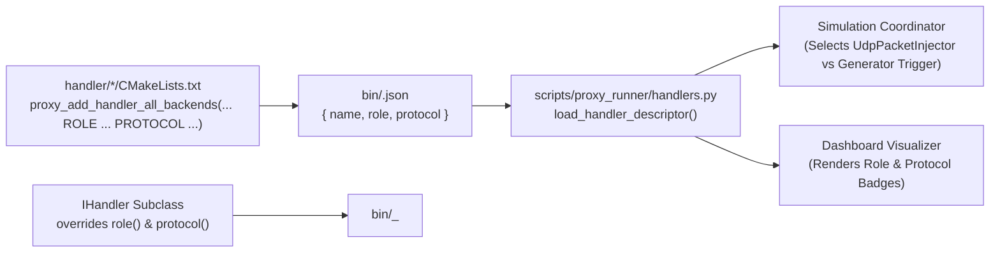

# 005: Handler Classification Traits (`HandlerRole`, `HandlerProtocol`) & Sidecar Manifests

## 1. Overview & Problem Statement

### Why It's Needed
Prior to `1fecfb7`, orchestration and simulation scripts (`scripts/chain_runner.py`, `scripts/proxy_runner/coordinator.py`, and the web dashboard `scripts/dashboard/js/canvas.js`) assumed that any handler without an internal `input_channel` in the chain topology was an autonomous synthetic generator (like `dummy_send`).

However, external network gateways (`udp_ingress_handler`) also have no internal bus `input_channel` because they listen directly to external UDP sockets. Without explicit classification metadata:
1. Python scripts had to resort to fragile hardcoded string checks (`type != "udp_ingress_handler"`).
2. The simulation coordinator could not automatically select the right protocol packet injector (`UdpPacketInjector` vs. `UnixSocketPacketInjector`) for external ingress gateways.
3. The simulation web UI could not distinguish autonomous generators (`⚡ Trigger Emit`) from external network gateways (`🌐 Ingress [UDP]`).

### The Solution
1. **Strongly-Typed C++ Handler Classification (`Core::Handler::HandlerRole` & `HandlerProtocol`)**: Added `HandlerRole` (`Generator`, `ExternalIngress`, `ExternalEgress`, `Processor`) and `HandlerProtocol` (`None`, `Udp`, `Http`) enums in `core/include/core/handler/HandlerTraits.hpp`, with virtual `role()` and `protocol()` query methods on `Core::Handler::IHandler`.
2. **Decoupled CMake Sidecar Descriptors (`<bin_dir>/<handler_name>.json`)**: Extended `proxy_add_handler_all_backends()` in `cmake/ProxyBackends.cmake` to accept `ROLE` and `PROTOCOL` arguments and emit a standalone JSON sidecar manifest alongside each compiled handler family in `bin/`.
3. **Protocol-Driven Simulation Injection (`scripts/proxy_runner/handlers.py` & `injectors.py`)**: Updated `chain_runner.py`, `coordinator.py`, and the dashboard visualizer to read `<handler>.json` sidecars directly.

---

## 2. Architecture & How It Works

### 2.1 Build-Time Sidecar Generation & Runtime Discovery



### 2.2 Built-In Handler Classifications

| Handler | `HandlerRole` | `HandlerProtocol` | Sidecar JSON (`bin/<name>.json`) |
| :--- | :--- | :--- | :--- |
| `dummy_send` | `Generator` | `None` | `{"name": "dummy_send", "role": "generator", "protocol": "none"}` |
| `udp_ingress_handler` | `ExternalIngress` | `Udp` | `{"name": "udp_ingress_handler", "role": "external_ingress", "protocol": "udp"}` |
| `udp_egress_handler` | `ExternalEgress` | `Udp` | `{"name": "udp_egress_handler", "role": "external_egress", "protocol": "udp"}` |
| `print_handler`, `dummy_receive`, `split_handler`, `merge_handler`, `route_handler`, `xml_verification_handler`, `order_validation_handler` | `Processor` | `None` | `{"name": "...", "role": "processor", "protocol": "none"}` |

---

## 3. Design Decisions

### 3.1 Per-Handler Sidecar JSON Files Over a Monolithic Registry
- **Decision**: Emit `<bin_dir>/<handler_base_name>.json` per handler rather than a single global `handlers.json` file.
- **Rationale**: Allows handlers to be built or packaged independently across separate repositories or OCI layers without merge conflicts on a central manifest.

---

## 4. Concrete Examples

### 4.1 Declaring Role & Protocol in `UdpIngressHandler`
```cpp
// handler/udp_ingress_handler/include/UdpIngressHandler.hpp
[[nodiscard]] Core::Handler::HandlerRole role() const noexcept override
{
    return Core::Handler::HandlerRole::ExternalIngress;
}

[[nodiscard]] Core::Handler::HandlerProtocol protocol() const noexcept override
{
    return Core::Handler::HandlerProtocol::Udp;
}
```

```cmake
# handler/udp_ingress_handler/CMakeLists.txt
proxy_add_handler_all_backends(udp_ingress_handler
    ROLE external_ingress
    PROTOCOL udp
    SOURCES ${SOURCES}
    INCLUDE_DIRS "${CMAKE_CURRENT_SOURCE_DIR}/include"
)
```

---

## 5. Tasks / Checklist

- [x] Define `HandlerRole` and `HandlerProtocol` in `core/include/core/handler/HandlerTraits.hpp` (`1fecfb7`).
- [x] Add `role()` and `protocol()` virtual methods to `Core::Handler::IHandler` and override in `DummySendHandler`, `UdpIngressHandler`, and `UdpEgressHandler`.
- [x] Update `proxy_add_handler_all_backends` in `cmake/ProxyBackends.cmake` to emit `<bin_dir>/<handler>.json` sidecars.
- [x] Update `scripts/proxy_runner/handlers.py`, `injectors.py`, `coordinator.py`, and `scripts/dashboard/js/canvas.js` to consume sidecar metadata.

