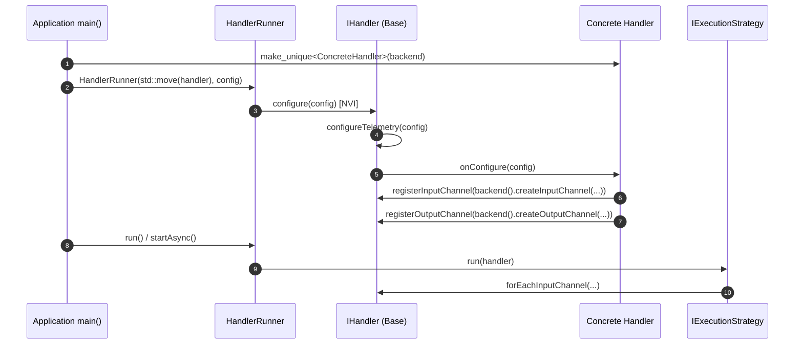

# 006: `HandlerRunner` Supervision, Constructor Injection, NVI `onConfigure`, & Channel Encapsulation

## 1. Overview & Problem Statement

### Why It's Needed
Prior to `f36c9f7` – `b143785`, `Core::Handler::IHandler` had accumulated too many orthogonal responsibilities and exposed fragile internal state:
1. **Nullable Backend & Manual Telemetry Setup**: `IBackend` was passed during `configure(config, backend)` rather than at construction, requiring null-pointer checks on `m_backend`. Every concrete handler also had to remember to call `IHandler::configure(config)` manually or telemetry setup was silently skipped.
2. **Lifecycle & Signal Coupling Inside `IHandler`**: `IHandler` directly managed execution strategies, `startAsync()`, `wait()`, and POSIX signal handlers.
3. **Exposed Channel Containers**: `IHandler::getInputChannels()` returned a reference to the internal `std::vector<std::unique_ptr<IInputChannel>>`, coupling execution strategies to the handler's internal storage container and duplicating channel names in both the handler and the channel.

### The Solution
1. **Constructor Backend Injection & NVI `configure()` (`f36c9f7`)**:
   - Injected `Backend::IBackend&` directly into `IHandler(Backend::IBackend& backend)` so `backend()` is guaranteed non-null for the entire lifetime of the handler.
   - Converted `IHandler::configure(const Backend::IConfig&)` into a Non-Virtual Interface (NVI) method that automatically initializes telemetry (`configureTelemetry(config)`) and delegates handler-specific channel setup to protected `virtual void onConfigure(const Backend::IConfig&) = 0`.
2. **Decoupled `Core::Handler::HandlerRunner` (`7da2296`)**:
   - Extracted execution strategy selection (`ExecutionModel`), lifecycle supervision (`run()`, `startAsync()`, `stop()`, `wait()`), and signal handling out of `IHandler` into `Core::Handler::HandlerRunner` (`core/include/core/handler/HandlerRunner.hpp`).
3. **Private Channel Ownership & Visitor Encapsulation (`210c3db`, `b143785`)**:
   - Made `m_inputChannels` and `m_outputChannels` strictly `private` inside `IHandler`.
   - Replaced `getInputChannels()` with `inputChannelCount()` and `forEachInputChannel(Visitor&&)`.
   - Consolidated canonical channel identity onto `IInputChannel::name()` and `IOutputChannel::name()`, removing duplicate name string members across handlers.

---

## 2. Architecture & How It Works

### 2.1 `HandlerRunner` & NVI `IHandler` Lifecycle



---

## 3. Design Decisions

### 3.1 Non-Virtual Interface (NVI) for `configure()` (`f36c9f7`)
- **Decision**: Make `IHandler::configure(const Backend::IConfig&)` non-virtual and have subclasses override `protected: virtual void onConfigure(const Backend::IConfig&) = 0`.
- **Rationale**: Makes it impossible for a derived handler to forget base telemetry initialization (`StatsDExporter` setup) when overriding configuration logic.

### 3.2 Visitor Iteration via `forEachInputChannel` (`b143785`)
- **Decision**: Expose `inputChannelCount()` and templated `forEachInputChannel(Func&& fn)` passing `Backend::IInputChannel&` by non-owning reference.
- **Rationale**: Execution strategies can iterate or bind threads to input channels without knowing how `IHandler` stores or owns them.

---

## 4. Concrete Examples

### 4.1 Writing a Clean Handler with NVI `onConfigure`
```cpp
class PrintHandler final : public Core::Handler::IHandler {
public:
    explicit PrintHandler(Backend::IBackend& backend)
        : IHandler(backend)
    {
    }

protected:
    void onConfigure(const Backend::IConfig& config) override
    {
        const auto inName = config.getOr<std::string>("print.input_channel", "default");
        registerInputChannel(backend().createInputChannel(inName, config));
    }

    Backend::MessageResult onMessageReceived(
        std::string_view channelName,
        const Backend::MessageView& message) override;
};
```

---

## 5. Tasks / Checklist

- [x] Inject `Backend::IBackend&` into `IHandler` constructor and adopt NVI `configure()` -> `onConfigure()` (`f36c9f7`).
- [x] Extract `Core::Handler::HandlerRunner` to supervise execution models, async lifecycle, and signals (`7da2296`).
- [x] Encapsulate channel names in `IInputChannel` / `IOutputChannel` and privatize `IHandler` channel collections behind `inputChannelCount()` and `forEachInputChannel()` (`210c3db`, `b143785`).

