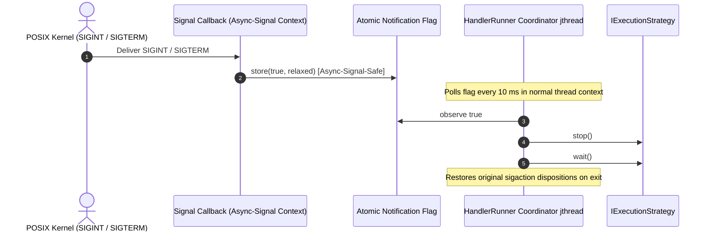

# 007: Handler Thread-Safety Guarantees & Async-Signal-Safe Shutdown

## 1. Overview & Problem Statement

### Why It's Needed
In `e41a3c2` – `f861e03`, two concurrency safety issues were identified in multi-threaded handler execution and process lifecycle management:
1. **Stateful Handler Data Races Under Parallel Execution (`e41a3c2`)**: In `DedicatedThreadStrategy` and `ThreadPoolStrategy`, `onMessageReceived()` / `onBatchReceived()` callbacks run concurrently across multiple threads while `step()` runs on its own timer thread. While stateless or atomic-backed handlers want lock-free parallel execution, handlers maintaining complex mutable state needed an opt-in mechanism to serialize access without rewriting strategy code.
2. **Non-Async-Signal-Safe Shutdown in POSIX Signal Handlers (`f861e03`)**: `HandlerRunner` previously invoked `stop()` directly inside its POSIX `SIGINT` / `SIGTERM` signal handler callback. Strategy `stop()` methods notify condition variables, manipulate atomics/queues, or log—operations that are not async-signal-safe under POSIX and risked deadlocks if a signal interrupted a thread holding a lock. Furthermore, starting signal handling on a second `HandlerRunner` silently overwrote the global active-runner pointer.

### The Solution
1. **Explicit Thread-Safety Contract & Opt-In `execution.serialize_handler_access` (`e41a3c2`)**:
   - Documented and enforced concurrency guarantees for each execution model.
   - Added `serialize_handler_access` (`bool`, default `false`) to `DedicatedThreadModel` and `ThreadPoolModel`. When `true`, strategies acquire a handler-access mutex around `processBatch()` and `step()`, serializing all handler entry points while keeping input polling concurrent. When `false` (default), zero mutex overhead is incurred on the fast path.
2. **Async-Signal-Safe Notification Flag & Shutdown Coordinator Thread (`f861e03`)**:
   - Restricted the POSIX `SIGINT` / `SIGTERM` handler callback to a single lock-free atomic store (`g_signalRequested.store(true, std::memory_order_relaxed)`).
   - A dedicated `Common::Compat::jthread` shutdown coordinator in `HandlerRunner` polls the flag every 10 ms in normal thread context and invokes `m_strategy->stop()` and `m_strategy->wait()` safely outside signal context.
   - Enforced exclusive process-wide signal ownership (`std::logic_error` if a second runner attempts to claim signal handling concurrently) and restored prior `sigaction` dispositions upon runner teardown.

---

## 2. Architecture & How It Works

### 2.1 Async-Signal-Safe Shutdown Flow



### 2.2 Execution Model Concurrency Matrix

| Execution Model | Input Channel Polling | `onMessageReceived` / `onBatchReceived` | `step()` Execution | `serialize_handler_access = true` |
| :--- | :--- | :--- | :--- | :--- |
| **`SimpleModel`** | 1 thread (round-robin) | Serial on main thread | Serial on main thread | Already serial |
| **`SequentialModel`** | 1 thread (batched round-robin) | Serial on main thread | Serial on main thread | Already serial |
| **`DedicatedThreadModel`** | 1 thread per input channel | Concurrent across channels | Separate `step` thread | Serializes `processBatch` & `step` via mutex |
| **`ThreadPoolModel`** | 1 thread per input channel | Concurrent across $N$ workers | Separate `step` thread | Serializes `processBatch` & `step` via mutex |

---

## 3. Design Decisions

### 3.1 Opt-In Serialization Defaulting to `false`
- **Decision**: Default `serialize_handler_access` to `false` in `DedicatedThreadModel` and `ThreadPoolModel`.
- **Rationale**: Production handlers (`XmlVerificationHandler`, `OrderValidationHandler`, `RouteHandler`, `SplitHandler`, `MergeHandler`) are stateless or thread-local on the hot path and scale linearly across cores without mutex contention, while stateful custom handlers can enable `execution.serialize_handler_access = true` via configuration.

### 3.2 Exclusive Signal Ownership & Restoration (`f861e03`)
- **Decision**: Track active signal ownership via an atomic flag in `HandlerRunner`, throwing `std::logic_error` if a second runner enables signal handling simultaneously, and restore previous `SIGINT`/`SIGTERM` handlers when `wait()` completes.
- **Rationale**: Prevents silent signal-handler hijacking in multi-runner tests and ensures clean process state between test cases.

---

## 4. Concrete Examples

### 4.1 Enabling Serialized Handler Access in Configuration
```ini
execution.model = thread_pool
execution.threads = 4
execution.serialize_handler_access = true
```

---

## 5. Tasks / Checklist

- [x] Add `serialize_handler_access` option to `DedicatedThreadModel`, `ThreadPoolModel`, `DedicatedThreadStrategy`, and `ThreadPoolStrategy` (`e41a3c2`).
- [x] Refactor `HandlerRunner` signal handling to use an async-signal-safe atomic flag and a normal-context coordinator `jthread` (`f861e03`).
- [x] Enforce exclusive signal ownership and restore prior `SIGINT`/`SIGTERM` dispositions (`f861e03`).
- [x] Add unit tests verifying parallel vs. serialized callback execution and signal-triggered shutdown (`test/TestThreadingStrategies.cpp`, `test/TestHandlerRunner.cpp`).

