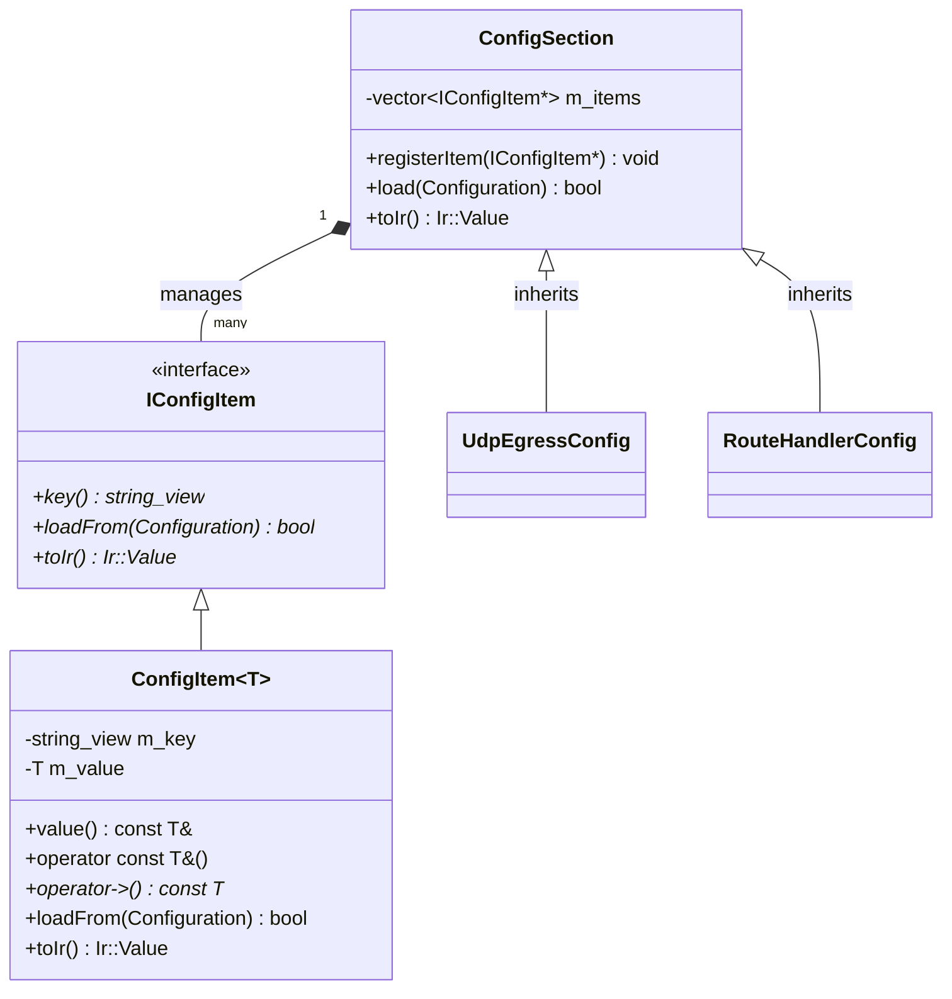

# 008: Strongly-Typed Handler Configuration Sections (`ConfigSection` & `ConfigItem`)

## 1. Overview & Problem Statement

### Why It's Needed
Previously, handlers parsed configuration keys by making repeated, untyped calls to `config.getOr<T>("raw.string.key", default)` within their `onConfigure()` methods. This pattern caused several problems:
1. **Silent Typo Bugs**: Misspelling a configuration key in handler code or config files caused silent fallback to default values without warning.
2. **Scattered Configuration Contracts**: Keys, types, and defaults were scattered across implementation files (`.cpp`) rather than documented in a clear, cohesive contract.
3. **Absence of Compile-Time Guarantees**: Renaming a key in code did not result in a compilation error across consumers.
4. **Ad-Hoc String Parsers for Structured Handlers**: Complex handlers like `RouteHandler` had to manually concatenate strings (`prefix + "pattern"`) and split comma-delimited strings to handle dynamic rule configurations.

### The Solution
We introduced strongly-typed configuration primitives in `Core::Config` (`core/include/core/config/`):
1. **`Core::Config::ConfigSection` & `Core::Config::ConfigItem<T>`**:
   - Each handler declares its configuration contract in a dedicated header (e.g. `UdpEgressConfig.hpp`, `RouteConfig.hpp`).
   - `ConfigItem<T>` pairs the key name, data type, and default value into a single member declaration.
   - Items self-register into the enclosing `ConfigSection` via `Common::Memory::ObserverPtr<ConfigSection>` at construction, allowing a single `cfg.load(config)` call to load all registered keys.
   - Container storage uses safe non-owning references (`Common::Memory::Borrow<IConfigItem>`), completely avoiding raw pointers across API boundaries.
2. **Seamless `Core::Serialization` Integration**:
   - `ConfigSection::toIr()` exports registered items into a `Core::Serialization::Ir::ObjectType` map, allowing immediate serialization to JSON, XML, or vendor dictionaries without custom reflection.
3. **100% C++17 & C++20 Compatibility**:
   - Zero external dependencies and zero build-time code generation.
   - String interpolation for dynamic prefix keys uses `fmt::format` rather than repetitive `std::string` concats.

---

## 2. Architecture & How It Works



---

## 3. Concrete Examples

### 3.1 Flat Handler: `UdpEgressConfig`
```cpp
// handler/udp_egress_handler/include/UdpEgressConfig.hpp
#pragma once

#include "core/config/ConfigItem.hpp"
#include "core/config/ConfigSection.hpp"
#include <string>

namespace Proxy::Handler {

struct UdpEgressConfig : public Core::Config::ConfigSection {
    Core::Config::ConfigItem<std::string> inputChannel{this, "egress.input_channel", "egress_in"};
    Core::Config::ConfigItem<std::string> mode{this, "egress.mode", "reply_to_origin"};
    Core::Config::ConfigItem<std::string> destHost{this, "egress.dest_host", "127.0.0.1"};
    Core::Config::ConfigItem<int> destPort{this, "egress.dest_port", 9200};
};

} // namespace Proxy::Handler
```

```cpp
// In UdpEgressHandler::onConfigure:
bool UdpEgressHandler::onConfigure(const Core::Config::Configuration& config)
{
    UdpEgressConfig cfg;
    if (!cfg.load(config)) {
        Proxy::Log::error("[UdpEgressHandler] Configuration loading failed due to invalid parameter types");
        return false;
    }

    const auto& inputChannelName = cfg.inputChannel.value();
    m_replyToOrigin = (cfg.mode.value() != "forward");
    m_destHost = cfg.destHost.value();
    m_destPort = static_cast<std::uint16_t>(cfg.destPort.value());
    // ...
    return true;
}
```

### 3.2 Dynamic Structured Handler: `RouteConfig`
```cpp
// handler/route_handler/include/RouteConfig.hpp
struct RouteRuleConfig {
    std::string name;
    std::string type{"contains"};
    std::string pattern;
    std::string target;
    int numericValue{0};

    static RouteRuleConfig fromPrefix(std::string_view ruleName,
        std::string_view prefix,
        const Core::Config::Configuration& config);
};

struct RouteHandlerConfig : public Core::Config::ConfigSection {
    Core::Config::ConfigItem<std::string> inputChannel{this, "route.input_channel", "route_in"};
    Core::Config::ConfigItem<std::string> defaultOutputChannel{this, "route.default_output", ""};
    Core::Config::ConfigItem<std::string> rulesCsv{this, "route.rules", ""};

    std::vector<RouteRuleConfig> rules;

    bool loadRules(const Core::Config::Configuration& config);
};
```

---

## 4. Verification Checklist

- [x] Implemented `IConfigItem`, `ConfigSection`, and `ConfigItem<T>`.
- [x] Added unit tests in `test/TestConfigSection.cpp` verifying defaults, overrides, type mismatches, and IR export.
- [x] Migrated `UdpEgressHandler` and `RouteHandler` to use strongly-typed config sections.
- [x] Built all handler backend targets (`shm`, `uds`, `socket`, `file`).
- [x] Passed entire Catch2 test suite (121,851 assertions across 102 test cases).
- [x] Executed end-to-end integration chain `chains/example_shm_full_proxy_chain.toml` with `chain_runner.py`.
- [x] Formatted all modified files with `clang-format` according to the WebKit base style.

