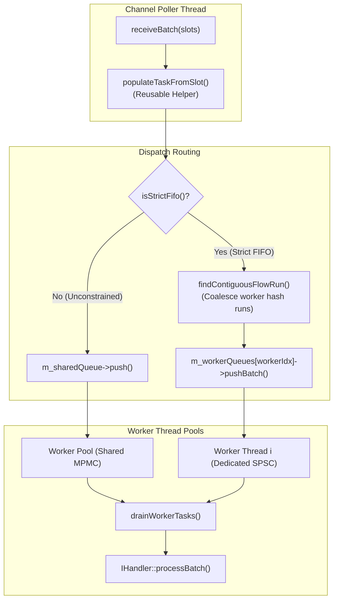

# Feature 009: ThreadPoolStrategy Cognitive Complexity Reduction & Task Ingress Deduplication

## Overview & Problem Statement

In the concurrency and message ingress pipeline, `ThreadPoolStrategy` is responsible for dispatching incoming network packets across worker threads under two distinct execution profiles:
1. **Strict FIFO Mode (`m_strictFifo = true`)**: Packets belonging to the same flow or channel are hashed and pinned to a dedicated per-worker SPSC ring buffer.
2. **Unconstrained Mode (`m_strictFifo = false`)**: Messages are distributed across worker threads via a shared MPMC queue to achieve maximum parallel throughput.

Code review of `ThreadPoolStrategy.cpp` and related threading components revealed several cognitive complexity and maintainability issues:
- **Misleading API Documentation**: In `include/core/threading/ThreadPoolStrategy.hpp`, the constructor and method documentation stated that when `strictFifo` is false, batches are distributed "round-robin across worker queues". In reality, the implementation initializes and routes to a single shared `Common::Queue::MpmcQueue<MessageTask, 4096>` where worker threads pop batches concurrently.
- **Duplicated MessageTask Ingress Population**: Both `pollUnconstrained` and `pollStrictFifo` contain identical multi-branch blocks (~25 lines each) inspecting `BufferSlot::isLeased()`, checking `BufferSlice` presence and sizing against `MessageTask::SmallBufferSize`, assigning into small-buffer optimization (SBO) or slice storage, and transferring transport leases.
- **Deeply Nested Run-Length Grouping in `pollStrictFifo`**: The contiguous run calculation for worker hashing was embedded directly in `pollStrictFifo` alongside queue batch pushes, increasing the nesting level and cognitive load.
- **MPMC Worker Idle Busy-Yield Spin**: When `m_sharedQueue` is empty, worker threads spin in `std::this_thread::yield()`, consuming CPU cycles unnecessarily during idle periods.

## Architecture & How It Works

The refactoring streamlines `ThreadPoolStrategy` by decomposing ingress into clean, single-responsibility helper functions and correcting documentation contracts:



### Key Changes
1. **Helper Function `populateTaskFromSlot`**:
   Centralizes the logic that inspects a filled `Backend::BufferSlot` and optional `BufferSlice`, handling zero-copy external leases, small buffer optimization (SBO) inline payloads (<= 256 bytes), and large pooled `BufferSlice` retention.
2. **Helper Function `findContiguousFlowRun`**:
   Extracts contiguous worker-group run-length detection from `pollStrictFifo`.
3. **Docstrings & Comments Correction**:
   Clarifies `ThreadPoolStrategy.hpp` to explicitly document the shared MPMC work-stealing queue behavior when `strictFifo = false`.
4. **Worker Idle Backoff**:
   In `ThreadPoolStrategy`'s shared MPMC worker loop, when no items are popped, adds a progressive yield/sleep backoff to prevent burning CPU cycles in tight loops while preserving responsive latency under load.

## Concrete Examples

### Task Population Helper

```cpp
void populateTaskFromSlot(
    MessageTask& task,
    std::string_view channelName,
    ::Backend::BufferSlot& slot,
    std::optional<Common::Memory::BufferSlice>& preSlice)
{
    if (slot.isLeased()) {
        task.assignLeased(channelName, slot.filledSpan(), std::move(slot.lease));
        return;
    }

    slot.setLease(std::move(slot.lease));
    const std::size_t pktSize = slot.size;
    if (preSlice.has_value()) {
        if (pktSize > MessageTask::SmallBufferSize) {
            task.assignSlice(channelName, std::move(*preSlice), pktSize);
        } else {
            task.assign(channelName, preSlice->span().subspan(0, pktSize));
        }
        preSlice.reset();
        return;
    }

    task.assign(channelName, slot.filledSpan());
}
```

## Tasks / Checklist

- [x] Create feature branch `feat/threadpool-refactor-and-task-dedup`.
- [x] Run baseline test suite to confirm all 108 tests pass.
- [ ] Correct documentation in `core/include/core/threading/ThreadPoolStrategy.hpp`.
- [ ] Extract `populateTaskFromSlot` and `findContiguousFlowRun` in `core/src/threading/ThreadPoolStrategy.cpp`.
- [ ] Add idle backoff to MPMC worker thread loop in `core/src/threading/ThreadPoolStrategy.cpp`.
- [ ] Format modified source files using `clang-format`.
- [ ] Rebuild and run test suite across all 108 tests.
- [ ] Review git diff and request user approval for commit.

