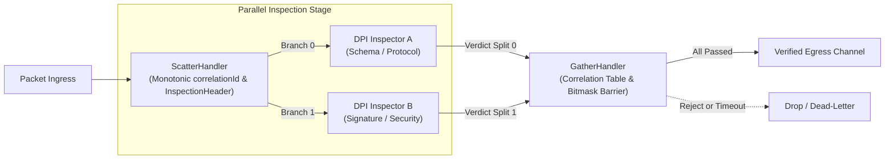

# 010: Parallelized Packet Inspection with Scatter-Gather Orchestration

## 1. Overview & Problem Statement

### Why It's Needed
In deep packet inspection (DPI), payload validation, and firewall rule evaluation, executing multiple security and protocol inspection handlers sequentially introduces cumulative processing delay:
$$\text{Total Latency} \approx \sum_{i=1}^{M} D_i$$
When inspection rules (e.g. XML/JSON schema validation, regex scanning, threat signatures, access policy checks) are independent and read-only, serial execution creates an unnecessary bottleneck. Parallelizing inspections across $M$ worker branches lowers the latency to:
$$\text{Parallel Latency} \approx \max_{i \in [1, M]}(D_i) + \delta_{\text{orchestration}}$$

However, parallel inspection requires orchestrating the lifecycle of every in-flight packet:
1. **Correlation**: Dispatched splits must be identifiable as belonging to the same root packet.
2. **Scatter / Dispatch**: The incoming packet must be duplicated and annotated with branch indexing and split totals.
3. **Gather / Barrier Check**: The orchestrator must track returning splits, verify that **all** inspection splits reported passing verdicts, fast-fail immediately upon any rejection, and evict unmerged messages when timeouts occur.

---

## 2. Architecture & How It Works

### 2.1 Topology (Scatter-Gather / Fork-Join)



### 2.2 Wire Protocol: Tunneling Metadata & Untouched `ProtocolId`
To prevent colliding with standard IANA protocols or customer proprietary protocols, `EnvelopeHeader::protocol` remains **100% untouched** (e.g. `IPPROTO_UDP` or custom customer ID).

Instead, the orchestration frame is placed at the front of the metadata section using a clean plain-data `InspectionHeader`:
```cpp
struct InspectionHeader {
    std::uint64_t magic { PipelineInspectionMagic }; // 0x50585F494E535043ULL ("PX_INSPC")
    std::uint64_t correlationId { 0 };               // Unique packet ID
    std::uint16_t totalSplits { 1 };                 // Total expected splits
    std::uint16_t splitIndex { 0 };                  // 0-based branch index
    InspectionVerdict verdict;                       // Pending, Pass, Reject, Error
    std::uint32_t errorCode { 0 };                   // Optional error code
    std::uint16_t originalMetadataLength { 0 };      // Length of original tunneled metadata
};
```

All view inspection, metadata extraction, and wire envelope packing logic is cleanly encapsulated inside `InspectionView`:
```cpp
class InspectionView {
public:
    static std::optional<InspectionView> from(const MessageView& message) noexcept;
    static std::vector<std::byte> pack(const MessageView& message, const InspectionHeader& header);

    [[nodiscard]] const MessageView& messageView() const noexcept;
    [[nodiscard]] InspectionHeader extractHeader() const noexcept;
    [[nodiscard]] Common::Compat::span<const std::byte> extractMetadata() const noexcept;

    template <typename T>
    [[nodiscard]] std::optional<T> extractMetadataAs() const noexcept;
};
```
- **Metadata Framing**: The metadata payload carries `[ InspectionHeader (30 bytes) | Original Metadata (e.g. UdpMetadata) ]`.
- **Zero-Allocation Stack Buffering**: `ScatterHandler` buffers the metadata slice on the stack (`std::array<std::byte, 512>`), avoiding heap allocation overheads.
- **Egress Restoration**: `GatherHandler` un-tunnels the original metadata bytes and restores the original untouched `protocol`, preserving `UdpMetadata` (IPs, client reply ports) end-to-end.

---

## 3. Design Decisions

### 3.1 Bitmask Convergence Barrier in `GatherHandler`
- **Decision**: In `GatherHandler`, split arrival is tracked using a 32-bit bitmask (`entry.receivedMask |= (1u << splitIndex)`). When `receivedMask == requiredMask`, all splits have arrived.
- **Rationale**: Provides $O(1)$ zero-allocation completion checking without allocating dynamic sets or lists per in-flight packet.

### 3.2 Fast-Path Rejection & Active Eviction
- **Decision**: If any branch returns `InspectionVerdict::Reject` or `InspectionVerdict::Error`, the pending packet is dropped immediately without waiting for other slower branches to finish.
- **Rationale**: Prevents wasted buffer retention and reduces tail latency when messages violate validation rules. A periodic sweep in `GatherHandler::step()` purges expired pending records older than `gather.timeout_ms`.

---

## 4. Concrete Usage Example

### Declarative Pipeline (`chains/example_scatter_gather_chain.toml`)
```toml
backend = "file"

[[handlers]]
name = "scatter_dispatcher"
type = "scatter_handler"
input_channel = "packet_ingress"
output_channels = "insp_branch_a,insp_branch_b"

[[handlers]]
name = "gather_merger"
type = "gather_handler"
input_channels = "insp_res_a,insp_res_b"
output_channel = "verified_egress"
[handlers.config]
"gather.timeout_ms" = 2000
```

---

## 5. Tasks / Checklist

- [x] Create `InspectionHeader` wire envelope in `backend/interface/include/backend/message/InspectionHeader.hpp`.
- [x] Implement `ScatterHandler` in `handler/scatter_handler/` for monotonic correlation tagging and fan-out.
- [x] Implement `GatherHandler` in `handler/gather_handler/` with bitmask barriers, fast-fail rejection, and timeout eviction.
- [x] Integrate subprojects into root `CMakeLists.txt` via `proxy_add_handler_all_backends()`.
- [x] Create unit tests in `test/TestScatterGatherPipeline.cpp` covering split generation, full convergence, rejection drop, and timeout expiration.
- [x] Author example pipeline configuration in `chains/example_scatter_gather_chain.toml`.
- [x] Verify all 107 test cases and 121,945 assertions pass cleanly.

