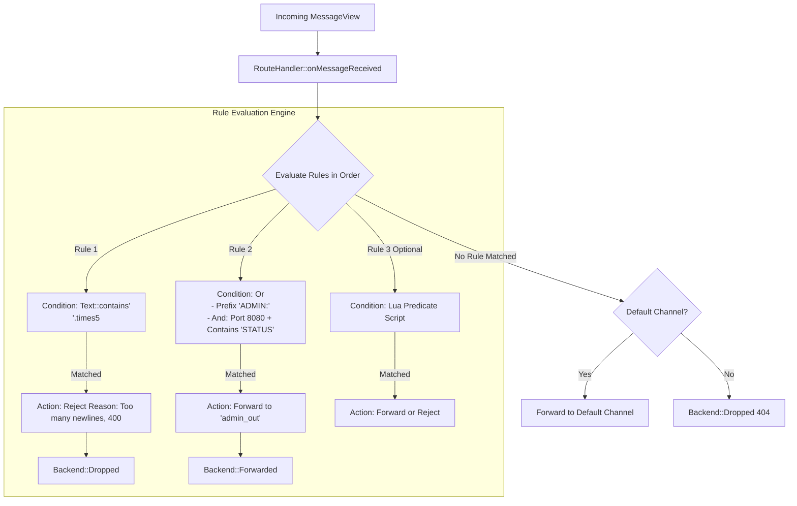

# Feature 011: Composable Route Rules and Embedded Lua Engine

## Overview & Problem Statement
The existing `RouteHandler` supports basic single-criterion pattern matching (`PayloadContains`, `PayloadPrefix`, `ClientPort`, `Protocol`, and `Fallback`). However, real-world content-based routing requires:
1. **Composability**: Combining conditions with boolean logic (`and`, `or`, `not`) and quantified constraints such as matching a substring a minimum number of times (e.g. `Text::contains('\n').times(5)`).
2. **Explicit Actions & Rejection**: The ability to not only forward messages to destination channels, but to explicitly reject/drop messages with a meaningful failure `reason` and `errorCode` (returning `Backend::Dropped`), enabling early filtering and DOS prevention.
3. **Fluent C++ Builder API**: Programmatic construction of complex rules in code without clumsy nested configuration structs.
4. **Dynamic Scripting (Lua)**: Dynamic routing scripts for complex stateful logic or runtime updates without recompilation.

This feature is split into two phases:
- **Phase 1**: Composable C++ Rule Engine, Fluent Builder API, Rejection Action with Reason, and JSON/TOML configuration mapping.
- **Phase 2**: Conan-integrated Lua scripting (`lua` and `sol2`) providing an embeddable rule evaluator.

---

## Architecture & How It Works



---

## Design Decisions

1. **Separation of Concerns**:
   - `RouteCondition`: Evaluates whether a `MessageView` matches (boolean predicate). Can be a leaf condition (`TextContainsCondition`, `TextPrefixCondition`, `PortCondition`, `ProtocolCondition`) or a composite condition (`AndCondition`, `OrCondition`, `NotCondition`).
   - `RouteAction`: What to do upon match (`ForwardAction` specifying target channel name and bound channel pointer, or `RejectAction` specifying reason and error code).
   - `RouteRule`: Pairs an `IRouteCondition` with an `IRouteAction`.
2. **Fluent Builder**:
   - Clean, readable syntax:
     ```cpp
     RouteRule::when(Text::contains("\n").times(5))
         .reject("Too many newlines", 400);

     RouteRule::when(Text::prefix("ADMIN:").or_(Port::equals(8080)))
         .forwardTo("admin_chan");
     ```
3. **Zero Allocation Hot Path for Built-in Conditions**:
   - Condition tree evaluates message views via lightweight string views without string copies or heap allocations during message processing.
4. **Single-Class-Per-File Policy**:
   - Following `AGENTS.md`, standalone types (`IRouteCondition`, `TextCondition`, `PortCondition`, `RouteAction`) are separated cleanly into dedicated headers and implementation files under `handler/route_handler/`.

---

## Tasks / Checklist

### Phase 1: Composable C++ Rule Engine & Fluent Builder
- [x] Define `IRouteCondition` interface and leaf conditions:
  - [x] `TextCondition` (contains with count/times, prefix, exact match).
  - [x] `PortCondition` (matches UDP port).
  - [x] `ProtocolCondition` (matches ProtocolId).
- [x] Define composite conditions:
  - [x] `AndCondition`, `OrCondition`, `NotCondition`.
- [x] Define `RouteAction` (`ForwardAction` vs `RejectAction` with reason and errorCode).
- [x] Create fluent builder helper classes (`Text`, `Port`, `RouteRule::when(...)`).
- [x] Update `RouteRule` to evaluate composable conditions and actions.
- [x] Update `RouteConfig` to parse composite conditions and reject actions from configuration.
- [x] Implement `ConditionExpressionParser` for inline `expr = "..."` syntax with AND/OR/NOT.
- [x] Update `RouteHandler` to execute `RejectAction` (returning `Backend::Dropped`) and `ForwardAction`.
- [x] Unit tests for all condition combinations, fluent builders, and rejection reasons.
- [x] Code formatting via `clang-format`.

### Phase 2: Embedded Lua Engine (sol2)
- [x] Add optional `with_lua` option in `conanfile.py` and `PROXY_ENABLE_LUA` in `CMakeLists.txt`.
- [x] Implement `LuaCondition` evaluating dynamic Lua snippets or functions.
- [x] Bind `MessageView` metadata and payload (`msg.payload`, `msg.protocol`, `msg.port`, `msg.dst_port`) to Lua table.
- [x] Support Lua predicate rules (`type = "lua"`, `script = "..."`) and rejection actions from config.
- [x] Unit tests for Lua routing scripts, parameter passing, and rejection handling.

