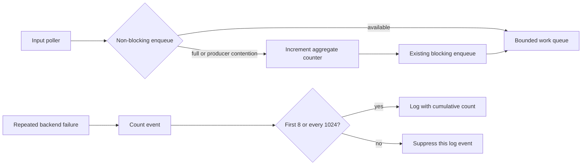

# 012: Runtime Overload Observability

## Overview & Problem Statement

Bounded queues and transport-specific backpressure already protect the runtime from unbounded buffering, but a full queue or repeated delivery failure was difficult to distinguish from normal traffic using telemetry. Repeated warnings from transport send paths could also overwhelm logs during sustained failure.

This change adds an aggregate core metric for thread-pool enqueue attempts that require the blocking path and applies one shared event-count sampling policy to repeated runtime failure logs. It deliberately preserves existing queue capacities, delivery behavior, retry limits, and transport-specific backpressure.

## Architecture & How It Works

The SPSC queue gains a non-blocking batch attempt that invokes its producer only if the entire batch can be enqueued. The thread pool records a backpressure event when this attempt fails, then uses the existing blocking enqueue. The MPMC path already has a non-blocking single-item attempt and records the same metric before its existing blocking push.



`queue_enqueue_backpressure_events_total` counts enqueue attempts that needed the blocking path. It has no channel or error labels. Backend-specific warning/error logs use the same event-count policy: emit the first eight events and then every 1024th event, including the cumulative count.

## Design Decisions

- Preserve existing overload semantics; observability must not silently switch a blocking path to message dropping.
- Count only queue operations that explicitly require a blocking fallback. No arbitrary queue high-water threshold is introduced.
- Keep backend-local failure counters and logging in backend modules rather than introducing a dependency from backends to core telemetry.
- Avoid per-channel metric labels to keep metric cardinality bounded.
- The sampled log cadence is count-based, matching the prior malformed-envelope and SHM invalid-slot behavior; it is not a time-window rate limiter.

## Concrete Examples

With the thread-pool strategy active, scrape telemetry to inspect the aggregate counter:

```text
queue_enqueue_backpressure_events_total 12
```

If a vendor relay pool remains full, sampled warnings include the total observed count, for example:

```text
[VendorInputChannel] Relay pool capacity reached on channel 'orders'; applying ingress backpressure (total events: 1024)
```

## Tasks / Checklist

- [x] Add a non-blocking SPSC batch enqueue attempt that does not invoke the producer on failure.
- [x] Count thread-pool enqueue attempts requiring the blocking fallback in core telemetry.
- [x] Share the existing bounded event-count log policy and apply it to repeated backend delivery failures.
- [x] Preserve current queue capacities, blocking behavior, retry limits, and delivery semantics.
- [x] Add focused tests for the sampling cadence and SPSC non-blocking batch behavior.
- [ ] Measure queue and logging overhead under representative workloads before considering configurable quotas or a changed overload policy.
