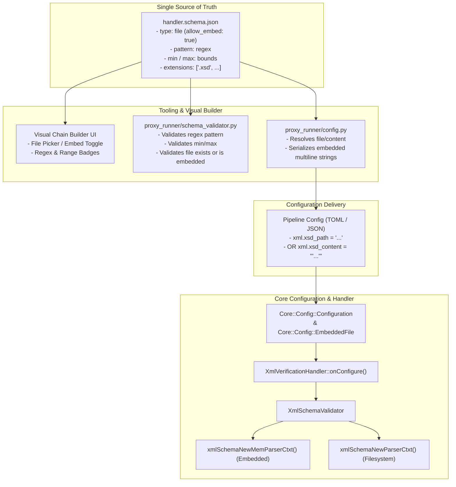

# 013: Schema-Driven Embedded File Configuration and Parameter Validation

## Overview & Problem Statement

Handlers such as `xml_verification_handler` take external file references (e.g., an XSD validation schema path). During execution, this introduces multiple operational and security hazards:
1. **Runtime Filesystem Dependencies**: Handlers fail if relative file paths shift depending on current working directory or deployment roots.
2. **Security & Tampering Risks**: External files can be modified or swapped out under running processes.
3. **Container & OCI Isolation Issues**: Distroless runtime containers require mounting local schemas separately rather than baking pipelines into immutable, self-contained artifacts.
4. **Lack of Type & Parameter Validation**: Parameter definitions lacked enforcement for string regular expressions, numeric ranges, and file type requirements across the Visual Builder, the Python execution engine, and the C++ configuration loader.

This feature establishes a unified, schema-driven configuration and validation architecture where `handler.schema.json` acts as the single source of truth for constraints, allowing files to be either referenced or embedded directly into pipeline configurations, and enforcing parameter constraints before handler execution.

## Architecture & How It Works



### Key Components

1. **`Core::Config::EmbeddedFile` (`core/include/core/config/EmbeddedFile.hpp`)**:
   - Represents a file resource that can either be loaded from an explicit filesystem path or directly from inlined string content.
   - Provides `.content()` returning `std::string_view` (loading from disk once on demand if given a path, or providing the inlined buffer).
   - Provides `.isEmbedded()` and `.path()`.
   - Automatically deserializes from `Core::Config::Configuration` by inspecting `<prefix>_content` (or direct string content) before `<prefix>_path`.

2. **In-Memory Schema Compilation (`XmlSchemaValidator`)**:
   - Extends `XmlSchemaValidator` with a constructor accepting `std::string_view schemaContent`.
   - Utilizes `libxml2`'s `xmlSchemaNewMemParserCtxt()` to parse and compile XSD schemas directly from memory.

3. **Schema & Tooling Validation (`proxy_runner`)**:
   - `schema_validator.py` enforces:
     - Regex matching via `pattern` for strings.
     - Numeric bounds (`min` / `max`) for integers and numbers.
     - `file` type rules: if `allow_embed` is enabled, validates either file existence on disk or the presence of embedded content.
   - `config.py` seamlessly handles embedded content during handler configuration generation and TOML serialization.

## Design Decisions

- **Schema as Single Source of Truth**: Keep validation rules in `handler.schema.json` rather than hardcoding arbitrary validation rules in C++ handlers, ensuring the Visual Builder, CLI, and C++ runtime share identical constraints without code duplication.
- **Backwards Compatibility**: Existing `xml.xsd_path` configurations remain 100% valid. Handlers prefer embedded content when provided (`xml.xsd_content`), falling back cleanly to file paths.
- **Zero-Copy In-Memory Validation**: When embedded, schemas compile via `xmlSchemaNewMemParserCtxt` without writing temporary files to `/tmp` or the filesystem.

## Concrete Examples

### Pipeline Configuration with Embedded XSD (TOML)

```toml
[[handlers]]
name = "xml_validator"
type = "xml_verification_handler"
input_channel = "orders_raw"
output_channel = "orders_verified"

[handlers.config]
"xml.xsd_content" = """
<?xml version="1.0" encoding="UTF-8"?>
<xs:schema xmlns:xs="http://www.w3.org/2001/XMLSchema">
  <xs:element name="order">
    <xs:complexType>
      <xs:sequence>
        <xs:element name="id" type="xs:string"/>
        <xs:element name="amount" type="xs:decimal"/>
      </xs:sequence>
    </xs:complexType>
  </xs:element>
</xs:schema>
"""
```

### Handler Implementation C++

```cpp
bool XmlVerificationHandler::onConfigure(const Core::Config::Configuration& config)
{
    auto schemaResource = Core::Config::EmbeddedFile::fromConfig(config, "xml.xsd");
    if (!schemaResource.has_value()) {
        Proxy::Log::error("[XmlVerificationHandler] Missing mandatory configuration: 'xml.xsd_content' or 'xml.xsd_path'");
        return false;
    }

    m_validator = std::make_unique<XmlSchemaValidator>(schemaResource->content());
    if (!isSchemaLoaded()) {
        Proxy::Log::error("[XmlVerificationHandler] Failed to compile XSD schema");
        return false;
    }
    // ...
}
```

## Tasks / Checklist

- [x] Implement `Core::Config::EmbeddedFile` in `core/include/core/config/EmbeddedFile.hpp` and `core/src/config/EmbeddedFile.cpp`
- [x] Add in-memory parsing constructor to `XmlSchemaValidator` (`XmlSchemaValidator.hpp` / `.cpp`) using `xmlSchemaNewMemParserCtxt`
- [x] Enable `XmlSchemaValidator` to directly accept `Core::Config::EmbeddedFile`
- [x] Update `XmlVerificationHandler::onConfigure` to support embedded schema content via `EmbeddedFile`
- [x] Remove obsolete `m_schemaPath` and eager construction from `XmlVerificationHandler`
- [x] Update `handler/xml_verification_handler/handler.schema.json` with `type: "file"`, `allow_embed: true`, and constraints
- [x] Enhance `scripts/proxy_runner/schema_validator.py` with `pattern` (regex), `min`/`max` bounds, and `file` type validation
- [x] Add unit tests for `EmbeddedFile`, in-memory `XmlSchemaValidator`, and Python schema validation
- [x] Verify build and all tests pass cleanly
