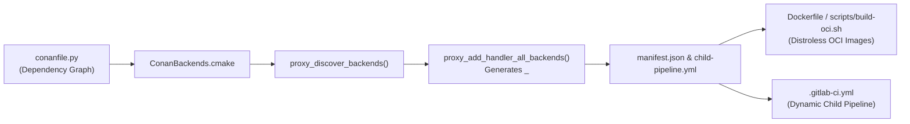

# 001: Conan 2 Dependency Discovery, Multi-Backend Matrix (`ProxyBackends.cmake`), & Dynamic OCI Packaging

## 1. Overview & Problem Statement

### Why It's Needed
In `fb64b45`, adding a new transport backend or a new message handler previously required manually editing CMake `if(STREQUAL)` conditionals across every handler's `CMakeLists.txt`, manually adding container build targets to `Dockerfile`, and manually updating `.gitlab-ci.yml` matrix lists.

### The Solution
1. **Conan 2 Graph Backend Discovery (`conanfile.py` & `cmake/ProxyBackends.cmake`)**:
   - `conanfile.py` inspects the resolved Conan 2 dependency graph and generates `ConanBackends.cmake` listing all active transport backends (`file`, `socket`, `uds`, `shm`, `inproc`, `sim`, `vendor`).
   - `proxy_discover_backends()` automatically adds subdirectories for in-tree backends and links Conan targets for external backends.
2. **Automatic Handler $\times$ Backend Matrix Generation (`proxy_add_handler_all_backends`)**:
   - Each handler's `CMakeLists.txt` calls `proxy_add_handler_all_backends(<handler_name> SOURCES ...)`, which generates an executable target `<handler_name>_<backend>` for every discovered backend and outputs all binaries into `bin/`.
3. **Zero-Maintenance OCI Packaging & Dynamic GitLab CI (`Dockerfile`, `scripts/build-oci.sh`, `.gitlab-ci.yml`)**:
   - `proxy_export_targets_manifest()` outputs `${CMAKE_BINARY_DIR}/manifest.json` and `${CMAKE_BINARY_DIR}/child-pipeline.yml` at CMake configure time.
   - A single parameterized multi-stage `Dockerfile` packages stripped binaries into lightweight `gcr.io/distroless/cc-debian12:nonroot` runtime images, driven automatically by `scripts/build-oci.sh` and GitLab CI dynamic child pipelines.

---

## 2. Architecture & How It Works

### 2.1 Build, Discovery, & OCI Packaging Pipeline



---

## 3. Design Decisions

### 3.1 CMake Agnosticism via `cmake/conan_provider.cmake`
- **Decision**: Intercept `find_package()` calls using `cmake/conan_provider.cmake` (`CMAKE_PROJECT_TOP_LEVEL_INCLUDES`) so subproject `CMakeLists.txt` files use pure standard CMake `find_package(<pkg> REQUIRED)` with zero Conan-specific syntax (`AGENTS.md` Rule 3).
- **Rationale**: Keeps every subproject (`common`, `log`, `backend/*`, `core`, `handler/*`) buildable both standalone and within the top-level workspace.

---

## 4. Concrete Examples

### 4.1 Declaring a Multi-Backend Handler Target
```cmake
file(GLOB_RECURSE SOURCES CONFIGURE_DEPENDS
    "${CMAKE_CURRENT_SOURCE_DIR}/src/*.cpp"
    "${CMAKE_CURRENT_SOURCE_DIR}/include/*.hpp"
)

proxy_add_handler_all_backends(print_handler
    ROLE processor
    PROTOCOL none
    SOURCES ${SOURCES}
    INCLUDE_DIRS "${CMAKE_CURRENT_SOURCE_DIR}/include"
)
```

### 4.2 Packaging OCI Container Images Locally
```bash
# Build all discovered handler images:
./scripts/build-oci.sh

# Build a single handler image:
./scripts/build-oci.sh print_handler_socket
```

---

## 5. Tasks / Checklist

- [x] Implement `proxy_discover_backends`, `proxy_add_handler_all_backends`, and `proxy_export_targets_manifest` in `cmake/ProxyBackends.cmake` (`fb64b45`).
- [x] Configure multi-stage Distroless `Dockerfile`, `scripts/build-oci.sh`, and dynamic `.gitlab-ci.yml` (`fb64b45`).
- [x] Add Conan 2 `conanfile.py` recipes for all subprojects (`common`, `log`, `backend/*`, `core`).

