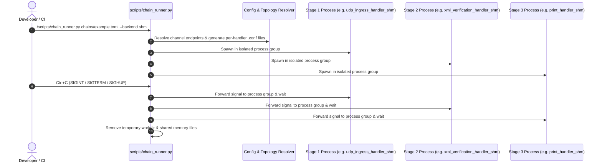

# 002: Declarative Multi-Process Pipeline Supervisor (`scripts/chain_runner.py`)

## 1. Overview & Problem Statement

### Why It's Needed
Because Proxy handlers are compiled as independent microservice executables (`<handler>_<backend>`), running a multi-stage pipeline across 3 to 6 processes manually required creating separate `.conf` files per process, matching socket/file/shared-memory paths between upstream outputs and downstream inputs, launching each binary in a separate terminal, and manually killing background processes and cleaning `/tmp` or `/dev/shm` artifacts on exit.

### The Solution
Implemented `scripts/chain_runner.py` (with modular helpers in `scripts/proxy_runner/`), an **automated multi-process pipeline supervisor**:
1. **Declarative `.toml` / `.json` Topologies (`chains/*.toml`)**: Defines the shared transport `backend`, global `config`, and the ordered list of `handlers` (`name`, `type`, `input_channel`, `output_channel`, and per-handler `config`).
2. **Runtime Backend Swapping (`--backend`)**: Resolves `<handler_type>_<backend>` binaries automatically from the build directory (`--bin-dir`) and generates matched temporary configuration files (`proxy.conf`) for `file`, `socket`, `uds`, `shm`, `sim`, and `vendor` backends.
3. **Process-Group Supervision & Clean Teardown**: Launches each handler in its own process group (`os.setsid`) and forwards `SIGINT`, `SIGTERM`, and `SIGHUP` across all active process groups via `os.killpg()`, removing temporary runtime directories on exit.

---

## 2. Architecture & How It Works

### 2.1 Multi-Process Supervision Lifecycle



---

## 3. Design Decisions

### 3.1 Transport-Agnostic Topology Files
- **Decision**: Allow `--backend <name>` on the CLI to override the `backend` field in a `.toml` chain file, automatically synthesizing channel paths (`/tmp/proxy_chain_*/...`) or loopback UDP ports.
- **Rationale**: A single topology definition can be tested across `file`, `socket`, `uds`, `shm`, and `sim` without duplicating `.toml` files.

---

## 4. Concrete Examples

### 4.1 Running a Chain Across Different Backends
```bash
# Run with the backend specified in the TOML file:
./scripts/chain_runner.py chains/example_file_chain.toml

# Override backend to Shared Memory at runtime:
./scripts/chain_runner.py chains/example_socket_chain.toml --backend shm

# Run with a custom binary directory:
./scripts/chain_runner.py chains/example_socket_chain.toml --bin-dir ./build/debug/bin
```

---

## 5. Tasks / Checklist

- [x] Implement TOML and JSON chain configuration parsing in `scripts/chain_runner.py`.
- [x] Implement dynamic binary discovery and per-handler `.conf` generation (`scripts/proxy_runner/config.py`).
- [x] Implement process-group signal forwarding (`SIGINT`, `SIGTERM`, `SIGHUP`) and temporary directory cleanup.
- [x] Integrate simulation mode (`--sim`, `--trace`) and live telemetry topology publishing (`--telemetry-url`).

