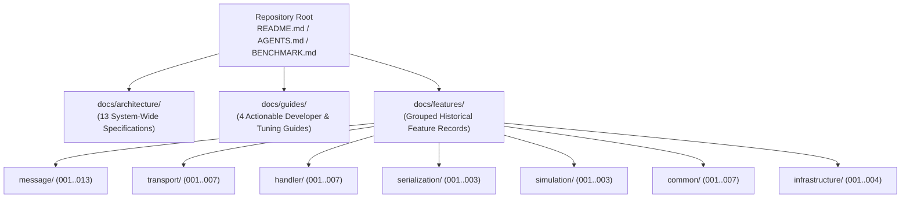

# 003: Comprehensive Documentation Architecture, Guides, & Repository `README.md`

## 1. Overview & Problem Statement

### Why It's Needed
In `58ccd9a` and `d7ccc34`, as the Proxy platform matured across 7 transport backends, 10 handlers, 4 concurrency execution strategies, trait-based serialization, deterministic PCAP simulation, and live StatsD telemetry, the project needed a structured documentation hierarchy (`AGENTS.md` Rule 11) so developers and AI agents could navigate both system-wide architectural invariants and chronological feature records.

### The Solution
Established a three-tier documentation structure under `docs/` alongside the root `README.md` and `BENCHMARK.md`:
1. **`docs/architecture/`**: 13 system-wide architectural specifications covering layer separation, transport channels, handler catalog, sidecar manifests, lock-free memory/queues, concurrency supervision, binary wire framing, PCAP simulation, control-plane telemetry, Catch2 testing, deterministic trace assertions, CMake/Conan/OCI packaging, and dynamic GitLab CI pipelines.
2. **`docs/guides/`**: 4 actionable developer guides (`developer-extension-guide.md`, `benchmark-suite-and-runner.md`, `tools-and-synthetic-traffic-generation.md`, `performance-tuning-and-profiling.md`).
3. **`docs/features/`**: Grouped historical feature records (`message/`, `transport/`, `handler/`, `serialization/`, `simulation/`, `common/`, `infrastructure/`) documenting the problem statement, Mermaid architecture diagrams, design decisions, concrete code examples, and task checklists for each engineering milestone.

---

## 2. Architecture & How It Works

### 2.1 Repository Documentation Hierarchy

---

## 3. Design Decisions

### 3.1 Relative Repository Paths Only (`AGENTS.md` Rule 11)
- **Decision**: Never use machine-specific absolute filesystem paths in markdown documentation; always use relative paths from the repository root (`core/include/...`, `docs/...`).
- **Rationale**: Keeps links portable across developer workstations, containers, and Git hosting UIs.

---

## 4. Tasks / Checklist

- [x] Author root `README.md` covering architecture, build presets, offline Conan bundles, orchestration scripts, and documentation index (`58ccd9a`).
- [x] Author `docs/architecture/*.md` and `docs/guides/*.md` (`58ccd9a`, `d7ccc34`).
- [x] Organize `docs/features/` into chronological domain groups (`message/`, `transport/`, `handler/`, `serialization/`, `simulation/`, `common/`, `infrastructure/`).

