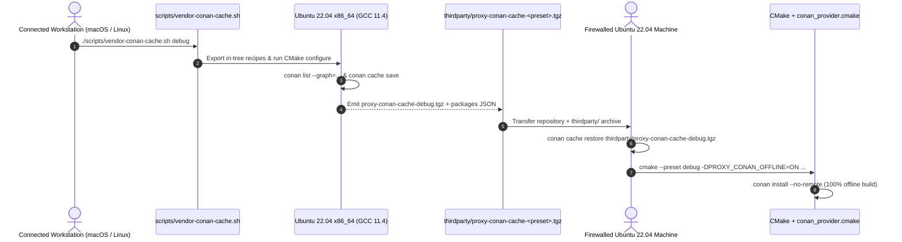

# 004: Offline Conan 2 Cache Bundles & Firewalled Build Support

## 1. Overview & Problem Statement

### Why It's Needed
In `614f842`, `cmake/conan_provider.cmake` normally resolves and downloads missing third-party packages from configured Conan remotes during CMake configuration. However, firewalled or air-gapped Linux development machines cannot reach external Conan remotes even when the Proxy source tree and its in-repository Conan recipes are present locally.

### The Solution
Implemented a reproducible offline Conan cache bundling and restoration workflow (`scripts/vendor-conan-cache.sh`, `profiles/conan/`, and `PROXY_CONAN_OFFLINE` in `cmake/conan_provider.cmake`):
1. **Graph-Scoped Cache Archiving (`scripts/vendor-conan-cache.sh`)**: Runs inside an Ubuntu 22.04 `x86_64` container (via Podman on macOS or natively on Linux) with GCC/G++ 11.4, exports all in-tree Conan recipes (`common`, `log`, `backend/*`, `core`), resolves the exact dependency graph for a selected CMake preset (`debug`, `release`, `debug-cpp17`, `release-cpp17`), and archives the package list using `conan cache save` into `thirdparty/proxy-conan-cache-<preset>.tgz`.
2. **Strict Offline Provider Mode (`PROXY_CONAN_OFFLINE=ON`)**: When `PROXY_CONAN_OFFLINE=ON` is passed to CMake, `cmake/conan_provider.cmake` appends `--no-remote` to `conan install`, guaranteeing that builds use only the restored local Conan cache and fail immediately if any artifact is missing rather than attempting network access.

---

## 2. Architecture & How It Works

### 2.1 Connected Bundling to Firewalled Offline Build Flow



---

## 3. Design Decisions

### 3.1 `conan cache save` / `conan cache restore` Over Raw Directory Tarballs
- **Decision**: Use Conan 2's built-in `conan list --graph` + `conan cache save` and `conan cache restore` commands.
- **Rationale**: Archives only the exact recipes, sources, and binary packages required by the selected CMake preset's dependency graph without bundling unrelated packages from the developer's cache or hardcoding host filesystem paths.

### 3.2 Pinned Target Profiles (`profiles/conan/ubuntu-x86_64-gcc-11*`)
- **Decision**: Provide explicit C++20 (`profiles/conan/ubuntu-x86_64-gcc-11`) and C++17 (`profiles/conan/ubuntu-x86_64-gcc-11-cpp17`) Conan profiles.
- **Rationale**: Ensures that the package IDs built inside the Ubuntu 22.04 container match the exact compiler, ABI, and `cppstd` settings used on the firewalled target machine.

---

## 4. Concrete Examples

### 4.1 Creating a Cache Bundle on a Connected Machine
```bash
# Initialize Podman VM on macOS (if needed) and bundle the debug preset:
podman machine start
./scripts/vendor-conan-cache.sh debug
```

### 4.2 Restoring and Building on a Firewalled Ubuntu 22.04 Machine
```bash
conan cache restore thirdparty/proxy-conan-cache-debug.tgz

cmake --preset debug --fresh \
  -DCMAKE_C_COMPILER=/usr/bin/gcc-11 \
  -DCMAKE_CXX_COMPILER=/usr/bin/g++-11 \
  -DCONAN_HOST_PROFILE="$PWD/profiles/conan/ubuntu-x86_64-gcc-11" \
  -DCONAN_BUILD_PROFILE="$PWD/profiles/conan/ubuntu-x86_64-gcc-11" \
  -DPROXY_CONAN_OFFLINE=ON

cmake --build --preset debug
```

---

## 5. Tasks / Checklist

- [x] Export in-repository Conan recipes before resolving the project dependency graph (`614f842`).
- [x] Save the selected graph's artifacts into `thirdparty/proxy-conan-cache-<preset>.tgz` via `scripts/vendor-conan-cache.sh` (`614f842`).
- [x] Add `PROXY_CONAN_OFFLINE` option to `cmake/conan_provider.cmake` passing `--no-remote` to `conan install` (`614f842`).
- [x] Pin `profiles/conan/ubuntu-x86_64-gcc-11` and `profiles/conan/ubuntu-x86_64-gcc-11-cpp17` profiles (`614f842`).

