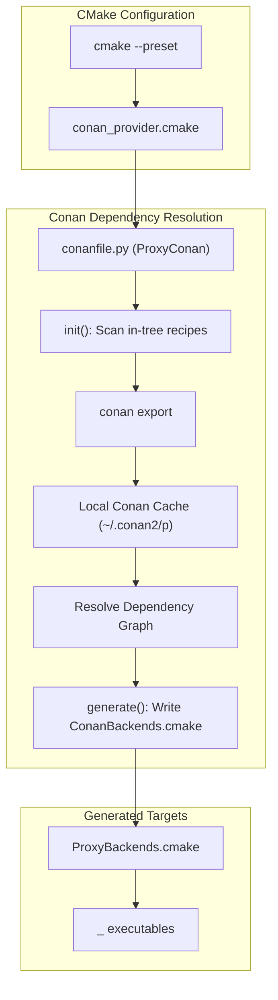

# 005: Automated In-Tree Conan Recipe Export and Zero-Touch Backend Discovery

## 1. Overview & Problem Statement

### Why It's Needed
In the previous setup, introducing a new backend (`backend/<name>`) or modifying an in-tree recipe required developers to run manual `conan export backend/<name>` commands before CMake could discover and build the backend targets.

If a developer omitted the `conan export` step:
- The backend did not exist in Conan's local cache graph.
- Conan failed to discover package properties (`proxy_component == "backend"`, `backend_name`).
- CMake's `ProxyBackends.cmake` did not receive the `proxy_register_conan_backend()` entry, leaving handler targets ungenerated despite metadata appearing in static manifests.

### The Solution
We automated in-tree recipe exports directly inside root `conanfile.py` (`ProxyConan.init()`):
1. **Zero-Touch In-Tree Discovery**: Whenever Conan runs (`conan install`, `conan graph`, or CMake configuration via `conan_provider.cmake`), `ProxyConan.init()` automatically discovers all in-tree recipes (`common`, `log`, `backend/interface`, `core`, and `backend/*`) and exports them into the local cache if present.
2. **Seamless Out-of-Tree Transition**: If a backend is migrated to an independent Git repository, removing `backend/<name>` causes `conanfile.py` to stop auto-exporting that directory and seamlessly resolve the package from a remote registry (e.g. Artifactory/Nexus) without modifying CMake build rules or developer commands.

---

## 2. Architecture & How It Works



### 2.1 The In-Tree Export Lifecycle
1. When CMake executes `conan install` via `conan_provider.cmake`, Conan instantiates `ProxyConan`.
2. `ProxyConan.init()` triggers before graph calculation.
3. The method discovers in-tree directories:
   - `common`
   - `log`
   - `backend/interface`
   - `core`
   - `backend/*`
4. Each discovered recipe is exported into the local cache (`conan export <path>`).
5. Conan builds its dependency graph, discovers all backend packages via `dep.cpp_info.get_property("proxy_component") == "backend"`, and generates `ConanBackends.cmake`.
6. `ProxyBackends.cmake` registers each backend and creates `<handler_name>_<backend>` executables for all registered handlers.

---

## 3. Design Decisions

### 3.1 Unmodified Upstream `conan_provider.cmake`
- **Decision**: Keep `cmake/conan_provider.cmake` strictly untouched as upstream vendor code.
- **Rationale**: Keeps the provider clean and upgradable, locating repository-specific in-tree packaging logic exclusively inside the root `conanfile.py`.

### 3.2 Topological Order for In-Tree Exports
- **Decision**: Export in order: `common` $\to$ `log` $\to$ `backend/interface` $\to$ `core` $\to$ `backend/*`.
- **Rationale**: Ensures downstream backends depending on `backend-interface` or `common` find their dependencies already exported when Conan parses local package trees.

---

## 4. Concrete Examples

### 4.1 Developer Workflow for Adding a Backend
A developer now only needs to:
1. Create `backend/<name>/` with `CMakeLists.txt` and `conanfile.py`.
2. Declare the dependency in root `conanfile.py`.
3. Run standard CMake:
```bash
cmake --preset debug
cmake --build --preset debug
```
No manual `conan export` commands are required.

---

## 5. Tasks / Checklist

- [x] Implement in-tree recipe discovery and export in `conanfile.py` `ProxyConan.init()`.
- [x] Ensure export gracefully logs warnings rather than crashing if an optional recipe is absent.
- [x] Verify fresh configure and target compilation with GCC 16 toolchain.
- [x] Update `docs/guides/developer-extension-guide.md` with streamlined developer instructions.
- [x] Create architectural feature document `docs/features/infrastructure/005-infrastructure-automated-in-tree-conan-recipe-export.md`.

