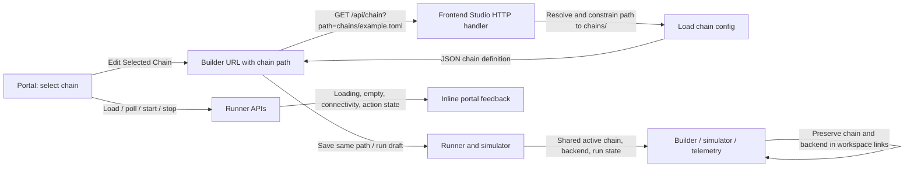

# Unified Studio Chain Handoff and Feedback

## Overview & Problem Statement

Proxy provides a portal, visual builder, simulator, and telemetry dashboard, but moving from selecting a chain in the portal to editing it in the builder was not a direct workflow. In addition, the portal could leave users with blank selectors or stale status when requests failed, and action failures were shown in browser alerts rather than in the control surface.

This change makes the portal's chain selection actionable and makes request state visible where users need it. A selected chain can be opened in the builder, saved to its existing path, run in simulation, and carried through workspace navigation. A shared status summary reports the active chain, backend, and runner state in each workspace. The server constrains chain reads and writes to `chains/`. Portal data loading, runner connectivity, and start/stop outcomes are surfaced inline with retry actions.

## Architecture & How It Works



The optional `chain` query parameter preserves the existing builder behavior when absent. When present, it is parsed and decoded on the server, then resolved relative to the project root. The API rejects absolute paths and paths that resolve outside `chains/`; missing files and invalid configurations return explicit client errors.

## Design Decisions

- **Reuse the current portal and builder:** the workflow change does not add a new app shell or frontend dependency.
- **Pass a repository-relative chain path:** this keeps links understandable and avoids exposing local absolute paths to the browser.
- **Constrain file operations server-side:** requested reads and saves must resolve beneath the configured `chains/` directory, rather than trusting a client-provided path.
- **Use the runner as the active state source:** the shared workspace summary queries the existing runner status API; session storage carries the selected chain and backend across links.
- **Keep feedback in the page:** inline messages preserve context and allow users to retry without dismissing browser dialogs.
- **Keep the chain parameter optional:** existing `/builder/` links and builder-created workflows continue to work.

## Concrete Example

From the portal, choose `chains/example_file_chain.toml` and select **Edit Selected Chain**. The browser navigates to a URL equivalent to:

```text
/builder/?chain=chains%2Fexample_file_chain.toml
```

The builder then requests:

```text
GET /api/chain?path=chains%2Fexample_file_chain.toml
```

Requests such as `?path=../../outside.toml` are rejected rather than loading files outside the chain directory.

## Tasks / Checklist

- [x] Add a portal-to-builder action for the currently selected chain.
- [x] Add visible loading, empty, connection, and action feedback to the portal.
- [x] Load an explicitly requested chain when initializing the builder.
- [x] Constrain chain-file loading to `chains/` and cover the API behavior with tests.
- [x] Continue the chain context through save, run, simulation, and telemetry workflows.
- [x] Show the active chain, backend, and runner state across workspaces.
- [ ] Add broader browser-level checks for keyboard and assistive-technology feedback.
