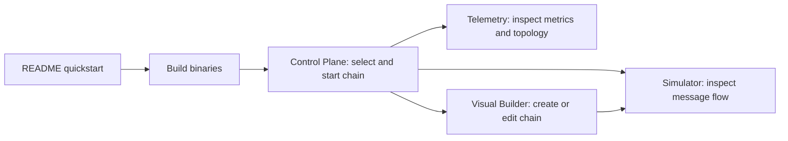

# First-Pipeline Quickstart and Guided Empty States

## Overview & Problem Statement

The project has capable orchestration and diagnostic tools, but a new user must connect build instructions, the portal, a sample chain, and the simulator without one short end-to-end entry point. Empty states also vary: some explain the next action, while others leave users to infer how to make data appear.

This feature adds a copyable first-pipeline path to the README, clarifies how the four workspaces fit together, and adds next-step guidance to empty chain, PCAP, builder, simulation, and telemetry views.

## Architecture & How It Works



The quickstart uses the existing `debug` CMake preset and `frontend_runner.py`. The portal's chain runner starts `example_file_chain.toml` using the `sim` backend, so the user can inspect generated messages without a PCAP file. In-product hints distinguish an empty workspace from a running pipeline that has not emitted data.

## Design Decisions

- **Use the existing demo chain and preset:** no tutorial-only fixture, dependency, or new build path is introduced.
- **Keep the guide linear and copyable:** build, start the web app, run the example, inspect, then stop.
- **Explain what each workspace is for:** the portal is the workflow entry point, the builder edits topology, the simulator inspects execution, and telemetry monitors production-style metrics.
- **Make empty states contextual:** recommend a generator for a blank builder, traffic for an ingress-only chain, a chain for an empty simulator, and starting the runner for telemetry with no topology.
- **Avoid claiming telemetry always contains useful rates:** the dashboard may have no metrics until handlers emit messages and publish data.

## Concrete Example

```bash
cmake --preset debug
cmake --build --preset debug
./scripts/frontend_runner.py --open portal
```

In the portal, choose `example_file_chain.toml`, keep the backend set to `sim`, and start the chain. The Simulator opens with that run; use Step or Play. The Control Plane can stop the run, and Live Telemetry displays topology and metrics as they become available.

## Tasks / Checklist

- [x] Add first-pipeline instructions to the README and its table of contents.
- [x] Add a short workflow map to the Control Plane.
- [x] Add next-step guidance for empty chain and PCAP lists.
- [x] Add a one-click generator starter to the empty builder canvas.
- [x] Distinguish unloaded simulation, generator-driven, and ingress-driven empty states.
- [x] Explain how to start telemetry from the Control Plane.
- [x] Restore the missing topology visibility helper needed to render telemetry disconnected/empty states.
- [x] Validate the documented command and render the updated empty states.
