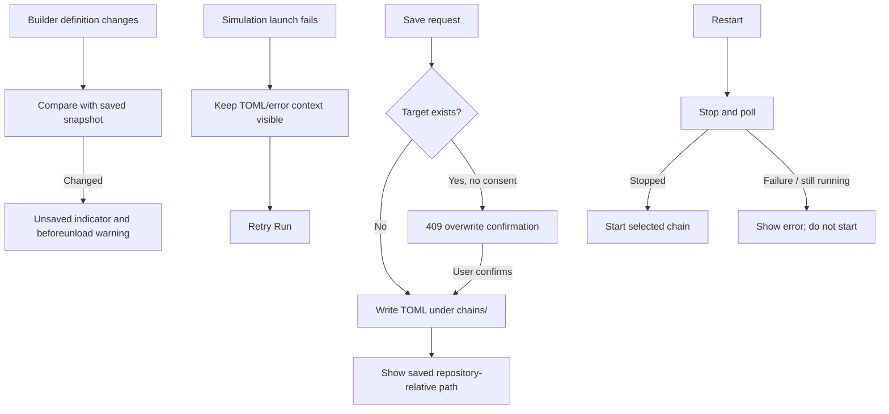

# Safe Builder Save and Run Recovery

## Overview & Problem Statement

Pipeline edits are valuable work, but the builder did not indicate unsaved changes or warn before navigation. Save failures closed the dialog and used browser alerts, and writing a chain could silently replace an existing file. Runner restart also proceeded after a stop request without checking the resulting state.

This feature protects edits and makes save/run recovery actionable. It adds a dirty-state indicator and unload warning, preserves the save dialog on errors, requires explicit consent before overwriting, displays the saved path, and retries failed simulation launches from the existing error viewer. Restart proceeds only after stop succeeds and the runner no longer reports itself running.

## Architecture & How It Works

The builder snapshots its normalized chain definition after initial load and successful save. Save errors remain in the modal, and a 409 response reveals an overwrite acknowledgement. The server requires the acknowledgement itself, so the protection is not only a client-side prompt.

## Design Decisions

- **Compare definitions, not event flags:** snapshot comparison catches edits made by every control without manually maintaining dirty flags.
- **Use the browser's native unload warning:** it is the reliable safeguard for links and browser close/reload; browser text remains user-agent controlled.
- **Require server-side overwrite acknowledgement:** user confirmation is explicit and API callers cannot silently overwrite a target.
- **Keep operation context in place:** save errors remain beside the chosen filename; run errors retain generated TOML and offer a retry.
- **Restart sequentially:** starting is blocked if the stop API fails or a status poll still says the process is running.

## Concrete Example

After editing a loaded chain, the builder shows **Unsaved changes**. Navigating away prompts for confirmation. Selecting **Save Chain** for an existing file requires checking an acknowledgement naming the path. On a new path that already exists, the server first returns a conflict; the modal then asks for overwrite confirmation. Once saved, it reports a repository-relative path such as `chains/example_file_chain.toml`.

If simulation startup fails, the generated TOML and error stay visible. **Retry Run** submits the current definition again without rebuilding it manually.

## Tasks / Checklist

- [x] Track edits against the last loaded or saved chain snapshot.
- [x] Show an unsaved indicator and warn before discarding builder edits.
- [x] Preserve the save modal and show actionable failures in place.
- [x] Require explicit overwrite consent in the UI and API.
- [x] Report saved chain locations.
- [x] Keep failed simulation context and offer retry.
- [x] Stop restart flow when stop fails or the runner remains active.
- [x] Verify save conflict/consent, dirty state, and run retry behavior in the UI and API.
- [x] Verify restart only continues after a successful stop/status check.
