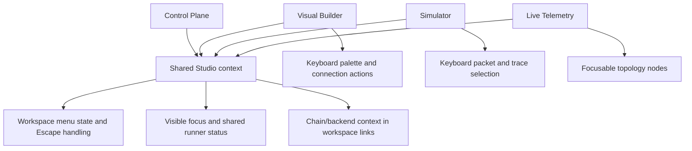

# Unified Studio Interaction and Accessibility

## Overview and problem statement

The Control Plane, Visual Builder, Simulator, and Live Telemetry dashboard are parts of one workflow, but their interaction details had evolved independently. Workspace menus did not expose their expanded state or a consistent Escape behavior, the shared runner banner lacked a common focus and small-screen treatment, and several important actions were clickable `div` elements or icon-only buttons. On narrow screens the portal's fixed-width workspace cards also caused horizontal scrolling.

This phase makes the common navigation and operation state predictable, ensures primary editing and inspection paths work from the keyboard, and keeps the existing visual system and JavaScript framework. It does not claim full WCAG conformance; a formal assistive-technology audit remains an appropriate follow-up if the product adopts that requirement.

## Architecture and how it works

The existing shared Studio context script remains the common integration point. It continues propagating the selected chain/backend and runner state, and now also establishes shared focus and menu behavior. Workspace-specific markup contributes native controls where possible; specialized canvas/trace interactions expose keyboard semantics directly.



The shared context owns workspace-menu toggling, synchronizes `aria-expanded` with the open state, closes the open menu on Escape, and returns focus to its trigger. Its status region uses `role="status"` and polite live updates, and only changes its text when the reported state changes.

## Design decisions

- **Use native buttons for primary actions.** Builder palette entries and packet/batch selection cards now receive built-in Tab, Enter, and Space behavior without changing their click or drag actions.
- **Keep specialized interactions local.** SVG builder wires and the simulation trace tree need custom keyboard handling; they expose button semantics, focus targets, and accessible names without introducing a component layer.
- **Keep status and navigation in the shared script.** This avoids four independent implementations drifting in wording, state announcements, focus treatment, and menu keyboard behavior.
- **Use explicit accessible names for icon controls.** Tooltips remain helpful for pointer users, but no longer serve as the only description for controls whose visible text is hidden at narrow widths.
- **Limit responsive changes to measured issues.** The portal grid and action group now fit narrow viewports, and the Builder/Simulator declare a mobile viewport. No redesign or layout framework was introduced.
- **Preserve runtime behavior.** Existing click handlers, workspace URLs, runner operations, and menu visual styling remain in place.

## Concrete examples

The shared context gives the menu trigger an explicit relationship and state:

```html
<button aria-label="Switch workspace: Visual Builder"
        aria-controls="studio-workspace-menu"
        aria-expanded="false">
  ...
</button>
```

Palette entries are native, named controls while retaining drag support:

```html
<button type="button" class="palette-card" draggable="true"
        aria-label="Add Dummy Generator">
  ...
</button>
```

At narrow widths, the portal uses a single flexible card column and wraps runner actions rather than allowing fixed-width overflow.

## Tasks / checklist

- [x] Add shared visible focus, live runner status, and workspace menu state synchronization.
- [x] Support Escape-to-close and return focus for workspace menus.
- [x] Convert builder palette entries and simulator packet/batch selection items to native buttons.
- [x] Add keyboard selection to trace rows, subtraces, and builder wire actions.
- [x] Add explicit accessible names to icon-only workspace actions.
- [x] Declare mobile viewport sizing and eliminate portal overflow at a 375 px viewport.
- [x] Manually verify workspace menus, focus return, palette keyboard toggling, and responsive dimensions in the browser.
