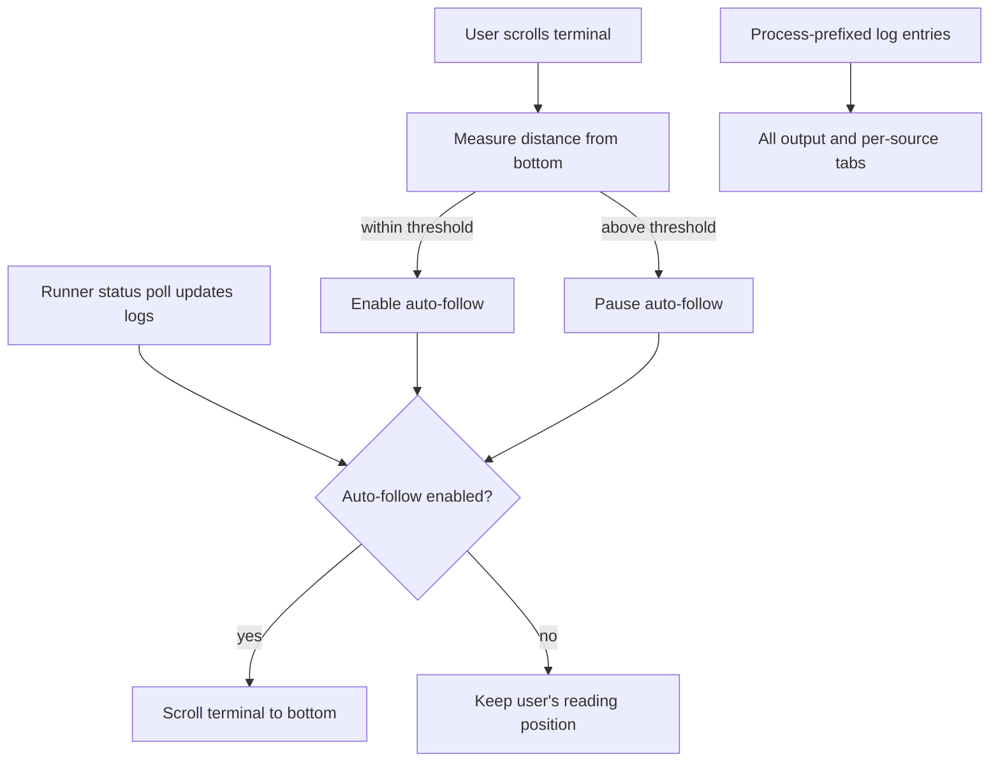

# Terminal Output Scrolling and Readability

## Overview and problem statement

The Control Plane terminal showed runner and handler output in a dense, unstructured block. Long paths could break at arbitrary characters, severity was conveyed only by text color, and polling new logs continuously moved the viewport to the bottom. That made it difficult to inspect earlier output while a chain remained active.

This update improves log readability and makes following live output conditional on the user's scroll position. Scrolling away from the bottom pauses auto-follow; returning to the bottom resumes it.

The output can also be viewed as one combined stream or filtered into tabs by process/source prefix, such as `sender_1`, `receiver_1`, `ChainRunner`, and `FrontendRunner`.

## Architecture and how it works

The portal's existing Petite Vue state remains the source of truth for the Auto-scroll checkbox. The terminal scroll event measures the distance to the bottom, toggling auto-follow off when the user leaves the live edge and on again when they return within a small threshold. The existing status polling only scrolls after replacing logs when auto-follow is enabled.

Each log remains a separate text-only line. The line text is bound without template indentation, avoiding whitespace that would otherwise be preserved in the terminal. Rows use tight terminal-like line spacing with no card padding, margins, or severity rails; a subtle hover background is retained. Long paths wrap within the panel with a consistent left inset and right breathing room; severity continues to use the existing log text colors.

The process tabs are derived from the first bracketed prefix on each log line. The All output tab remains available at all times. Tabs expose selected state and support Left/Right Arrow plus Home/End navigation; counts show how many lines each stream currently contains.

## Design decisions

- **Use the bottom edge as the follow toggle.** This matches familiar log viewers and avoids requiring a second explicit resume action.
- **Keep the existing checkbox.** Users can still manually pause or resume scrolling, and the control accurately reflects scrolling away from or back to the bottom.
- **Retain plain log text.** No parsing, truncation, or HTML interpretation is added; the runner's output remains intact.
- **Prefer wrapping over horizontal scrolling.** Long filesystem paths and messages remain visible in the fixed-height panel.
- **Keep the output visually terminal-like.** Log rows are compact, flush to a small consistent inset, and free of card-style decoration.
- **Derive stream tabs from existing log prefixes.** No server/API changes or assumptions about a fixed process list are needed.

## Concrete behavior

1. Auto-scroll starts enabled.
2. Scrolling upward changes the checkbox to off; new log polls do not move the viewport.
3. Scrolling back to the bottom changes the checkbox to on; subsequent updates follow the latest output.
4. Manually enabling Auto-scroll immediately moves to the newest log line.
5. **All output** shows every stream; selecting a process tab filters output to that source. Arrow keys move between tabs.

## Tasks / checklist

- [x] Remove template whitespace and use compact terminal-like line spacing.
- [x] Keep long log lines inside the terminal's left and right content bounds.
- [x] Disable auto-follow when the user scrolls away from the bottom.
- [x] Resume auto-follow when the user returns to the bottom.
- [x] Make manually enabling Auto-scroll jump to the latest output.
- [x] Restore subtle line hover feedback.
- [x] Add an All output tab and tabs for each detected log source, with keyboard navigation.
- [x] Verify pause/resume behavior in the browser with live log updates.
- [x] Verify source counts, filtering, and arrow-key tab selection with mixed-process output.
