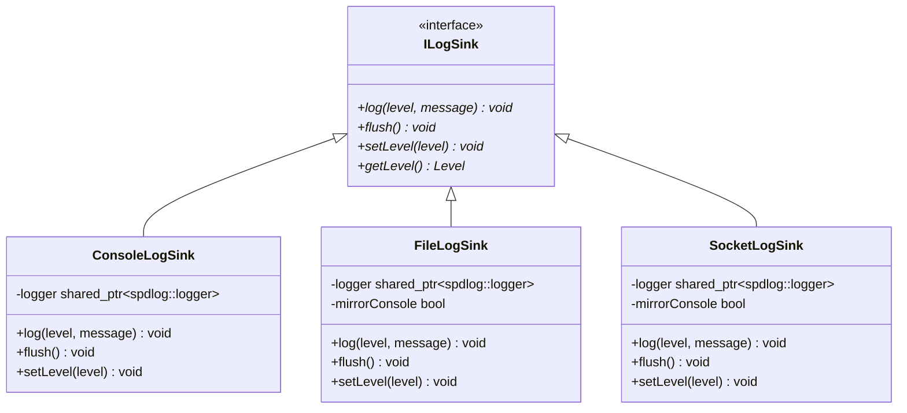

# Logging Subsystem & Sinks (`proxylog`)

## 1. Overview & Problem Statement

### Why It's Needed
In low-latency proxy environments, logging requires strict trade-offs:
- **Hot-Path Formatting Overhead**: Constructing log strings (allocating strings, formatting integers/timestamps) when the log level is disabled wastes CPU cycles on critical packet-routing paths.
- **Lock Contention**: Standard console output (`std::cout` / `printf`) uses global locks that stall concurrent worker threads.
- **Distributed Auditing**: In production multi-process clusters, writing log files locally to disk can saturate storage I/O. Operators often require streaming log events over UDP datagrams to centralized logging aggregators (e.g. Logstash, Fluentd) with optional console mirroring.

### The Solution
`log/` (`proxylog`) is an abstract universal logging library encapsulating `spdlog`. It exposes:
1. **Lock-Free Fast-Path Checks (`shouldLog`)**: Formatted log statements skip `fmt::format` evaluations completely if the severity level is below the sink threshold.
2. **Abstract Sink Interface (`ILogSink`)**: Handlers log against `Proxy::Log::{trace, debug, info, warn, error, critical}` without knowing whether messages are routed to stdout, a disk file, or a network UDP socket.
3. **Pluggable Sink Implementations**: Pre-built sinks for `ConsoleLogSink`, `FileLogSink`, and `SocketLogSink`.

---

## 2. Architecture & Sink Implementations



### Sink Implementations:
1. **`ConsoleLogSink`**: Emits formatted, colorized log statements directly to stdout / stderr.
2. **`FileLogSink`**: Wraps `spdlog::sinks::basic_file_sink_mt` for multi-threaded thread-safe disk writing with optional console mirroring.
3. **`SocketLogSink`**: Wraps `spdlog::sinks::udp_sink_mt` to transmit log records as UDP datagrams to remote log collectors, avoiding local disk I/O stalls.

---

## 3. High-Level Design Decisions

1. **Non-Allocating Severity Checks**:
   - The log macros use compile-time template expansion coupled with an inline `shouldLog(level)` check:
     ```cpp
     template <typename... Args>
     inline void info(fmt::format_string<Args...> fmtStr, Args&&... args)
     {
         if (shouldLog(Level::Info)) {
             logMessage(Level::Info, fmt::format(fmtStr, std::forward<Args>(args)...));
         }
     }
     ```
   - When the global level is set to `Warn`, calling `Proxy::Log::info(...)` evaluates an atomic integer comparison and immediately returns without executing string formatting or heap allocations.
2. **Automatic Backend Sink Initialization**:
   - Transports configure logging automatically in `configure()`:
     - `FileBackend` initializes `FileLogSink` pointing to configured log directory paths.
     - `SocketBackend` initializes `SocketLogSink` pointing to configured log host and port.

---

## 4. Concrete Examples

### Example: Logging from C++ Code
```cpp
#include "log/Log.hpp"

// Simple string view logging:
Proxy::Log::info("Pipeline handler initialized successfully");

// Formatted logging with variables:
std::string channel = "orders_raw";
uint64_t packetCount = 1048576;
double avgLatencyUs = 0.85;

Proxy::Log::debug("Channel '{}' processed {} packets (avg latency: {:.2f} µs)",
                  channel, packetCount, avgLatencyUs);

// Error logging:
Proxy::Log::error("Failed to parse incoming XML: Malformed root tag at line 42");
```

### Example: Initializing Custom Sinks at Startup
```cpp
#include "log/Log.hpp"
#include "log/FileLogSink.hpp"
#include "log/SocketLogSink.hpp"

// Option 1: File logging with console mirroring
auto fileSink = std::make_unique<Proxy::Log::FileLogSink>("/var/log/proxy.log", /*mirrorConsole=*/true);
Proxy::Log::init(std::move(fileSink));

// Option 2: Remote UDP syslog export
auto socketSink = std::make_unique<Proxy::Log::SocketLogSink>("10.0.0.100", 5140, /*mirrorConsole=*/false);
Proxy::Log::init(std::move(socketSink));
```

---

## 5. Tasks / Checklist
- [x] Define abstract `ILogSink` interface and severity `Level` enum
- [x] Implement zero-allocation `shouldLog` fast-path check
- [x] Implement `ConsoleLogSink` wrapping `spdlog::stdout_color_mt`
- [x] Implement `FileLogSink` with optional console mirroring
- [x] Implement `SocketLogSink` transmitting datagrams over UDP
- [x] Integrate Conan recipe for `proxylog` packaging

