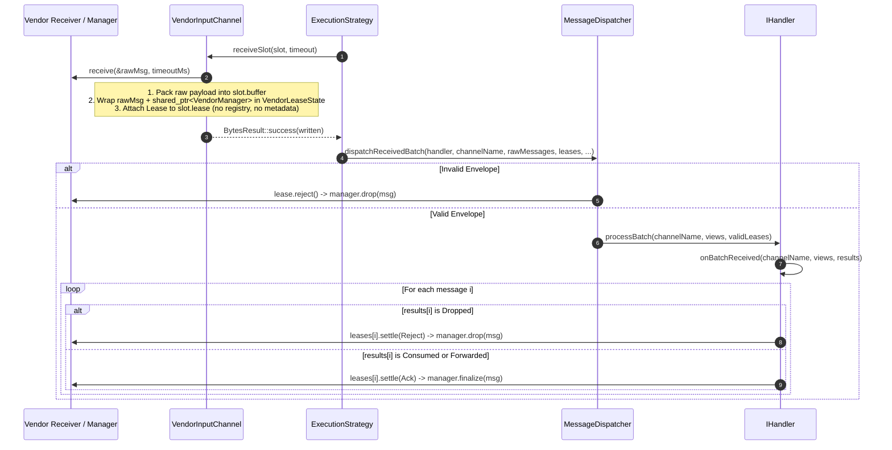
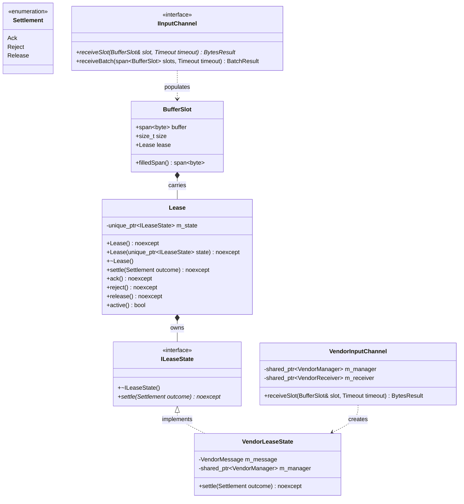

# Out-of-Band Message Ownership & Lease Settlement

## 1. Overview & Problem Statement

### Why It's Needed
In standard Proxy transports (`backend/file`, `backend/socket`, `backend/shm`, `backend/uds`, `backend/inproc`, `backend/sim`), the transport copies incoming bytes into caller-owned memory buffers and immediately releases any underlying kernel or ring-buffer resources. However, when integrating 3rd-party vendor SDKs (`backend/vendor`) or broker-based transports, the message object is owned by the external API and must be explicitly finalized or dropped after processing completes.

The initial `backend/vendor` prototype coupled message ownership to the wire payload by:
1. Caching `ScopedVendorMessage` in a central `std::unordered_map<uint64_t, ScopedVendorMessage>` protected by a mutex in `VendorBackend`.
2. Embedding `VendorMetadata { uint64_t messageId }` inside the `MessageEnvelope` metadata section.
3. Re-parsing the raw message envelope inside `VendorBackend::onMessageResult()` (a hook originally designed for simulation tracing) to extract `messageId`, look up the cached `ScopedVendorMessage`, and invoke `finalize()` or `drop()`.

This in-band correlation and central registry approach introduced several architectural weaknesses:
- **In-Band Lifecycle Coupling**: Any envelope decode failure, payload/metadata rewrite, or cross-transport message forwarding could silently lose the correlation ID, leaking the message in `m_inFlightMessages` until shutdown or misinterpreting arbitrary 8-byte metadata as a `VendorMetadata` ID.
- **Unnecessary Registry & Mutex Contention**: `VendorInputChannel::receiveInto()` locked the backend registry multiple times per message (register, unregister to read payload, re-register) and maintained an unbounded hash map shared across all channels.
- **Duplicate ID Collisions**: Using `emplace` on an existing `messageId` destroyed the newly constructed `ScopedVendorMessage`, immediately dropping the redelivered message while leaving the stale entry in the map.
- **Channel-to-Backend Lifetime Coupling**: `VendorInputChannel` held a raw `VendorBackend&` reference solely to access the central in-flight registry.
- **Conflating Tracing with Settlement**: Overloading `IBackend::onMessageResult()` tied transport settlement to simulation tracing callbacks and prevented clean RAII lifecycle management across execution strategies (`SimpleExecutionStrategy`, `SequentialStrategy`, `DedicatedThreadStrategy`, `ThreadPoolStrategy`).

### The Solution
Introduce an out-of-band, zero-registry ownership model centered around **`Backend::Lease`**:
1. **Direct RAII Ownership (`Backend::Lease` & `Backend::ILeaseState`)**: A move-only `Lease` travels *next to* the message buffer (`BufferSlot::lease` and `MessageTask`), never inside the wire bytes. The `ILeaseState` implementation (`VendorLeaseState`) directly owns the `Sdk::VendorMessage` and `std::shared_ptr<Sdk::VendorManager>`, eliminating the central `m_inFlightMessages` map, mutex, and `VendorMetadata` wire header.
2. **Guaranteed Settlement (`Backend::Settlement`)**: A `Lease` settles its owned message at most once with `Settlement::Ack` (finalize), `Settlement::Reject` (drop), or `Settlement::Release` (unprocessed / return for redelivery). If a `Lease` is destroyed without explicit settlement (e.g. exception, early return, or queue drain on shutdown), its destructor automatically settles with `Settlement::Release`.
3. **Zero Impact on Buffer-Owning Backends**: `IInputChannel::receiveSlot(BufferSlot&, Timeout)` is the single authoritative reception primitive, replacing `receiveInto()` and `receive()`. Buffer-owning backends populate `slot.buffer` and `slot.size` while leaving `slot.lease` empty. An empty `Lease` is a single `nullptr` (`std::unique_ptr<ILeaseState>`) whose operations are no-ops, preserving zero-allocation, zero-overhead behavior for all existing backends.

---

## 2. Architecture & How It Works

### 2.1 End-to-End Lease Data Flow



### 2.2 Class Relationships



---

## 3. Design Decisions

### 3.1 Lease Owns the Message (No In-Flight Registry)
- **Decision**: Embed `Sdk::VendorMessage` and `std::shared_ptr<Sdk::VendorManager>` directly inside `VendorLeaseState : public Backend::ILeaseState`, owned by `Backend::Lease`.
- **Rationale**:
  - **Correct by Construction**: Every leased message has a single owner and is settled exactly once when `Lease::settle()` or `~Lease()` runs. There is no map lookup that can fail, no duplicate-key collision, and no possibility of orphaned registry entries.
  - **Decoupled Lifetimes**: Because `VendorLeaseState` holds `std::shared_ptr<Sdk::VendorManager>`, in-flight messages do not hold raw references to `VendorInputChannel` or `VendorBackend`.
  - **Higher Throughput**: Eliminates two mutex acquisitions and two hash-table operations per message. Benchmarks show a single `std::make_unique<VendorLeaseState>` (~15 ns overhead) outperforms mutex-guarded `std::unordered_map` insertion and extraction.

### 3.2 `BufferSlot::lease` and `IInputChannel::receiveSlot()`
- **Decision**: Extend `Backend::BufferSlot` with a `Backend::Lease lease` field and replace `IInputChannel::receiveInto()` and `IInputChannel::receive()` with `virtual BytesResult IInputChannel::receiveSlot(BufferSlot& slot, Timeout timeout) = 0`.
- **Rationale**:
  - **Eliminates Lease-Discarding Reception**: Because every single-message and batched receive call takes a `BufferSlot&`, it is impossible to invoke an `IInputChannel` method that silently drops or orphans a `Lease`.
  - **Unified Batch Polling**: `IInputChannel::receiveBatch()` calls `receiveSlot(slots[i], ...)` by default, so `VendorInputChannel` supports both single-slot polling (`SimpleExecutionStrategy`) and batched polling (`SequentialStrategy`, `DedicatedThreadStrategy`, `ThreadPoolStrategy`) through a single `receiveSlot()` implementation.

### 3.3 Thread-Pool Propagation via `MessageTask`
- **Decision**: Store a `Backend::Lease` inside `Core::Threading::MessageTask` and move it from `BufferSlot::lease` when enqueuing tasks into SPSC or MPMC worker queues in `ThreadPoolStrategy`.
- **Rationale**:
  - Preserves the exact same settlement semantics regardless of whether a handler runs on a single thread (`SimpleExecutionStrategy`, `SequentialStrategy`), per-channel threads (`DedicatedThreadStrategy`), or decoupled worker pool threads (`ThreadPoolStrategy`).
  - If a queue drains or is destroyed during shutdown before a worker processes a task, `MessageTask`'s destructor destroys the `Lease`, automatically settling the message with `Settlement::Release`.

### 3.4 Pure Wire Envelopes & Egress Payload Extraction
- **Decision**: Remove `VendorMetadata` from the wire envelope in `VendorInputChannel` (packing `ProtocolId::Raw` with empty metadata), and update `VendorOutputChannel::send()` to unwrap `MessageView::from(message)` when an enveloped frame is passed, transmitting only the application payload bytes to `Sdk::VendorSender`.
- **Rationale**:
  - Wire frames carry application data and transport protocol metadata (`UdpMetadata`), never internal memory-management handles.
  - Handlers forwarding messages to `VendorOutputChannel` no longer leak the 18-byte `EnvelopeHeader` into the 3rd-party vendor SDK.

### 3.5 Separation of `onMessageResult()` Tracing from Transport Settlement
- **Decision**: Revert `VendorBackend::tracksMessageResults()` / `onMessageResult()` to their default no-op behavior in `IBackend`, keeping `onMessageResult()` strictly for `SimulationBackend` tracing. Settlement is performed unconditionally at the end of `IHandler::processBatch()` and on malformed-envelope rejection in `MessageDispatcher::dispatchReceivedBatch()`.
- **Rationale**: Keeps simulation observability orthogonal to transport resource management.

---

## 4. Concrete Examples

### 4.1 Vendor Lease State (`backend/vendor/src/VendorLeaseState.hpp` & `.cpp`)

```cpp
// backend/vendor/src/VendorLeaseState.hpp
#pragma once

#include "backend/ILeaseState.hpp"
#include "backend/vendor/VendorSdkStub.hpp"
#include <memory>

namespace Backend::Vendor {

class VendorLeaseState final : public ::Backend::ILeaseState {
public:
    VendorLeaseState(
        Sdk::VendorMessage message,
        std::shared_ptr<Sdk::VendorManager> manager) noexcept;

    ~VendorLeaseState() override = default;

    void settle(::Backend::Settlement outcome) noexcept override;

private:
    Sdk::VendorMessage m_message;
    std::shared_ptr<Sdk::VendorManager> m_manager;
};

} // namespace Backend::Vendor
```

### 4.2 Ingress Channel (`backend/vendor/src/VendorInputChannel.cpp`)

```cpp
::Backend::BytesResult VendorInputChannel::receiveSlot(
    ::Backend::BufferSlot& slot,
    Timeout timeout)
{
    slot.size = 0;
    slot.lease.release();

    if (!m_receiver) {
        return ::Backend::BytesResult::failure(::Backend::ReceiveClosed {});
    }

    if (!m_manager) {
        Proxy::Log::error("[VendorInputChannel] VendorManager not initialized");
        return ::Backend::BytesResult::failure(::Backend::ReceiveFailure {});
    }

    Sdk::VendorMessage rawMsg;
    if (!m_receiver->receive(&rawMsg, static_cast<int>(timeout.count()))) {
        return ::Backend::BytesResult::failure(::Backend::ReceiveTimeout {});
    }

    const std::string payload = rawMsg.getPayload();
    const std::size_t written = ::Backend::MessageEnvelope::packInto(
        slot.buffer,
        ::Backend::ProtocolId::Raw,
        Common::Compat::span<const std::byte> {},
        Common::Memory::ByteView(payload));

    if (written == 0) {
        Proxy::Log::error("[VendorInputChannel] Destination buffer too small for message ID {}", rawMsg.getId());
        m_manager->drop(rawMsg);
        return ::Backend::BytesResult::failure(::Backend::ReceiveFailure {});
    }

    slot.size = written;
    slot.lease = ::Backend::Lease(std::make_unique<VendorLeaseState>(std::move(rawMsg), m_manager));
    return ::Backend::BytesResult::success(written);
}
```

### 4.3 Handler Batch Settlement (`core/src/handler/IHandler.cpp`)

```cpp
void IHandler::processBatch(
    std::string_view channelName,
    Common::Compat::span<const Backend::MessageView> messages,
    Common::Compat::span<::Backend::Lease> leases)
{
    // ... latency telemetry & onBatchReceived(channelName, messages, resultsSpan) ...

    if (m_backend.tracksMessageResults()) {
        for (std::size_t i = 0; i < messages.size(); ++i) {
            m_backend.onMessageResult(channelName, messages[i].rawBuffer(), resultsSpan[i]);
        }
    }

    const auto settleCount = std::min(leases.size(), messages.size());
    for (std::size_t i = 0; i < settleCount; ++i) {
        leases[i].settle(
            resultsSpan[i].is<::Backend::Dropped>()
                ? ::Backend::Settlement::Reject
                : ::Backend::Settlement::Ack);
    }
}
```

---

## 5. Tasks / Checklist

- [x] **1. Feature Documentation**
  - [x] Create `docs/features/message-lease-ownership.md` documenting problem statement, architecture, diagrams, design decisions, examples, and task checklist.
- [x] **2. Backend Interface Lease Primitives (`backend/interface`)**
  - [x] Add `Backend::Settlement` enum (`backend/interface/include/backend/Settlement.hpp`).
  - [x] Add `Backend::ILeaseState` interface (`backend/interface/include/backend/ILeaseState.hpp`).
  - [x] Add `Backend::Lease` RAII class (`backend/interface/include/backend/Lease.hpp` and `backend/interface/src/Lease.cpp`).
  - [x] Extend `Backend::BufferSlot` with `Backend::Lease lease` (`backend/interface/include/backend/BufferSlot.hpp`).
  - [x] Add `IInputChannel::receiveSlot(BufferSlot&, Timeout)` and update `IInputChannel::receiveBatch()` to delegate to `receiveSlot()`.
- [x] **3. Core Dispatch & Execution Strategy Integration (`core`)**
  - [x] Update `IHandler::processBatch()` to accept `Common::Compat::span<::Backend::Lease>` and settle each lease based on `MessageResult`.
  - [x] Update `MessageDispatcher::dispatchReceivedBatch()` to reject leases on malformed envelopes and forward valid leases to `IHandler::processBatch()`.
  - [x] Update `SimpleExecutionStrategy`, `SequentialStrategy`, and `DedicatedThreadStrategy` to pass slot leases into `dispatchReceivedBatch()`.
  - [x] Extend `MessageTask` and `ThreadPoolStrategy` to carry `Backend::Lease` across worker queues and settle on worker completion.
- [x] **4. Refactor Vendor Backend (`backend/vendor`)**
  - [x] Create `VendorLeaseState` in `backend/vendor/src/VendorLeaseState.hpp` and `backend/vendor/src/VendorLeaseState.cpp`.
  - [x] Refactor `VendorInputChannel` to override `receiveSlot()` and attach `VendorLeaseState` without in-band `VendorMetadata` or backend registry calls.
  - [x] Refactor `VendorBackend` to remove `m_inFlightMessages`, `m_mutex`, `registerInFlight()`, `unregisterInFlight()`, and `onMessageResult()`.
  - [x] Remove obsolete `VendorMetadata.hpp` and `ScopedVendorMessage.hpp`, and move `VendorSdkStub` non-trivial logic or keep clean declaration/implementation separation per project rules.
  - [x] Update `VendorOutputChannel::send()` to extract payload from `MessageView` if enveloped.
- [x] **5. Testing & Verification (`test`)**
  - [x] Update and expand `test/TestVendorBackend.cpp` to verify lease settlement (Ack on Consumed/Forwarded, Reject on Dropped, Release on unsettled destruction, and multi-strategy execution).
  - [x] Format modified files with `clang-format -i`.
  - [x] Build and run full CTest suite across all backends to confirm zero regressions.

