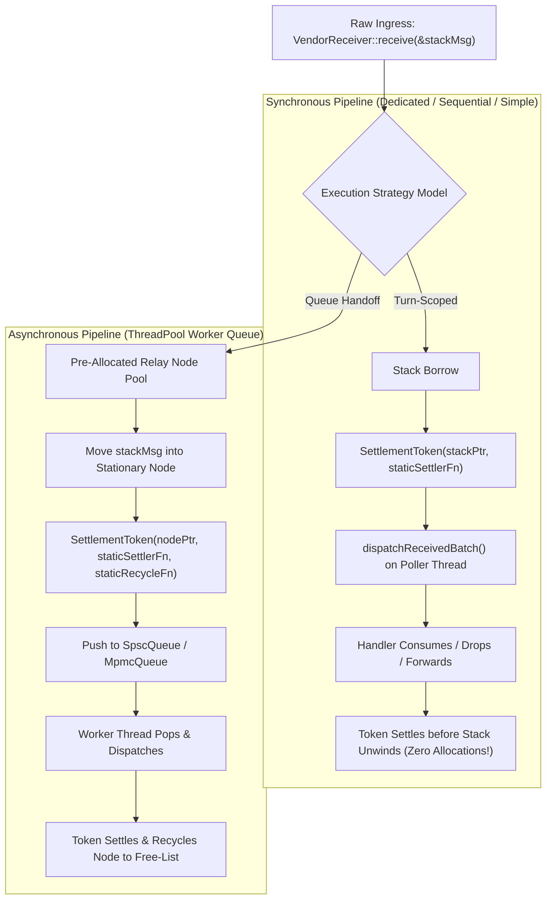
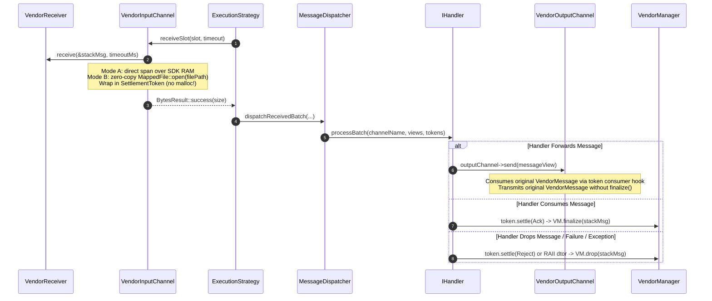
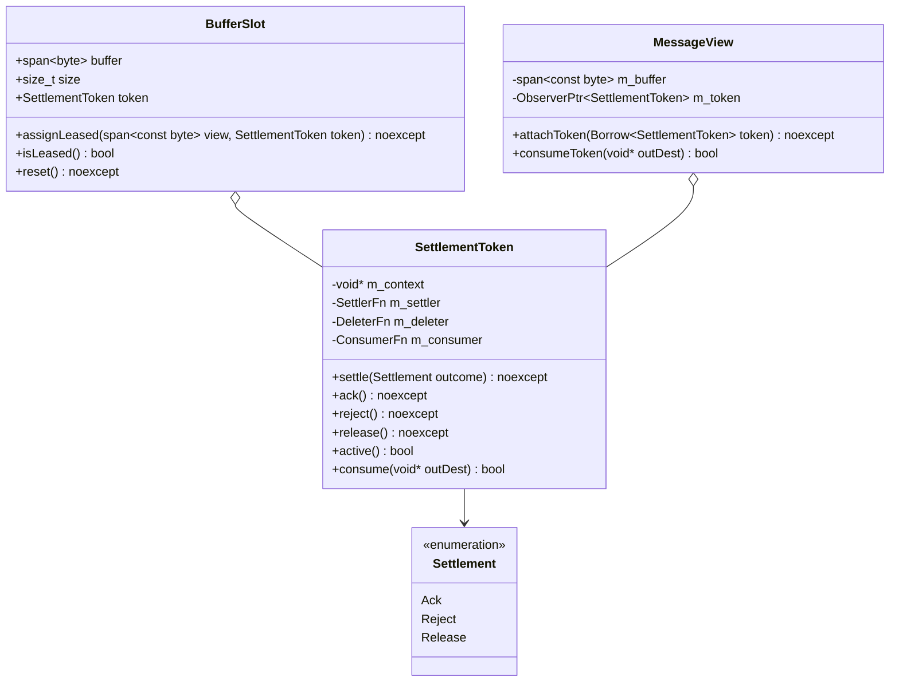

# 014: Zero-Allocation `SettlementToken` & Ingress Lifecycle Decoupling

## 1. Overview & Problem Statement

### 1.1 The Evolution of In-Flight Message Tracking

Across the system's development, handling external proprietary messages (such as `backend/vendor`'s `Sdk::VendorMessage`) has evolved through three distinct phases:

1. **Phase 011 (`VendorMetadata` & Map Registry)**:
   - In-flight messages were registered in a global hash map `m_inFlightMessages` protected by a mutex, while an in-band correlation ID traveled inside serialized wire frames.
   - *Problems*: Severe mutex contention on concurrent channels, fragile in-band wire metadata, and memory leaks / capacity exhaustion whenever an unhandled exception or malformed packet orphaned an entry in the map.

2. **Phase 012 & 013 (`Backend::Lease` & Polymorphic `ILeaseState`)**:
   - Out-of-band RAII ownership: `Backend::Lease` encapsulated a `std::unique_ptr<ILeaseState>` that moved alongside the raw bytes.
   - Destroying an unsettled lease automatically invoked `settle(Settlement::Release)` / `manager->drop(msg)`, guaranteeing no message could be silently lost.
   - Forwarding was supported by downcasting `message.consumeLeaseState()` via `dynamic_cast<VendorLeaseState*>`.
   - *Remaining Deficiencies*:
     - **Heap Jitter on Hot Path**: Every single incoming packet triggered `std::make_unique<VendorLeaseState>()`, paying the penalty of general-purpose `malloc`/`free` and cache misses.
     - **BufferPool Misuse & Exhaustion**: For Mode B (file-backed messages), `VendorInputChannel` attempted to read file contents into 64 KB `BufferPool` blocks. Under burst traffic, the pool exhausted (256 blocks), falling back to ad-hoc memory mappings or dropping packets.
     - **Type Coupling / RTTI Overhead**: Forwarding required polymorphic `dynamic_cast` across module boundaries.

3. **Phase 014 (`Backend::SettlementToken` & Zero-Copy Direct Mapping)**:
   - Replaces polymorphic heap-allocated leases with a **type-erased, zero-allocation `SettlementToken`**.
   - Decouples `VendorBackend` entirely from `BufferPool`: Mode A payloads view SDK memory directly, while Mode B payloads use zero-copy `Common::Io::MappedFile` (leveraging the OS page cache rather than a fixed userland slab pool).
   - In synchronous execution strategies (`DedicatedThreadStrategy`, `SequentialStrategy`, `SimpleExecutionStrategy`), where dispatch immediately follows receive on the same thread, `SettlementToken` borrows the stack/batch turn without any heap allocation or pool reservation.
   - In asynchronous strategies (`ThreadPoolStrategy`), `SettlementToken` binds to stationary, pre-allocated relay nodes sized exactly to the task queue capacity, guaranteeing bounded memory and zero dynamic allocation.

---

## 2. Architecture & How It Works

### 2.1 The Two Ingress Lifecycles



### 2.2 End-to-End Sequence Diagram



### 2.3 Class Structure



---

## 3. Design Decisions & Trade-Offs

### 3.1 Function Pointer Vtable vs. `std::unique_ptr<ILeaseState>`
- **Decision**: Replace `std::unique_ptr<ILeaseState>` inside `Lease` with flat function-pointer callbacks (`SettlerFn`, `DeleterFn`, `ConsumerFn`) stored directly inside `SettlementToken`.
- **Rationale**:
  - `sizeof(SettlementToken)` is only 32 bytes (4 pointers).
  - Calling function pointers involves no vtable lookups and requires no polymorphic base class (`ILeaseState`).
  - Allows stack-allocated and stationary pool-allocated objects to be wrapped without heap `malloc`.

### 3.2 Removal of `BufferPool` from `VendorBackend`
- **Decision**: Eliminate `BufferPool` from `VendorBackend` and `VendorInputChannel`. Mode B file payloads use `Common::Io::MappedFile` directly.
- **Rationale**:
  - `BufferPool` fixed-size blocks (e.g. 64 KB) suffered from internal fragmentation for small files and capacity exhaustion under load.
  - File payloads are already stored on the filesystem; memory mapping them (`mmap`) is natively zero-copy and offloads paging and caching directly to the OS kernel.
  - Eliminates pool synchronization contention and configuration guesswork.

### 3.3 RAII Drop-on-Unsettled Destructor
- **Decision**: If `SettlementToken` destructs while still active, it automatically invokes `Settlement::Reject` (which calls `m_manager->drop(msg)`).
- **Rationale**:
  - Prevents leaked messages in the vendor SDK when exceptions or early handler exits occur.
  - Guarantees exactly-once settlement semantics.

### 3.4 Elimination of `thread_local IngressBatchScratch` in `ThreadPoolStrategy`
- **Decision**: Replace `thread_local Detail::IngressBatchScratch` in `ThreadPoolStrategy`'s poller functions with channel-thread-scoped stack instances allocated in the poller thread entry lambda.
- **Rationale**:
  - GCC on macOS targets emulated TLS (`emutls`). Dual linkage between shared `libstdc++.6.dylib` (which manages `jthread` TLS cleanup) and static `libgcc_eh.a` resulted in conflicting `_pthread_key` cleanups, triggering `SIGSEGV` inside `emutls_destroy` upon thread termination.
  - Channel poller threads are long-lived and dedicated to single input channels. Stack allocation provides optimal cache locality and deterministic cleanup before thread termination, completely eliminating `emutls` overhead and TLS key destructor collisions.

### 3.5 Dynamic Metrics Counter Lookup in `MessageDispatcher`
- **Decision**: Avoid file-static or function-static `static auto&` bindings to counters returned by `Telemetry::MetricsRegistry::instance()`.
- **Rationale**:
  - `MetricsRegistry::clear()` recreates the internal unordered map entries during test runs or pipeline resets. Binding static references causes dangling reference bugs when map nodes are reallocated or cleared.

---

## 4. Concrete Examples

### 4.1 Synchronous Stack Borrow in `VendorInputChannel`
```cpp
// On the poller thread stack:
Sdk::VendorMessage stackMsg;
if (m_receiver->receive(&stackMsg, timeoutMs)) {
    // Zero-allocation stack context
    VendorStackContext ctx{ stackMsg, *m_manager, mappedFile, false };

    auto token = Backend::SettlementToken(
        &ctx,
        // Settler
        [](void* ptr, Backend::Settlement outcome) noexcept {
            auto* c = static_cast<VendorStackContext*>(ptr);
            if (c->settled) return;
            c->settled = true;
            if (outcome == Backend::Settlement::Ack) {
                c->manager.finalize(c->msg);
            } else {
                c->manager.drop(c->msg);
            }
        });

    slot.assignLeased(payloadSpan, std::move(token));
}
```

---

## 5. Tasks / Checklist

- [x] **1. Define `Backend::SettlementToken` (`backend/interface`)**
  - [x] Implement `include/backend/SettlementToken.hpp` and `src/SettlementToken.cpp`.
  - [x] Update `BufferSlot` to hold `SettlementToken` and expose `assignLeased(span, SettlementToken)`.
  - [x] Update `MessageView` to attach and consume `SettlementToken`.
- [x] **2. Refactor `backend/vendor` for Zero-Allocation Ingress**
  - [x] Remove `BufferPool` usage from `VendorBackend` and `VendorInputChannel`.
  - [x] Implement Mode B direct zero-copy via `Common::Io::MappedFile`.
  - [x] Wire `VendorInputChannel` to emit `SettlementToken` with zero per-message heap allocation.
  - [x] Update `VendorOutputChannel::send(const MessageView&)` to extract and forward original `VendorMessage` via `token.consume(...)`.
- [x] **3. Update Core Threading Strategies & Dispatcher (`core/`)**
  - [x] Update `MessageDispatcher::dispatchReceivedBatch` to accept `span<SettlementToken>`.
  - [x] Update `DedicatedThreadStrategy`, `SequentialStrategy`, `SimpleExecutionStrategy`, and `ThreadPoolStrategy`.
  - [x] Replace `thread_local IngressBatchScratch` with thread-entry stack allocation in `ThreadPoolStrategy` to prevent GCC `emutls` crashes.
  - [x] Prevent static counter reference invalidation across `MetricsRegistry::clear()`.
  - [x] Update `MessageTask` to hold `SettlementToken`.
- [x] **4. Testing & Verification**
  - [x] Update `test/TestVendorBackend.cpp` to verify the new zero-allocation lifecycle and consuming forwards.
  - [x] Run full test suite with all unit and integration tests passing across Debug and Release presets.
  - [x] Format all modified files with `clang-format -i`.

