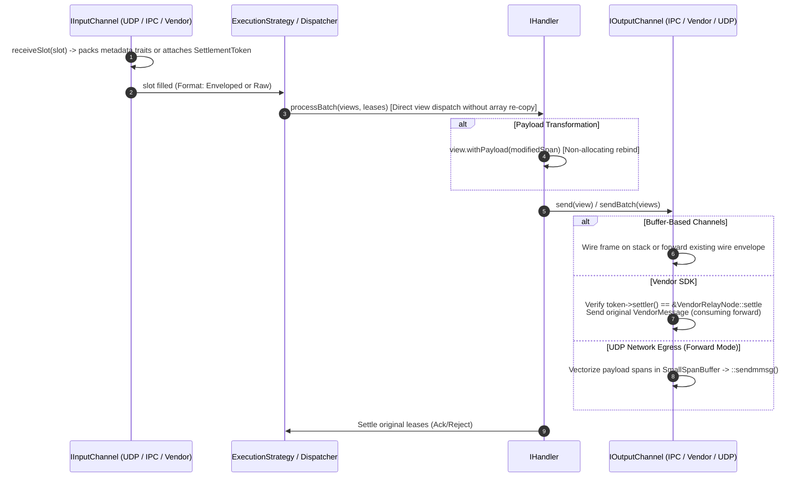

# 015: Pipeline Architectural Review, Open Protocol Id & Settlement Unification

## 1. Overview & Problem Statement

### Why It's Needed
Following a holistic architectural review of message ingress (`Backend::IInputChannel`), threading orchestration (`Core::Threading`), handler execution (`Core::Handler::IHandler`), and egress (`Backend::IOutputChannel`), six critical areas of performance overhead, tight coupling, and lifecycle fragmentation were identified:
1. **Unreachable SPSC In-Place Code Paths & Bloated Task SBO**: `ThreadPoolStrategy` retained an unreachable in-place SPSC write path with an oversized 2,048-byte SBO buffer in `MessageTask` (~2.4 MB per worker ring) and fragile peek heuristics.
2. **Redundant Vector Copies in `IHandler::processBatch`**: Handlers performed duplicate array copies of `MessageView` and redundant lease attachment loops even though `MessageDispatcher` already formatted and attached them.
3. **Closed `ProtocolId` Enum & Metadata Coupling**: `MessageView` and `ThreadPoolStrategy` were coupled to `UdpMetadata` (with ad-hoc packing methods like `packUdp()`), and adding a new protocol required modifying a centralized enum.
4. **Missing Allocation-Free Payload Mutation**: Handlers transforming payloads (e.g. enrichment or sanitization) had no non-allocating way to rebind `MessageView::payload()` while preserving protocol, metadata, and in-flight transport lease.
5. **Dual Lease State & Unchecked Downcasts**: `Backend::Lease` maintained both `ILeaseState` and `SettlementToken`, while `VendorOutputChannel` performed an unchecked cast of `token->context()` without verifying origin.
6. **Unvectorized Forward Egress Syscalls**: `UdpEgressHandler` and `Core::Net::UdpOutputChannel` looped individual `::sendto()` syscalls for batches even in static forward mode.

---

## 2. Architecture & How It Works

### 2.1 Refactored Ingress-to-Egress Pipeline Flow



---

## 3. Design Decisions & Trade-Offs

### 3.1 Open Protocol Resolution via `StrongType` and `MetadataTraits<T>`
- **Decision**: Replaced the closed `enum class ProtocolId` with an open `Common::Types::StrongType<std::uint8_t, ProtocolIdTag>` matching IANA 8-bit protocol numbers (e.g. `IPPROTO_UDP` = 17, `RawProtocol` = 0) and `Backend::MetadataTraits<T>`.
- **Rationale**: Applications and transport libraries can introduce new protocols without modifying the core `backend/interface` repository headers. `MessageView` no longer knows anything about concrete metadata types.

### 3.2 Non-Allocating `MessageView::withPayload()`
- **Decision**: Added `MessageView::withPayload(span<const std::byte>)` and `MessageView::hasWireEnvelope()`.
- **Rationale**: Handlers mutating application bytes return a view pointing to new memory while keeping protocol, metadata, timestamp, and `Lease` intact. `IOutputChannel` frames the envelope on the stack (when `<= 4096` bytes) with zero heap allocation.

### 3.3 Unification of `Backend::Lease` Around `SettlementToken`
- **Decision**: Completely removed `ILeaseState` and `VendorLeaseState`. `Backend::Lease` is a clean move-only wrapper around `SettlementToken`.
- **Rationale**: Eliminates 8 bytes and dead vtable branches from every in-flight message. `VendorOutputChannel` validates `token->settler() == &VendorRelayNode::settle` before accessing node context, eliminating unsafe downcasts.

### 3.4 Vectorized Forward UDP Batching
- **Decision**: `UdpEgressHandler` in `forward` mode extracts payload spans into `Common::Memory::SmallSpanBuffer` and calls `m_udpOut->sendBatch()`, utilizing `::sendmmsg()` on Linux.
- **Rationale**: Reduces kernel syscall transitions from N to 1 during burst egress.

---

## 4. Concrete Examples

### 4.1 Non-Allocating Payload Rebinding
```cpp
// Handler modifies payload without allocating wire envelopes:
const std::string transformed = transform(message.payload());
auto rebound = message.withPayload(Common::Memory::ByteView(transformed));
m_outputChannel->send(rebound); // Frames wire envelope on the stack
```

### 4.2 Token Origin Verification in `VendorOutputChannel`
```cpp
if (auto token = message.token(); token && token->settler() == &VendorRelayNode::settle) {
    auto* node = static_cast<VendorRelayNode*>(token->context());
    if (node && !node->consumed && node->manager == m_manager) {
        // Safe consuming forward
        m_sender->send(node->message);
        node->consumed = true;
        token->disarm();
        return true;
    }
}
```

---

## 5. Tasks / Checklist

- [x] Remove dead SPSC `tryPushInPlace` Path B and shrink `MessageTask::SmallBufferSize` from 2,048 to 256 bytes.
- [x] Remove duplicate array copying in `IHandler::processBatch()`.
- [x] Replace `ProtocolId` enum with `StrongType<uint8_t, ProtocolIdTag>` and `MetadataTraits<T>`, removing `packUdp()` from `MessageView`.
- [x] Implement allocation-free `MessageView::withPayload()` and stack-framing egress in `IOutputChannel`.
- [x] Delete `ILeaseState` and unify `Lease` around `SettlementToken` with settler origin validation.
- [x] Implement vectorized batch forward egress in `UdpEgressHandler` and `::sendmmsg()` in `Core::Net::UdpOutputChannel`.

