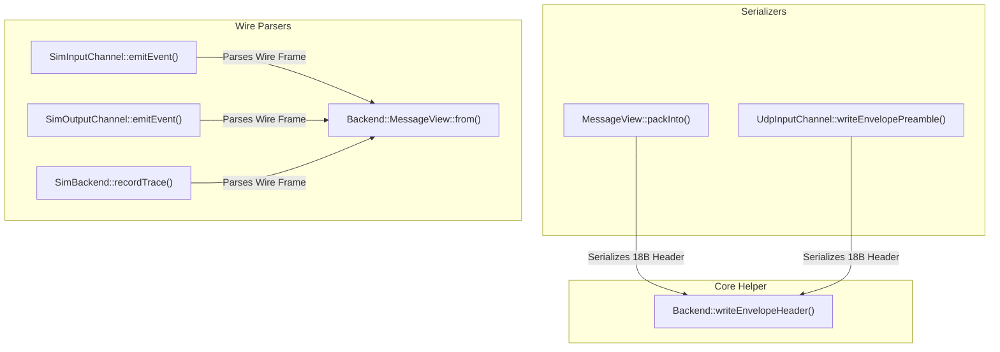

# 016: Deduplicate Binary Envelope Header Offsets Across Channels

## 1. Overview & Problem Statement

### Why It's Needed
During the unification of `MessageEnvelope` into `Backend::MessageView` (commit `1dca32c`), serialization was consolidated into `MessageView::packInto()`. However, low-level binary offset writing and wire header unpacking (`dst + 4`, `dst + 6`, `dst + 10`, `payload[0..17]`) remained duplicated across multiple channels and components:
1. `core/src/net/UdpInputChannel.cpp` (`writeEnvelopePreamble`) manually serialized the 18-byte big-endian preamble via individual `writeUint*Be` calls.
2. `backend/sim/src/SimInputChannel.cpp`, `backend/sim/src/SimOutputChannel.cpp`, and `backend/sim/src/SimBackend.cpp` manually extracted the 18-byte big-endian header using raw bitshifts and offsets to unpack `magic`, `metaLen`, `payloadLen`, and `timestampNs`.

This duplication created risk of wire framing divergence and maintenance overhead across transport backends.

---

## 2. Architecture & How It Works

### 2.1 Authoritative Preamble Serialization via `writeEnvelopeHeader`
A canonical serialization function `writeEnvelopeHeader` is introduced in `Backend::EnvelopeHeader` (`backend/interface/include/backend/EnvelopeHeader.hpp` and `backend/interface/src/EnvelopeHeader.cpp`):

```cpp
namespace Backend {

std::size_t writeEnvelopeHeader(
    Common::Compat::span<std::byte> destination,
    ProtocolId protocol,
    std::uint16_t metadataLength,
    std::uint32_t payloadLength,
    std::uint64_t timestampNs) noexcept;

} // namespace Backend
```

Both `MessageView::packInto()` and `UdpInputChannel::writeEnvelopePreamble()` invoke `writeEnvelopeHeader` directly, guaranteeing identical 18-byte wire preamble serialization.

### 2.2 Wire Framing Flow



### 2.3 Sim Channels Parsing via `MessageView::from()`
The Simulation backend (`SimInputChannel`, `SimOutputChannel`, and `SimBackend`) replaced manual magic checking and byte offset shifting with `Backend::MessageView::from(rawMessage)`. If the message carries a valid Proxy wire frame (`0x5058`), `optView->payload()` and `optView->timestampNs()` are extracted automatically without ad-hoc byte math.

---

## 3. Design Decisions & Trade-Offs

- **Header File Declaration & C++ Source Separation**: In compliance with `AGENTS.md` Section 6, `writeEnvelopeHeader` is declared in `backend/interface/include/backend/EnvelopeHeader.hpp` and implemented in `backend/interface/src/EnvelopeHeader.cpp`.
- **Zero Heap Allocations**: `writeEnvelopeHeader` operates over `Common::Compat::span<std::byte>` with boundary validation and `noexcept` guarantees.
- **Unified Wire Parser**: Relying on `MessageView::from()` in `Sim*` channels ensures any changes or additions to wire header validation immediately propagate across the simulation subsystem.

---

## 4. Concrete Examples

### 4.1 Authoritative Serialization in `UdpInputChannel`
```cpp
Backend::writeEnvelopeHeader(
    destination,
    Backend::MetadataTraits<Backend::UdpMetadata>::protocol,
    static_cast<std::uint16_t>(sizeof(Backend::UdpMetadata)),
    static_cast<std::uint32_t>(payloadSize),
    getCurrentTimeNs());
```

### 4.2 Inspecting In-Flight Payloads in Sim Channels
```cpp
Common::Compat::span<const std::byte> appPayload = payload;
if (auto optView = ::Backend::MessageView::from(payload)) {
    appPayload = optView->payload();
}
```

---

## 5. Tasks / Checklist

- [x] Declare `writeEnvelopeHeader` in `backend/interface/include/backend/EnvelopeHeader.hpp`.
- [x] Implement `writeEnvelopeHeader` in `backend/interface/src/EnvelopeHeader.cpp`.
- [x] Refactor `MessageView::packInto()` to use `writeEnvelopeHeader()`.
- [x] Refactor `Core::Net::UdpInputChannel::writeEnvelopePreamble()` to use `writeEnvelopeHeader()`.
- [x] Replace manual header offsets in `SimInputChannel::emitEvent()`, `SimOutputChannel::emitEvent()`, and `SimBackend::recordTrace()` with `MessageView::from()`.
- [x] Add unit test coverage in `test/TestChannels.cpp` verifying `writeEnvelopeHeader` serialization and validation.
- [x] Update `TODO.md` status to resolved.

