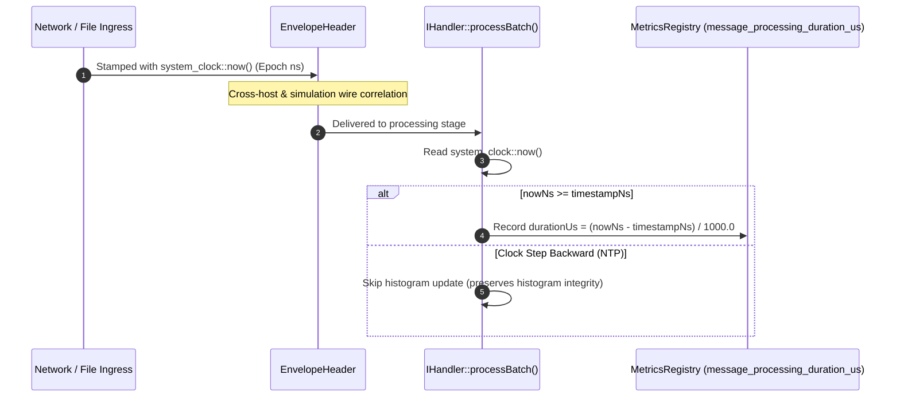

# 017: Clock Domain Review & Telemetry Timestamp Specification

## 1. Overview & Problem Statement

### Why It's Needed
`EnvelopeHeader` defines an 8-byte `timestampNs` field serialized across all `Backend::MessageView` instances. However, an architectural ambiguity was noted regarding whether ingress stamping and hop age telemetry should use monotonic time (`std::chrono::steady_clock`) or wall-clock epoch time (`std::chrono::system_clock`).

Because `message_processing_duration_us` is calculated in `Core::Handler::IHandler::processBatch()` as `nowNs - message.timestampNs()`, using `system_clock` could theoretically observe backwards steps if NTP step adjustments occur while a message is in flight. Conversely, using `steady_clock` would make `timestampNs` meaningless across distributed physical nodes or container boundaries that lack shared boot times.

---

## 2. Architecture & How It Works

### 2.1 Clock Domain Separation
The system establishes a clean, explicit boundary between **cross-boundary wire timestamps** and **intra-process timeouts**:

1. **Wire Timestamp (`EnvelopeHeader::timestampNs`)**:
   - Clock Domain: **UNIX Epoch Nanoseconds (`std::chrono::system_clock`)**.
   - Contract: Represents physical world wall-clock time at the point of network or system ingress.
   - Purpose: Cross-host distributed correlation, PCAP packet timestamp alignment, trace file export, and telemetry dashboards (`scripts/telemetry_dashboard.html`).
2. **Hop Transit & Processing Age Observation**:
   - `IHandler::processBatch()` inspects `message.timestampNs()`.
   - To guard against wall-clock step adjustments or clock drift without corrupting metrics, `nowNs >= message.timestampNs()` is checked before computing `durationUs`. Negative durations resulting from NTP backward steps are discarded rather than contaminating the latency histogram.
3. **Execution & Channel Timeouts**:
   - All channel pollers, ring buffers (`ShmRingBuffer`), batch deadlines, and strategy loops strictly use `std::chrono::steady_clock`.

---

## 3. Design Decisions & Trade-Offs

- **Standardization on UNIX Epoch for Envelopes**:
  - `steady_clock` is process-local and host-local (tied to system boot time). Envelopes serialized across network UDP channels or saved to PCAPs cannot be meaningfully interpreted by receivers on different hosts if stamped with a local monotonic counter.
  - Using `system_clock` ensures wire packets match UTC/POSIX standards and align with PCAP headers (`tsSec`, `tsUsec`/`tsNsec`).
- **Defensive Observation**:
  - The monotonic check `if (message.timestampNs() > 0 && nowNs >= message.timestampNs())` in `IHandler::processBatch()` provides resilience against NTP skew.

---

## 4. Tasks / Checklist

- [x] Review clock domains across `MessageView::packInto()`, `UdpInputChannel`, and `IHandler::processBatch()`.
- [x] Document the wire format clock specification in `docs/architecture/message-envelope-and-framing.md`.
- [x] Create historical feature document `docs/features/message/017-message-clock-domain-and-timestamp-specification.md`.
- [x] Clean up completed tracking documents (`TODO.md`, `REVIEW.MD`).

