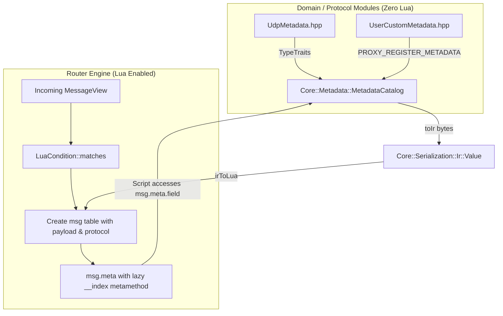

# Feature 018: Decentralized Metadata Reflection Catalog & Dynamic Lua Binding

## Overview & Problem Statement
In previous implementations, `LuaCondition.cpp` was directly coupled to specific concrete metadata structs (e.g. `Core::Net::UdpMetadata`). This meant:
1. Every time a new metadata struct was introduced, removed, or modified across network, trading, or storage domains, `LuaCondition.cpp` had to be manually edited.
2. If `core` or `backend` were to register Lua binders directly, it would force core transport layers to depend on Lua and `sol2`.

This feature decouples protocol metadata reflection completely:
- Introduces `Core::Metadata::MetadataCatalog` in `core` with **zero external dependencies and zero knowledge of Lua**.
- Leverages the existing `Core::Serialization::TypeTraits` compile-time reflection system to dynamically convert any registered metadata structure to an Intermediate Representation (`Ir::Value`).
- Provides `PROXY_REGISTER_METADATA(Type)` for decentralized static registration from any compilation unit.
- Implements lazy Lua metatable evaluation via `__index` in `LuaCondition`: metadata is reflected on demand only when a Lua script accesses `msg.meta` or shortcut properties like `msg.port`.

---

## Architecture & How It Works

---

## Tasks / Checklist

- [x] Create `Core::Metadata::MetadataCatalog` mapping `ProtocolId` to IR converter functions without Lua dependencies.
- [x] Add `std::hash<Backend::ProtocolId>` specialization in `ProtocolId.hpp`.
- [x] Specialize `Core::Serialization::TypeTraits<Core::Net::UdpMetadata>`.
- [x] Implement decentralized auto-registration macro `PROXY_REGISTER_METADATA(Type)`.
- [x] Refactor `LuaCondition.cpp` to eliminate direct includes of `UdpMetadata.hpp`.
- [x] Implement lazy `__index` metatable in `LuaCondition` with top-level fallback (`msg.port`, `msg.dst_port`, `msg.meta.*`).
- [x] Verify complete test suite (110 test cases, 122,026 assertions pass).
- [x] Format all code according to WebKit style via `clang-format`.
