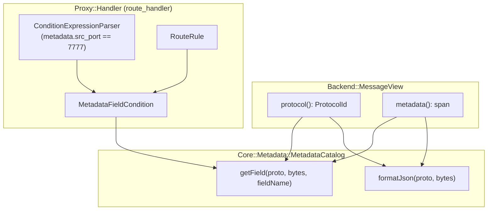

# 019: Protocol Metadata Generalization via MetadataCatalog

## 1. Overview & Motivation
Following the introduction of `Core::Metadata::MetadataCatalog` in feature `018-metadata-catalog-and-lua-reflection`, protocol metadata reflection was decoupled from Lua dependencies. However, routing rules inside `route_handler` were still statically tied to concrete metadata structs (e.g., `PortCondition` calling `message.getMetadata<Core::Net::UdpMetadata>()`). Furthermore, formatting or diagnostic inspection of metadata required static linking of concrete protocol headers.

This feature generalizes metadata access across the codebase:
1. **Direct Field Extraction**: Enables fast single-field inspection from raw metadata bytes via `MetadataCatalog::getField(...)` using reflected `TypeTraits<T>` member descriptors without requiring full IR allocations.
2. **Generic `MetadataFieldCondition`**: Replaces hardcoded transport condition logic in `route_handler` with dynamic field evaluations supporting equality, inequality, and ordering operators (`==`, `!=`, `<`, `<=`, `>`, `>=`).
3. **Condition Expression Extension**: Extends `ConditionExpressionParser` so inline routing expressions can query arbitrary metadata fields directly using `metadata.<fieldName> <op> <value>` (e.g. `metadata.src_port == 7777 && prefix("SECURE:")`).
4. **Structured JSON Formatting**: Provides `MetadataCatalog::formatJson(...)` for diagnostic logging of registered protocol metadata.

---

## 2. Architecture & How It Works



---

## 3. Concrete Examples

### 3.1 Inline Route Expression (`expr`)
```toml
[route.rule.secure_inbound]
expr = "metadata.src_port == 7777 && prefix('SECURE:')"
target = "secure_egress"
```

### 3.2 Structured Route Rule Configuration
```toml
[route.rule.check_address_family]
type = "metadata_field"
field = "address_family"
op = "=="
value = "4"
target = "ipv4_processing"
```

### 3.3 Fluent C++ Builder
```cpp
auto rule = Proxy::Handler::RouteRule::when(
    Proxy::Handler::MetadataField::equals("src_port", 9999))
    .forwardTo("audit_channel");
```

---

## 4. Tasks / Checklist
- [x] Extend `MetadataCatalog` with `getField(...)`, `registerFieldExtractorFn(...)`, and `formatJson(...)`.
- [x] Implement `MetadataFieldCondition` with `FieldOperator` support.
- [x] Update `RouteRuleBuilder` with `MetadataField` factory methods.
- [x] Extend `ConditionExpressionParser` with lexer tokens (`.`, `!=`, `<`, `<=`, `>`, `>=`) and `metadata.<field>` parsing.
- [x] Update `RouteConfig` to support `type = "metadata_field"` / `"field"`.
- [x] Add unit tests covering direct field extraction, JSON formatting, AST parsing, and rule execution.
- [x] Verify all 112 test cases pass without regressions.

