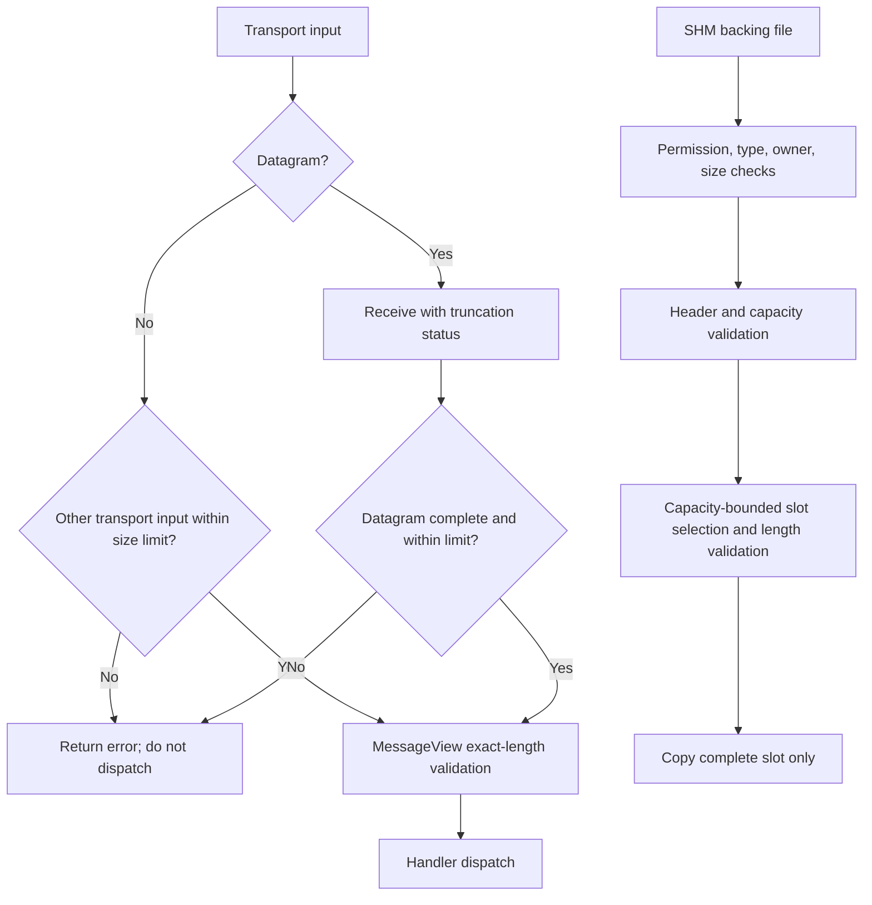

# 020: Bounded Message Framing and Shared-Memory Validation

## 1. Overview & Problem Statement

Message frames and shared-memory mappings cross transport and process boundaries. Before this change, envelope parsing accepted frames without a shared total-size ceiling, packing could narrow lengths into the wire header, datagram receives could silently consume a truncated prefix, and shared-memory state could be trusted before its mapping and slot bounds were fully validated. These gaps could turn malformed or oversized input into inconsistent messages, out-of-bounds access, or silent data loss.

This P0 hardening establishes a bounded envelope contract, detects datagram truncation, rejects oversized records at other ingress points, and validates file-backed shared-memory mappings before indexing or copying slots. It provides safe framing and bounds checks, not sender authentication or replay protection.

## 2. Architecture & How It Works



### 2.1 Envelope Framing

`Backend::MaxEnvelopeFrameBytes` is a shared 65,535-byte total-frame ceiling, including the 18-byte envelope header and metadata. Transport implementations may impose lower limits. Parsing checks the declared metadata and payload lengths using overflow-safe bounds and requires them to consume the entire input span. Packing rejects metadata or payload lengths that do not fit their wire fields or exceed the total-frame ceiling: `packInto()` returns zero and the allocating pack helpers return `std::nullopt`.

Datagram pollers use receive APIs that expose truncation. A truncated datagram produces `std::errc::message_size`; batched receive slots carry a truncation marker so wrappers cannot mistake a truncated prefix for a valid packet. File, in-process, simulation, and mock input paths reject oversized messages rather than clipping them.

The allocating `MessageView::pack()` API reports unrepresentable frames with `std::nullopt`; allocation failures remain exceptions. This treats an oversized frame as an expected validation failure, aligns packing with `MessageView::from()`, and lets callers handle failure explicitly instead of catching an exception. An empty vector is not used as a failure sentinel because it could be mistaken for a valid serialized value.

The optional result applies to `MessageView::pack()`, its typed overload, `packRaw()`, and the allocating `withPayload()` helper; `InspectionView::pack()` propagates it. Runtime callers translate an empty result at their boundary: `IOutputChannel::send(MessageView)` returns `false`; scatter and gather log and return dropped results; and `DummySendHandler` rejects an oversized configured payload during configuration. `packInto()` retains its existing contract of returning the number of bytes written, or zero when the destination or frame is invalid. Allocation failures such as `std::bad_alloc` are not converted to wire-validation results and may propagate.

### 2.2 Shared-Memory Mapping

The SHM backend creates backing files with owner-only permissions and validates existing files as regular files owned by the current user. Openers coordinate initialization, and a mapping is accepted only when its file size, header, configured capacity, and computed layout are compatible. Ring indexes are masked by the validated local capacity; occupancy reads reject distances outside capacity. Runtime slot handling validates lengths before access or copy; malformed slot lengths invalidate the local ring instance, while a valid message that exceeds a caller's output span is dropped without copying a partial message.

## 3. Design Decisions

1. **One shared envelope ceiling**: Use 65,535 bytes to match the fixed ingress scratch-slot size and keep frame validation consistent across channels. A configurable per-channel limit is deferred until a concrete operational need exists.
2. **Exact frame consumption**: Reject trailing bytes instead of interpreting them differently across transports.
3. **Reject instead of clip**: A prefix of an oversized or truncated message must never look like a complete message. File records are rejected and removed so an oversized record cannot block subsequent watched files.
4. **Fail closed on incompatible SHM state**: Do not silently resize or reinitialize an existing incompatible mapping. This can require operators to replace stale backing files, but avoids treating unknown shared state as valid.
5. **Explicit packing failure contract**: The allocating packing APIs return `std::nullopt` for wire-size violations; allocation failures remain exceptions. The non-allocating `packInto()` API reports an invalid destination or unrepresentable frame with a zero byte count.
6. **No integrity/authentication claim**: Length and mapping checks protect memory and framing invariants. Checksums, MACs, and replay policies remain separate, requirement-driven work.

## 4. Concrete Example

```cpp
const auto packed = Backend::MessageView::packRaw(payload);
if (!packed) {
    return false;
}

return output.send(*packed);
```

For callers using a pre-allocated buffer:

```cpp
auto frame = Backend::MessageView::from(receivedBytes);
if (!frame) {
    // Reject malformed, oversized, incomplete, or trailing-byte input.
    return;
}

std::array<std::byte, Backend::MaxEnvelopeFrameBytes> output {};
const auto written = Backend::MessageView::packInto(
    output,
    frame->protocol(),
    frame->metadata(),
    frame->payload());
if (written == 0) {
    // The frame could not be represented in the bounded wire format.
    return;
}
```

At the socket layer, callers must also reject the datagram when the poller reports truncation; parsing a received prefix as a complete envelope is not permitted.

## 5. Performance Comparison

The existing end-to-end XML verification benchmark was run in Release mode with the `inproc-sequential` strategy on macOS arm64 using GCC 16 and C++20. The baseline was built from the pre-P0 `HEAD`; the hardened build includes the framing and receive-bound changes. Each configuration has 10 runs, alternated between baseline and hardened builds; values below are medians.

| Messages | Baseline throughput | Hardened throughput | Change | Baseline duration | Hardened duration |
|---:|---:|---:|---:|---:|---:|
| 20,000 | 324,699 msg/s | 330,556 msg/s | +1.8% | 61.59 ms | 60.50 ms |
| 100,000 | 392,189 msg/s | 405,251 msg/s | +3.3% | 254.98 ms | 246.76 ms |

These are full-pipeline results, including XML validation, scheduling, and in-process transport; they are not an isolated `MessageView` microbenchmark. Individual run ranges were wide (20k: baseline 128k–348k msg/s, hardened 302k–402k; 100k: baseline 234k–407k, hardened 389k–415k), so the small median gains are within observed run-to-run variance. This run detected no meaningful throughput regression; it does not establish a performance improvement.

## 6. Tasks / Checklist

- [x] Define and enforce the total envelope size and exact declared-length policy.
- [x] Reject out-of-range packing lengths without narrowing.
- [x] Detect single and batched datagram truncation and propagate it through input channels.
- [x] Reject oversized input in file, in-process, simulation, and mock channels.
- [x] Restrict SHM backing-file permissions and validate existing mapping properties.
- [x] Validate SHM capacity/layout/slot lengths before access or copy.
- [x] Run the targeted framing/UDP/SHM tests and the complete regression suite.
- [x] Return optional failure from allocating pack helpers for unrepresentable frames.
- [ ] Validate platform-specific receive implementations in CI, including Linux `recvmmsg` and io_uring.
- [ ] Revisit lower transport-specific ceilings only when supported by a documented requirement.

Local validation used the `gcc16-debug` CMake build on macOS arm64 with C++20. Linux-only poller code was not compiled in this environment.
