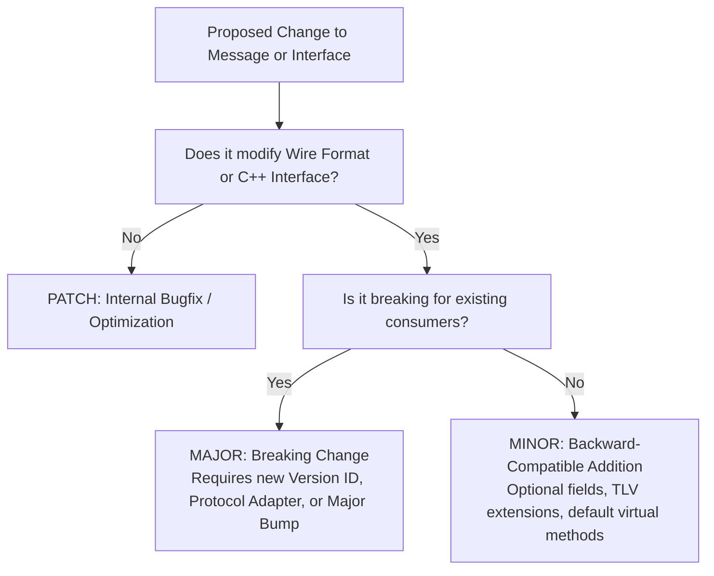
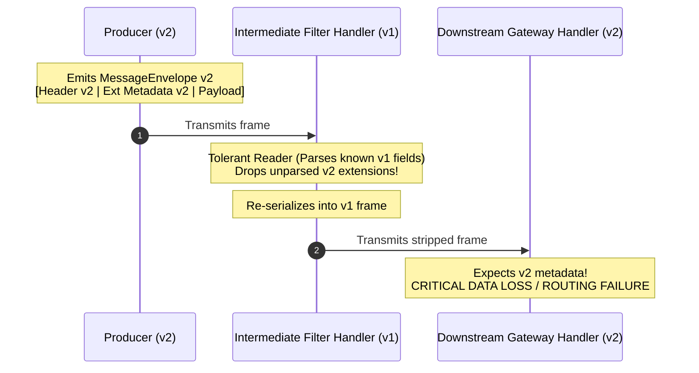

# 021: Message Versioning, Wire Evolution & Full-Chain Compatibility

## 1. Overview & Problem Statement

### The Problem
In distributed message architectures and multi-stage handler pipelines, system components do not evolve or deploy simultaneously. Independent handler binaries—potentially compiled at different times, against different schema versions, or running across heterogeneous hosts—must interact over shared transport layers (Shared Memory IPC, UDP sockets, Unix Domain Sockets, or simulation).

When message header layouts, framing definitions, or message interfaces evolve:
1. **Wire Deserialization Corruption**: A newer upstream handler emitting version 2 frames into a pipeline where downstream handlers expect version 1 will cause fixed-offset binary decoders to read corrupted offsets or fail validation.
2. **The "Data Stripping" Relay Problem**: In linear or branched handler chains ($\text{Producer (v2)} \to \text{Handler A (v1)} \to \text{Handler B (v2)}$), an intermediate handler $A$ may parse a message using a tolerant reader pattern. However, if handler $A$ re-serializes the message using its $v1$ schema, **it silently drops the $v2$ extensions**, depriving downstream handler $B$ of critical metadata (e.g. trace tokens, routing tags, inspection headers).
3. **In-Process API/ABI Instability**: Modifying C++ virtual interfaces (`IMessage`, `IHandler`, `IInputChannel`) breaks compile-time backwards compatibility (API) or leads to undefined behavior/vtable mismatches if dynamic linking is used (ABI).

### The Goal
Establish a clear, enforceable versioning taxonomy (Major vs. Minor vs. Patch) and architectural guarantees ensuring **full-chain compatibility** across mixed-version topologies without message loss, silent metadata stripping, or uncoordinated lockstep deployments.

---

## 2. Semantic Versioning Taxonomy

Message wire definitions, framing headers, protocol schemas, and C++ interfaces adhere to Semantic Versioning (`MAJOR.MINOR.PATCH`):



### 1. Major Version (`X.0.0`) — Incompatible / Breaking
Changes that break existing parsers, alter field semantics, or break C++ contracts:
- Modifying binary field byte offsets, alignments, or endianness in `EnvelopeHeader`.
- Removing or renaming an existing header or metadata field.
- Changing the semantic meaning or unit of an existing field (e.g. shifting `timestampNs` from UNIX epoch nanoseconds to monotonic ticks).
- Adding new pure virtual methods (`virtual void fn() = 0;`) to C++ contracts (`IHandler`, `IInputChannel`, `IOutputChannel`).
- Increasing mandatory wire frame requirements beyond `MaxEnvelopeFrameBytes` without adapter layers.

### 2. Minor Version (`0.Y.0`) — Backwards-Compatible Additions
Additive changes that older components can safely process without degradation:
- Introducing optional metadata extensions via Tag-Length-Value (TLV) or extensible metadata sections.
- Adding new `ProtocolId` identifiers to `Core::Metadata::MetadataCatalog`.
- Adding new virtual methods with default non-pure implementations in C++ interfaces.
- Introducing new handler roles or configuration keys with backward-compatible defaults.

### 3. Patch Version (`0.0.Z`) — Non-Observable Refactors & Fixes
Internal implementation adjustments with zero wire or API surface impact:
- Performance enhancements in `MessageView` or `BufferPool` slicing.
- Fixes to edge-case parsing bugs adhering strictly to the established specification.
- Internal refactoring of execution strategies and queue synchronization.

---

## 3. The Full-Chain Transit & Data Stripping Problem

In point-to-point systems (Client $\leftrightarrow$ Server), backwards compatibility only requires tolerant reading at each endpoint. In chained pipelines, intermediate nodes act as both consumers and producers:



To solve this, the pipeline enforces **Lossless Pass-Through Preservation**.

---

## 4. Architectural Patterns for Full-Chain Compatibility

```
                      Contiguous Wire Frame
 ┌───────────────────────────────────────────────────────────────────┐
 │ Fixed EnvelopeHeader │ Known Metadata │ Unknown Extensions Block  │ Payload
 └──────────┬───────────┴────────────────┴─────────────┬─────────────┴────────
            │                                          │
            ▼                                          ▼
   Version Dispatcher                         Preserved Bit-for-Bit
(Inspects header version)                   Forwarded by Relay Nodes
```

### Pattern 1: Multi-Version Header Framing & Dispatch
`EnvelopeHeader` reserves an explicit `uint8_t version` as field 2 (immediately following magic bytes `0x5058`):
- Wire parsers read the fixed 18-byte `EnvelopeHeader` first.
- The `version` byte routes parsing to the appropriate schema decoder:
  - If `version == 1`: parsed via standard $v1$ layout.
  - If `version == 2`: parsed via $v2$ layout.
  - If `version > MAX_SUPPORTED_VERSION`: safely rejected or routed to a dead-letter/telemetry channel with an explicit error rather than attempting out-of-bounds memory reads.

### Pattern 2: Unknown Fields Preservation ("Passthrough Baggage")
Intermediate handlers that decode and re-encode envelopes must not drop unrecognized metadata or header extensions:
- During deserialization into `MessageView`, unrecognized metadata bytes are retained in an unparsed slice (`unknownExtensions`).
- During egress serialization (`packInto` or `withPayload`), the framing engine re-attaches the preserved slice byte-for-byte to the outgoing frame.
- Downstream handlers on $v2$ receive their complete metadata unmolested, even after traversing multiple $v1$ intermediate hops.

### Pattern 3: Zero-Copy Pass-Through Semantics
Whenever an intermediate handler acts as a router, filter, or tap (e.g. `RouteHandler`, `ScatterHandler`, `SplitHandler`):
- Handlers do **not** deserialize into mutable intermediate representation structs.
- Handlers forward the original contiguous `Common::Memory::BufferSlice` or `MessageView` directly to output channels.
- Zero-copy pass-through eliminates CPU overhead and guarantees 100% byte-exact fidelity across arbitrary version hops.

### Pattern 4: Tolerant Reader & Sensible Fallbacks
For payload serialization (`Core::Serialization::Ir`, JSON, XML):
- **Additive Evolution**: New fields in schemas must always be defined as optional or carry unambiguous default values.
- **Ignore Unknowns**: Parsers must discard or pass through unknown fields without failing validation.
- Schema verification handlers (`XmlVerificationHandler`) must use open-content models (e.g. `<xs:any minOccurs="0" processContents="lax"/>`) when validating payloads expected to carry additive cross-version extensions.

### Pattern 5: Topology Pre-Flight Compatibility Verification
The control plane orchestrator (`chain_runner.py` / `frontend_runner.py`):
- Queries handler manifests for version bounds (`min_wire_version`, `max_wire_version`).
- Validates that connected channels have overlapping compatible version windows before starting child processes.
- Rejects invalid topologies at configuration time rather than failing on production traffic.

---

## 5. Summary Compatibility Matrix

| Transition Hop | Compatibility Mechanism | Guarantee |
| :--- | :--- | :--- |
| **Old Hop $\to$ New Hop** ($v1 \to v2$) | Default Values & Optionality | New handlers supply default values for fields absent in $v1$. |
| **New Hop $\to$ Old Hop** ($v2 \to v1$) | Tolerant Reader | Old handlers process known fields and ignore new extensions. |
| **Relay** ($v2 \to v1 \to v2$) | Unknown Fields Preservation / Zero-Copy Forwarding | Old intermediate handlers forward unparsed byte slices intact without stripping. |
| **Breaking Wire Shift** ($v1 \not\leftrightarrow v2$) | Adapter Handlers (`ProtocolBridgeHandler`) | Dedicated conversion nodes translate between disjoint major versions. |

---

## 6. Actionable Implementation Checklist

- [x] **Wire Framing Version Check**: Verify that `MessageView::from()` validates `EnvelopeHeader::version` and enforces version dispatch bounds.
- [x] **Passthrough Preservation**: Ensure `MessageView` exposes accessors for unparsed metadata extensions and that `packInto()` preserves them upon re-wrapping.
- [x] **Zero-Copy Forwarding**: Verify that non-mutating routing handlers (`RouteHandler`, `SplitHandler`, `MergeHandler`) forward raw slices without re-encoding.
- [x] **Orchestrator Validation**: Update `chain_runner.py` topology validator to verify channel wire version compatibility during DAG initialization.
- [x] **Schema Evolution Rules in CI**: Add CI checks to detect incompatible binary layout shifts in headers without corresponding major version bumps.
