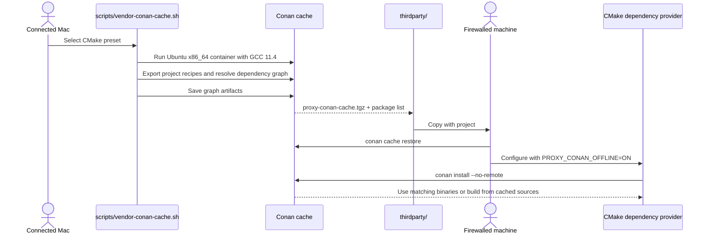

# Offline Conan Cache Bundles

https://wormhole.app/xmRevW#CodeWrNn9Le1cOU2rLHQSg

## Overview & Problem Statement

The CMake dependency provider normally lets Conan resolve missing packages from configured remotes. A firewalled development machine cannot reach those remotes, even when the project and its own Conan recipes are available locally.

This feature provides a reproducible way to bundle the Conan artifacts in a selected project dependency graph and restore them into Conan's local cache before building offline. The supported target profile is Ubuntu Linux x86_64 with GCC/G++ 11.4. The bundle includes cached recipes, source files, and available binaries for that target.

## Architecture & How It Works



The CMake provider records Conan's install graph for each configuration. The vendor script converts that graph into a Conan package list and archives only its required artifacts. The provider's `PROXY_CONAN_OFFLINE` option adds `--no-remote` to `conan install`, so a missing artifact is reported instead of fetched.

## Design Decisions

- **Use Conan's cache archive rather than copying the cache directory.** `conan cache save` and `conan cache restore` preserve Conan-managed artifacts without depending on the machine-specific cache layout.
- **Bundle graph-specific artifacts.** The vendor script captures the package graph generated during CMake configuration rather than archiving every unrelated package in the developer's Conan cache.
- **Target one explicit profile.** Conan binaries are OS-, architecture-, compiler-, and configuration-specific. This workflow targets Ubuntu x86_64 with GCC/G++ 11.4.
- **Build inside the target container.** On macOS, Podman runs the vendor script in an Ubuntu 22.04 x86_64 container with GCC/G++ 11.4. The bundle therefore contains Linux artifacts even though the host is macOS.
- **Keep the cache bundle generated.** The archive is created under `thirdparty/` when needed rather than adding large, machine-specific package artifacts to normal source changes.

## Usage

Install Podman CLI on the connected Mac. Initialize its Linux VM once, then start it:

```bash
# Run once to create the VM:
podman machine init
```

```bash
# Run whenever the VM is stopped:
podman machine start
```

Then create a bundle for the chosen configure preset:

```bash
./scripts/vendor-conan-cache.sh debug
```

On macOS, the script starts an `ubuntu:22.04` x86_64 container, installs GCC/G++ 11.4, Conan, and CMake, then exports the repository's Conan recipes and configures the preset with its pinned target profile: [C++20](../../profiles/conan/ubuntu-x86_64-gcc-11) or [C++17](../../profiles/conan/ubuntu-x86_64-gcc-11-cpp17). It builds missing packages inside Linux and creates files named for the preset, for example:

- `thirdparty/proxy-conan-cache-debug.tgz`
- `thirdparty/proxy-conan-packages-debug.json`

Copy `thirdparty/` and the project to the firewalled Ubuntu 22.04 x86_64 machine with GCC/G++ 11.4. Restore the cache and configure using the same profile and compiler:

```bash
conan cache restore thirdparty/proxy-conan-cache-debug.tgz
cmake --preset debug --fresh \
  -DCMAKE_C_COMPILER=/usr/bin/gcc-11 \
  -DCMAKE_CXX_COMPILER=/usr/bin/g++-11 \
  -DCONAN_HOST_PROFILE="$PWD/profiles/conan/ubuntu-x86_64-gcc-11" \
  -DCONAN_BUILD_PROFILE="$PWD/profiles/conan/ubuntu-x86_64-gcc-11" \
  -DPROXY_CONAN_OFFLINE=ON
cmake --build --preset debug
```

The host and build profiles are both set explicitly because this workflow builds natively on the target machine. Use `debug`/`release` with the C++20 profile or `debug-cpp17`/`release-cpp17` with the C++17 profile. Each preset creates a separate archive. For example, restore the C++17 archive and use its profile for an offline C++17 build:

```bash
conan cache restore thirdparty/proxy-conan-cache-debug-cpp17.tgz
cmake --preset debug-cpp17 --fresh \
  -DCMAKE_C_COMPILER=/usr/bin/gcc-11 \
  -DCMAKE_CXX_COMPILER=/usr/bin/g++-11 \
  -DCONAN_HOST_PROFILE="$PWD/profiles/conan/ubuntu-x86_64-gcc-11-cpp17" \
  -DCONAN_BUILD_PROFILE="$PWD/profiles/conan/ubuntu-x86_64-gcc-11-cpp17" \
  -DPROXY_CONAN_OFFLINE=ON
cmake --build --preset debug-cpp17
```

`PROXY_CONAN_OFFLINE=ON` prevents Conan from contacting remotes. If any package or source is missing from the archive, configuration fails rather than downloading it. The generated Linux binaries target Ubuntu 22.04; use a compatible Ubuntu release and system ABI on the offline machine.

## Tasks / Checklist

- [x] Export in-repository Conan recipes before resolving the project graph.
- [x] Save the selected graph's artifacts into a transferable Conan cache archive.
- [x] Add an opt-in CMake provider mode that disables Conan remotes.
- [x] Document connected-machine bundling and firewalled-machine restore/build steps.
- [x] Pin and validate the Ubuntu x86_64/GCC 11.4 target profile.
- [x] Run the bundler in an Ubuntu 22.04 x86_64 Podman container from macOS.
- [x] Support separate C++17 and C++20 Conan profiles and preset-specific archives.
