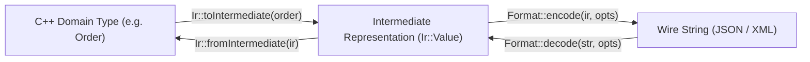

# Trait-Based Serialization & Intermediate Representation Framework

## 1. Overview & Problem Statement

### Why It's Needed
In heterogeneous messaging systems, messages arrive encoded in various formats (e.g., JSON, XML, or binary protocols) and must be parsed into internal C++ structs for validation or routing.
Traditional approaches suffer from major drawbacks:
- **Tight Coupling**: Embedding XML or JSON library types directly inside domain structures makes switching formats or supporting multiple formats difficult.
- **Excessive Allocation & Copying**: Many third-party JSON/XML parsers construct ASTs with deep heap allocations for every node and string key, creating significant GC/allocator pressure.
- **Repetitive Boilerplate**: Writing bespoke serialization routines for every struct and every format leads to fragile, boilerplate-heavy codebases.

### The Solution
`core/serialization` decouples domain types from wire formats using a **compile-time trait system (`TypeTraits<T>`)** and a **zero-copy-capable Intermediate Representation (`Ir::Value`)**. Developers define their struct properties once via static traits; the engine handles encoding and decoding to/from JSON, XML, or future formats automatically.

---

## 2. How It Works

### The Serialization Pipeline



### Components
1. **Dynamic Intermediate Representation (`Core::Serialization::Ir::Value`)**:
   - A lightweight variant type: `std::variant<NullType, bool, int64_t, uint64_t, double, std::string, std::string_view, ArrayType, ObjectType>`.
   - Supports non-owning `std::string_view` leaves to read string values directly from the input wire buffer without allocating a `std::string`.
2. **Type Reflection Traits (`Core::Serialization::TypeTraits<T>`)**:
   - Defines a compile-time mapping of struct field names, types, and getters/setters.
3. **Format Policies (`JsonFormat`, `XmlFormat`)**:
   - `JsonFormat` leverages `nlohmann::json` to encode/decode the IR tree.
   - `XmlFormat` leverages `pugixml` to serialize/deserialize XML trees with attribute and element mappings.
4. **Unified API**:
   - `serialize<Format>(value)`: Converts `T` $\rightarrow$ `Ir::Value` $\rightarrow$ Wire string.
   - `deserialize<Format, T>(string_view)`: Wire string $\rightarrow$ `Ir::Value` $\rightarrow$ `std::optional<T>`.

---

## 3. High-Level Design Decisions

1. **Non-Intrusive Domain Types**:
   - Domain structs remain pure Plain-Old-Data (POD) types with no inheritance, virtual tables, or format-specific annotations. Serialization logic is defined externally via template specializations.
2. **Zero-Copy In-Place Parsing**:
   - During decoding, strings can be stored as `std::string_view` into the raw wire payload buffer when lifetimes allow.
3. **Extensibility**:
   - Adding a new format (e.g. YAML, TOML, Protocol Buffers) only requires implementing a single format policy providing `encode(Ir::Value)` and `decode(string_view)`. All existing domain types automatically gain support for the new format.

---

## 4. Concrete Examples

### Example: Defining Serialization Traits for a Domain Model
```cpp
// 1. Define pure domain struct
struct Order {
    std::string orderId;
    std::string symbol;
    double price { 0.0 };
    int quantity { 0 };
};

// 2. Specialize TypeTraits in namespace Core::Serialization
namespace Core::Serialization {

template <>
struct TypeTraits<Order> {
    static constexpr std::string_view typeName = "Order";

    static Ir::Value toIntermediate(const Order& order)
    {
        Ir::ObjectType obj;
        obj["orderId"] = order.orderId;
        obj["symbol"] = order.symbol;
        obj["price"] = order.price;
        obj["quantity"] = static_cast<int64_t>(order.quantity);
        return obj;
    }

    static std::optional<Order> fromIntermediate(const Ir::Value& ir)
    {
        if (!ir.isObject()) return std::nullopt;
        const auto& obj = ir.asObject();

        Order order;
        if (auto it = obj.find("orderId"); it != obj.end() && it->second.isString()) {
            order.orderId = it->second.asString();
        }
        if (auto it = obj.find("symbol"); it != obj.end() && it->second.isString()) {
            order.symbol = it->second.asString();
        }
        if (auto it = obj.find("price"); it != obj.end() && it->second.isDouble()) {
            order.price = it->second.asDouble();
        }
        if (auto it = obj.find("quantity"); it != obj.end() && it->second.isInt64()) {
            order.quantity = static_cast<int>(it->second.asInt64());
        }
        return order;
    }
};

} // namespace Core::Serialization
```

### Example: Serializing and Deserializing to JSON & XML
```cpp
#include "core/serialization/Serializer.hpp"
#include "core/serialization/json/JsonFormat.hpp"
#include "core/serialization/xml/XmlFormat.hpp"

using namespace Core::Serialization;

Order order { "ORD-492", "AAPL", 182.50, 100 };

// 1. Serialize to JSON:
std::string jsonWire = serialize<JsonFormat>(order);
// Output: {"orderId":"ORD-492","price":182.5,"quantity":100,"symbol":"AAPL"}

// 2. Deserialize from JSON:
std::optional<Order> decodedOrder = deserialize<JsonFormat, Order>(jsonWire);

// 3. Serialize the exact same struct to XML:
std::string xmlWire = serialize<XmlFormat>(order);
// Output: <Order><orderId>ORD-492</orderId><price>182.5</price><quantity>100</quantity><symbol>AAPL</symbol></Order>
```

---

## 5. Tasks / Checklist
- [x] Implement dynamic IR value variant (`Ir::Value`)
- [x] Implement compile-time reflection traits (`TypeTraits<T>`)
- [x] Implement JSON format policy with `nlohmann::json`
- [x] Implement XML format policy with `pugixml`
- [x] Add zero-copy `std::string_view` decoding optimizations
