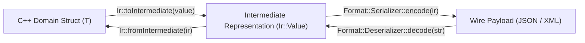

# 001: Trait-Based Serialization & Intermediate Representation (`Core::Serialization`)

## 1. Overview & Problem Statement

### Why It's Needed
In `e9a2e86`, heterogeneous messages arriving in JSON or XML needed to be parsed into internal C++ domain structs (`Order`, etc.) for validation, transformation, or routing. Traditional approaches suffered from:
1. **Tight Format Coupling**: Embedding `nlohmann::json` or `pugixml` calls directly inside domain structs made it impossible to switch wire formats without rewriting domain models.
2. **Repetitive Boilerplate**: Writing separate encode/decode functions for every struct and every format duplicated field-mapping logic.

### The Solution
Implemented `Core::Serialization` (`core/include/core/serialization/`) around three orthogonal layers:
1. **Dynamic Intermediate Representation (`Core::Serialization::Ir::Value`)**: A self-contained value tree (`Null`, `Bool`, `Int64`, `Uint64`, `Double`, `String`, `Array`, `Object`) acting as a format-neutral AST bridge.
2. **Compile-Time Reflection Traits (`Core::Serialization::TypeTraits<T>`)**: Non-intrusive template specializations mapping pure C++ structs to and from `Ir::Value` via `field()` descriptors or custom `toIntermediate` / `fromIntermediate` hooks.
3. **Pluggable Format Policies (`JsonFormat`, `XmlFormat`)**: Format drivers that encode `Ir::Value` to wire strings and decode wire strings back into `Ir::Value`, exposed through unified `serialize<Format>(value)` and `deserialize<Format, T>(input)` entry points.

---

## 2. Architecture & How It Works

### 2.1 Two-Stage Serialization & Deserialization Pipeline



---

## 3. Design Decisions

### 3.1 Non-Intrusive `TypeTraits<T>` Over Base-Class Inheritance
- **Decision**: Keep domain structs as pure Plain-Old-Data (POD) structs with zero base classes or virtual functions, specializing `Core::Serialization::TypeTraits<T>` externally.
- **Rationale**: Preserves `constexpr` / standard-layout properties on domain structs and keeps format libraries (`nlohmann::json`, `pugixml`) out of domain headers.

### 3.2 Format-Agnostic `Ir::Value` Tree
- **Decision**: Route all format conversions through `Core::Serialization::Ir::Value`.
- **Rationale**: Adding a new wire format requires only a single `Format` implementation (`Serializer` + `Deserializer`) rather than $N \times M$ per-type converters.

---

## 4. Concrete Examples

### 4.1 Serializing and Deserializing a Domain Struct
```cpp
#include "core/serialization/Serializer.hpp"
#include "core/serialization/json/JsonFormat.hpp"
#include "core/serialization/xml/XmlFormat.hpp"

Order order { "ORD-492", "AAPL", 182.50, 100 };

// Encode to JSON or XML using the exact same TypeTraits<Order>:
std::string jsonStr = Core::Serialization::serialize<Core::Serialization::Json::JsonFormat>(order);
std::string xmlStr  = Core::Serialization::serialize<Core::Serialization::Xml::XmlFormat>(order);

// Decode from JSON or XML:
auto fromJson = Core::Serialization::deserialize<Core::Serialization::Json::JsonFormat, Order>(jsonStr);
auto fromXml  = Core::Serialization::deserialize<Core::Serialization::Xml::XmlFormat, Order>(xmlStr);
```

---

## 5. Tasks / Checklist

- [x] Implement `Core::Serialization::Ir::Value` and `Converter` (`e9a2e86`).
- [x] Implement `TypeTraits<T>`, `serialize<Format, T>`, and `deserialize<Format, T>` (`e9a2e86`).
- [x] Implement `JsonFormat` (`nlohmann::json`) and `XmlFormat` (`pugixml`) policies (`e9a2e86`).
- [x] Add Catch2 unit tests in `test/TestSerialization.cpp`.

