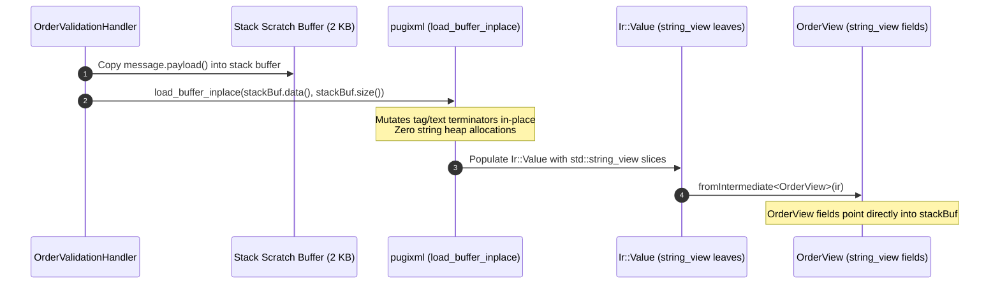

# 002: Zero-Copy `std::string_view` In-Place Parsing Optimizations

## 1. Overview & Problem Statement

### Why It's Needed
In `52f0b97` – `a04f299`, micro-benchmarking `OrderValidationHandler` revealed that deserializing an `<Order>` XML message into a C++ struct containing `std::string` fields (`orderId`, `customer`, `symbol`, `currency`, `side`) and allocating an `Ir::Value` tree with `std::map<std::string, Value>` nodes incurred multiple dynamic heap allocations per message.

When a handler only needs to inspect and validate a message during `onMessageReceived(channelName, messageView)`—where the underlying `messageView.payload()` buffer remains alive and immutable for the entire callback—allocating copies of every string field and tag name on the heap is unnecessary.

### The Solution
1. **Non-Owning `std::string_view` Support in `Ir::Value` (`a04f299`)**: Extended `Core::Serialization::Ir::Value` and `TypeTraits<T>` to support `std::string_view` leaves pointing directly into the caller's source buffer.
2. **In-Place `pugixml` Buffer Parsing (`load_buffer_inplace`)**: Added in-place XML decoding over caller-supplied stack/scratch buffers so `pugixml` mutates null-terminators in place without allocating its own string heap copy, storing zero-copy `std::string_view` slices in `Ir::Value`.
3. **Zero-Copy Domain Views (`OrderView`, `52f0b97`)**: Enabled domain view structs (such as `OrderView` holding `std::string_view` members) to deserialize directly from XML/JSON payloads without per-field string allocations.

---

## 2. Architecture & How It Works

### 2.1 Zero-Copy `OrderView` Deserialization Flow



---

## 3. Design Decisions

### 3.1 Dual Owning (`std::string`) and Non-Owning (`std::string_view`) Support in `Ir::Value`
- **Decision**: Support both `std::string` and `std::string_view` inside `Ir::Value` and `Converter`.
- **Rationale**: Callers that persist deserialized objects beyond the callback lifetime use `std::string` models (`Order`), while hot-path validators whose lifetime is scoped to `onMessageReceived` use `std::string_view` models (`OrderView`) for zero-copy speed.

---

## 4. Concrete Examples

### 4.1 Zero-Copy `OrderView` Definition
```cpp
struct OrderView {
    std::string_view id;
    std::string_view customer;
    std::string_view symbol;
    std::string_view side;
    std::string_view currency;
    double price { 0.0 };
    int quantity { 0 };
};
```

---

## 5. Tasks / Checklist

- [x] Add `std::string_view` leaf support to `Core::Serialization::Ir::Value` and `Converter` (`a04f299`).
- [x] Implement in-place `pugixml` parsing (`load_buffer_inplace`) in `XmlDeserializer` (`a04f299`).
- [x] Implement zero-copy `OrderView` deserialization and benchmark in `OrderValidationHandler` (`52f0b97`, `f7b09ab`).

