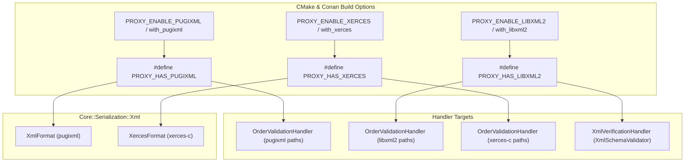

# 003: Conditional XML Library Switches & Core Xerces-C Integration

## 1. Overview & Problem Statement

### Why It's Needed
In `75a62e7` – `114f84e`, the Proxy codebase utilized three distinct XML libraries across `core` serialization and handler validation:
- **`pugixml`**: Lightweight, fast DOM parser/serializer used in `Core::Serialization::Xml::XmlFormat` and `OrderValidationHandler`.
- **`libxml2`**: W3C XSD schema validator used in `XmlVerificationHandler` and `OrderValidationHandler`.
- **`xerces-c`**: Enterprise Apache XML DOM/SAX parser and validator.

Previously, all three libraries were unconditionally required at build time, preventing minimal or constrained deployments from disabling unused XML engines, and `Core::Serialization::Xml` only supported `pugixml` as a format backend.

### The Solution
1. **Configurable CMake Options & Preprocessor Guards (`75a62e7`)**:
   - `PROXY_ENABLE_PUGIXML` (default `ON`) -> defines `PROXY_HAS_PUGIXML`
   - `PROXY_ENABLE_LIBXML2` (default `ON`) -> defines `PROXY_HAS_LIBXML2`
   - `PROXY_ENABLE_XERCES` (default `ON`) -> defines `PROXY_HAS_XERCES`
2. **Conan 2 Package Options**: Added `with_pugixml`, `with_libxml2`, and `with_xerces` options to root `conanfile.py` and `core/conanfile.py`.
3. **Core Xerces-C Format Policy (`Core::Serialization::Xml::XercesFormat`)**: Implemented `XercesFormat`, `XercesSerializer<T>`, and `XercesDeserializer<T>` in `core/include/core/serialization/xml/XercesFormat.hpp` and `core/src/serialization/xml/XercesFormat.cpp`.
4. **Conditional Compilation Across Handlers & Tests**: Guarded `XmlFormat`, `XercesFormat`, `OrderValidationHandler`, `XmlVerificationHandler`, `TestSerialization.cpp`, and `TestOrderValidationHandler.cpp` under `#if PROXY_HAS_*`.

---

## 2. Architecture & How It Works

### 2.1 Conditional XML Compilation Matrix



---

## 3. Design Decisions

### 3.1 Drop-In Format Policy Parity Between `XmlFormat` and `XercesFormat`
- **Decision**: Implement `Core::Serialization::Xml::XercesFormat` using the exact same `Serializer<T>` / `Deserializer<T>` policy signature as `XmlFormat`.
- **Rationale**: Any domain type specializing `TypeTraits<T>` can switch between `pugixml` and `xerces-c` simply by changing the template parameter (`serialize<XmlFormat>(obj)` vs. `serialize<XercesFormat>(obj)`).

---

## 4. Concrete Examples

### 4.1 Serializing with `XercesFormat`
```cpp
#if PROXY_HAS_XERCES
#include "core/serialization/Serializer.hpp"
#include "core/serialization/xml/XercesFormat.hpp"

Order order { "ORD-100", "MSFT", 410.25, 50 };
std::string xml = Core::Serialization::serialize<Core::Serialization::Xml::XercesFormat>(order);
auto roundTrip  = Core::Serialization::deserialize<Core::Serialization::Xml::XercesFormat, Order>(xml);
#endif
```

---

## 5. Tasks / Checklist

- [x] Add `PROXY_ENABLE_PUGIXML`, `PROXY_ENABLE_LIBXML2`, and `PROXY_ENABLE_XERCES` CMake options and `PROXY_HAS_*` compile definitions (`75a62e7`).
- [x] Add `with_pugixml`, `with_libxml2`, and `with_xerces` Conan options to `conanfile.py` and `core/conanfile.py`.
- [x] Implement `XercesFormat`, `XercesSerializer`, and `XercesDeserializer` in `core/include/core/serialization/xml/XercesFormat.hpp` and `core/src/serialization/xml/XercesFormat.cpp`.
- [x] Guard `XmlFormat`, `OrderValidationHandler`, `XmlVerificationHandler`, and unit tests with `#if PROXY_HAS_*`.

