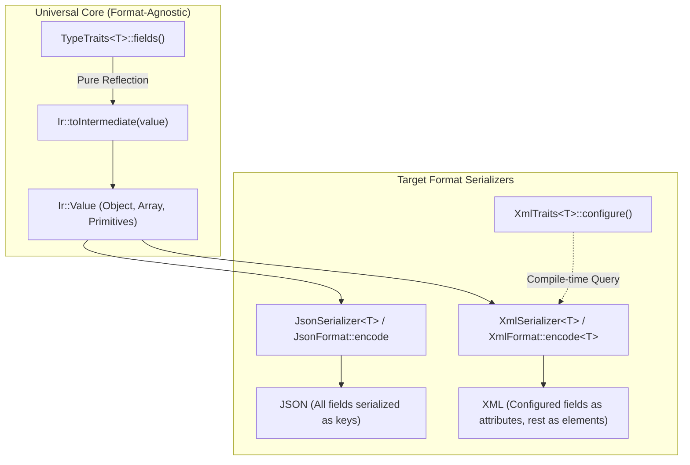

# Feature 004: Unified Field Traits and Fluent XML Configuration

## Overview & Problem Statement

Prior to this feature, reflection traits defined in `core/include/core/serialization/TypeTraits.hpp` separated struct members into two disjoint concepts and descriptor types: `FieldDescriptor` (via `fields()`) and `AttributeDescriptor` (via `attributes()`). This had critical drawbacks:

1. **Domain Leakage**: XML-specific concerns (`attribute()`, `attributes()`, `isAttribute`) leaked into foundational, format-agnostic core headers (`TypeTraits.hpp`, `Converter.hpp`, and `Value.hpp`).
2. **Format Incompatibility / Silent Data Loss**: A struct defining members as attributes could serialize to XML, but those attributes were completely ignored by JSON and other formats that lack the concept of attributes, leading to missing fields.
3. **Inflexible Extension Points**: Adding new format traits or field metadata required modifying core enums or descriptor structures, violating the Open-Closed Principle.
4. **IR Pollution**: `Ir::Value` had XML-specific attribute maps and methods (`setAttribute`, `findAttribute`, `AttributeMapType`), polluting the canonical runtime AST.

This feature unifies all struct reflection under a single `fields()` tuple in `TypeTraits.hpp`, moves format-specific attribute customization into a fluent `XmlTraits<T>` builder DSL in the XML subsystem, purifies `Ir::Value` into a clean format-agnostic AST, and enables typed format encoding.

---

## Architecture & How It Works



### Component Breakdown

1. **Universal Type Reflection (`core/include/core/serialization/TypeTraits.hpp`)**:
   - Only declares `FieldDescriptor<ClassType, MemberType>` and `field(name, &Class::member)`.
   - Every struct specifies all fields in a single `fields()` tuple.
2. **Format-Agnostic IR (`core/include/core/serialization/ir/Value.hpp`, `Converter.hpp`)**:
   - `Ir::Value` contains only pure value variants: `NullType`, `bool`, `int64`, `uint64`, `double`, `string`, `string_view`, `ArrayType`, and `ObjectType`.
   - All XML attribute methods (`attributes()`, `setAttribute()`, `findAttribute()`) are removed.
   - `toIntermediate` converts structs into `Ir::ObjectType` map entries.
   - `fromIntermediate` reads purely from `obj->find(desc.name)`.
3. **Fluent XML Traits (`core/include/core/serialization/xml/XmlTraits.hpp`)**:
   - Provides `XmlConfig<ClassType, MemberPtrs...>` with fluent `.asAttribute(&T::member)` chaining.
   - `XmlTraits<T>` defaults to an empty `XmlConfig<T>` (all fields serialized as elements) unless specialized.
4. **Compile-Time Typed XML Encoding (`XmlFormat.hpp`, `XercesFormat.hpp`)**:
   - `XmlFormat::encode<T>(ir, options)` and `XercesFormat::encode<T>(ir, options)` evaluate `XmlTraits<T>` directly at compile-time to determine if an object field should be written as an attribute or child element.
   - XML deserialization parses XML attributes and elements directly into the IR object map, preserving uniform deserialization across formats.

---

## Concrete Examples

### 1. Universal Type Trait Definition

```cpp
// Universal definition - works out of the box with JSON, XML, etc.
template <>
struct Core::Serialization::TypeTraits<UserProfile> {
    static constexpr auto fields() {
        return std::make_tuple(
            Core::Serialization::field("id", &UserProfile::id),
            Core::Serialization::field("role", &UserProfile::role),
            Core::Serialization::field("active", &UserProfile::active),
            Core::Serialization::field("username", &UserProfile::username),
            Core::Serialization::field("email", &UserProfile::email),
            Core::Serialization::field("location", &UserProfile::location)
        );
    }
};
```

### 2. XML-Specific Fluent Customization

```cpp
// Specialization in XML domain only
template <>
struct Core::Serialization::Xml::XmlTraits<UserProfile> {
    static constexpr auto configure() {
        return Core::Serialization::Xml::XmlConfig<UserProfile>{}
            .asAttribute(&UserProfile::id)
            .asAttribute(&UserProfile::role)
            .asAttribute(&UserProfile::active);
    }
};
```

### 3. Cross-Format Behavior

- **JSON Output**:
  ```json
  {"active":true,"email":"john@example.com","id":1337,"location":{"x":10,"y":20},"role":"admin","username":"johndoe"}
  ```
- **XML Output**:
  ```xml
  <UserProfile active="true" id="1337" role="admin">
    <email>john@example.com</email>
    <location>
      <x>10</x>
      <y>20</y>
    </location>
    <username>johndoe</username>
  </UserProfile>
  ```

---

## Tasks / Checklist

- [x] Remove `AttributeDescriptor`, `attribute()`, and `attributes()` from `core/include/core/serialization/TypeTraits.hpp`.
- [x] Create `core/include/core/serialization/xml/XmlTraits.hpp` with fluent `XmlConfig` builder.
- [x] Strip `AttributeMapType`, `m_attributes`, and attribute methods from `core/include/core/serialization/ir/Value.hpp`.
- [x] Keep `core/include/core/serialization/ir/Converter.hpp` 100% format-agnostic.
- [x] Update `XmlFormat` and `XercesFormat` to support typed `encode<T>` with compile-time `XmlTraits<T>` inspection.
- [x] Support uniform parsing of XML attributes and elements into `Ir::ObjectType`.
- [x] Update test models and add test cases verifying cross-format JSON serialization of structs with XML attributes.
- [x] Run full test suite and verify formatting.
