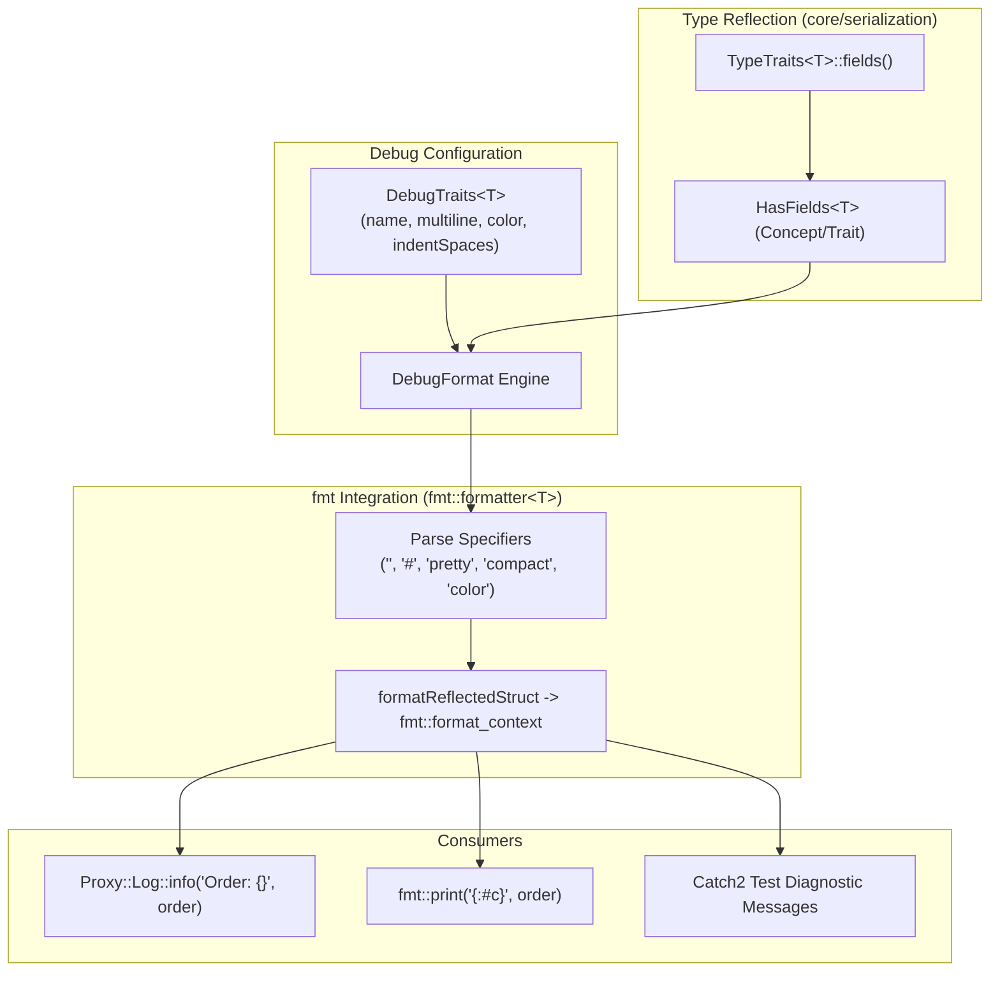

# Feature 005: Serialization Debug Trait and Console {fmt} Formatter

## Overview & Problem Statement

In high-throughput message processing pipelines, developers and operators frequently need to inspect complex domain messages, configuration entities, and internal state. Historically, inspecting reflected types required either:
1. Writing bespoke, repetitive string-formatting functions or logging calls member-by-member.
2. Incurring the performance overhead and heap allocations of encoding to wire formats (such as JSON or XML) via `Core::Serialization::serialize<JsonFormat>(val)`.
3. Suffering from rigid, unstyled log dumps that lack syntax color highlighting or legible indentation when debugging deeply nested objects in terminal sessions.

This feature introduces a zero-allocation, trait-driven console debug and `{fmt}` formatting subsystem (`core/include/core/serialization/fmt/DebugFormat.hpp` and `core/include/core/serialization/DebugTraits.hpp`). It enables any C++ struct reflected with `Core::Serialization::TypeTraits` to be passed directly to `{fmt}` routines and `Proxy::Log::{info, warn, error, debug}` without handwriting formatting logic.

For long-term reference and the complete developer guide, see the living architectural specification: [Logging, Formatting & Diagnostic Architecture](../../architecture/logging-formatting-and-diagnostics.md).

---

## Architecture & How It Works

### Component Breakdown

1. **Reflection Customization Point (`TypeTraits<T>`)**:
   - Pure, non-intrusive struct reflection in `core/include/core/serialization/TypeTraits.hpp` specifying fields via a compile-time tuple.
2. **Debug Customization Point (`DebugTraits<T>`)**:
   - Optional styling traits in `core/include/core/serialization/DebugTraits.hpp` (`name`, `multiline`, `color`, `indentSpaces`).
3. **`{fmt}` Formatter Engine (`core/include/core/serialization/fmt/DebugFormat.hpp`)**:
   - SFINAE-constrained `fmt::formatter<T, Char, std::enable_if_t<Core::Serialization::HasFields<T>>>`.
   - Directly streams into `fmt::format_context::out()` without heap allocations.
   - Recursively traverses nested reflected structs, primitives, standard strings, and standard containers (`std::vector`, `std::map`, `std::optional`, `std::array`).

---

## Design Decisions & Trade-Offs

1. **Decoupled Header Location (`fmt/DebugFormat.hpp`)**:
   - `core/serialization/TypeTraits.hpp` remains pure C++ with zero external dependencies (no `{fmt}` header included).
   - Translation units that only perform serialization or deserialization are not burdened with `{fmt}` template instantiations. Only call sites that print or log include `DebugFormat.hpp`.
2. **Rejection of Noisy `:?` Type Annotations**:
   - Redundant type annotations like `center (Point): Point { ... }` were evaluated and eliminated in favor of clean struct name prefixes (`Point { x: 10, y: 20 }`).
3. **Compile-Time Iteration via Fold Expressions**:
   - Struct fields are unrolled at compile time using `std::apply` and fold expressions directly into the formatter output iterator, ensuring minimal CPU overhead and zero memory allocation.

---

## Implementation Checklist

- [x] Create feature branch `feat/serialization-debug-fmt`.
- [x] Create `core/include/core/serialization/DebugTraits.hpp`.
- [x] Create `core/include/core/serialization/fmt/DebugFormat.hpp`.
- [x] Implement compile-time fold expression field iteration and format specifier parsing.
- [x] Add comprehensive test coverage in `test/TestSerialization.cpp` testing compact, pretty, nested, and container formatting.
- [x] Format all touched files with `clang-format`.
- [x] Verify test suite passes on debug build.
- [x] Document system architecture in `docs/architecture/logging-formatting-and-diagnostics.md`.
