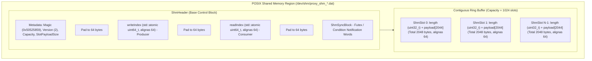

# Shared Memory Transport Architecture (`backend/shm`)

## 1. Overview & Problem Statement

### Why It's Needed
In ultra-low-latency financial and telemetry systems, passing messages between distinct operating system processes via standard network sockets (loopback UDP/TCP) or UNIX domain sockets incurs significant kernel overhead:
- **Kernel Boundary Crossings**: Every packet requires system calls (`sendto`, `recvfrom`) that trigger user-to-kernel mode switches and CPU register spills.
- **Buffer Duplication**: The kernel copies data from user space into socket buffers (`sk_buff`), schedules the receiving process, and copies data back into user space.
- **Latency Jitter**: Kernel scheduling and socket lock contention introduce microsecond-level latency spikes.

### The Solution
`backend-shm` provides a **kernel-bypass, zero-copy inter-process communication (IPC) transport** using POSIX shared memory (`shm_open`, `mmap`). Processes communicate directly through shared physical RAM pages mapped into their respective virtual address spaces, achieving sub-microsecond message transit times and processing millions of messages per second with minimal CPU overhead.

---

## 2. How It Works

### Memory Region Layout
A shared memory channel is backed by a single memory-mapped file (located in `/dev/shm` on Linux, or temporary space on macOS). The memory region is structured into two main sections:



### Producer-Consumer Flow
The transport implements a unidirectional Single-Producer Single-Consumer (SPSC) lock-free circular ring buffer:
1. **Producer Writing (`ShmOutputChannel`)**:
   - Computes `slotIndex = writeIndex.load(relaxed) % capacity`.
   - Checks for space: `(writeIndex - readIndex.load(acquire)) < capacity`.
   - Copies message payload directly into `slot.payload` and sets `slot.length`.
   - Increments `writeIndex` with `memory_order_release`.
   - Conditionally signals `ShmSignaler` if the consumer was waiting on an empty ring.
2. **Consumer Reading (`ShmInputChannel`)**:
   - Reads `readIndex` and checks if new slots are available: `writeIndex.load(acquire) > readIndex`.
   - If empty, it spins/yields adaptive iterations before parking via POSIX futex wait (`futex()` on Linux or condition variables on macOS).
   - Reads the payload directly from `slot.payload` into destination buffer slots.
   - Advances `readIndex` with `memory_order_release`.

---

## 3. High-Level Design Decisions

1. **Strict False Sharing Prevention**:
   - On multicore CPUs, if two cores write to different variables that share the same 64-byte hardware cache line, the CPU cache coherence protocol (MESI) constantly invalidates the cache line between cores (false sharing).
   - In `ShmHeader`, `writeIndex` (written by producer) and `readIndex` (written by consumer) are separated with explicit `alignas(64)` and padding bytes. Producer writes never stall consumer reads.
2. **Fixed-Size Slot Architecture (`ShmSlot`)**:
   - Each slot is exactly 2048 bytes (4-byte length + 2044-byte payload). Fixed slot sizes eliminate internal ring fragmentation and simplify index calculations to trivial modulo arithmetic (`index & (capacity - 1)`).
3. **Adaptive Signaling (`ShmSignaler`)**:
   - When message rates are high, producer and consumer stay in user space without issuing system calls. When idle, adaptive spinning yields briefly before falling back to kernel futex sleep to conserve CPU cores.
4. **Resilient Initialization & Recovery**:
   - The creating process flags creation and handles `shm_unlink` on graceful exit. Consuming processes inspect the `0x50525859` ('PRXY') magic number and `version` before attaching to verify memory integrity.

---

## 4. Concrete Examples

### Example: Configuring a Shared Memory Channel in C++
Handlers do not write shared memory logic directly; they request channels via `IBackend`:

```cpp
// Within a custom handler's onConfigure():
auto inChannel = backend().createInputChannel("orders_shm", config);
auto outChannel = backend().createOutputChannel("verified_shm", config);

// Producer sends a message:
std::string msg = "ORD#10042,BUY,100,AAPL";
outChannel->send(Common::Memory::ByteView(msg));

// Consumer receives a message into a local buffer:
std::array<std::byte, 2048> buffer;
auto result = inChannel->receive(buffer, std::chrono::milliseconds(10));
if (std::holds_alternative<Backend::ReceivedBytes>(result)) {
    size_t bytesRead = std::get<Backend::ReceivedBytes>(result).count;
    // Process payload...
}
```

### Example: Declarative Chain Configuration (`chains/example_shm.toml`)
```toml
backend = "shm"

[config]
"channel.orders.path" = "/tmp/proxy_shm_orders.dat"
"shm.capacity" = 2048

[[handlers]]
name = "sender"
type = "dummy_send"
output_channel = "orders"

[[handlers]]
name = "receiver"
type = "print_handler"
input_channel = "orders"
```

---

## 5. Tasks / Checklist
- [x] Implement fixed-slot circular ring buffer (`ShmRingBuffer`)
- [x] Implement false-sharing-free header (`ShmHeader`) with 64-byte line alignment
- [x] Implement adaptive signaling and futex notifications (`ShmSignaler`)
- [x] Implement batch slot reading and writing (`BufferSlot`)
- [x] Export `ShmBackend` through `proxy_discover_backends()`
