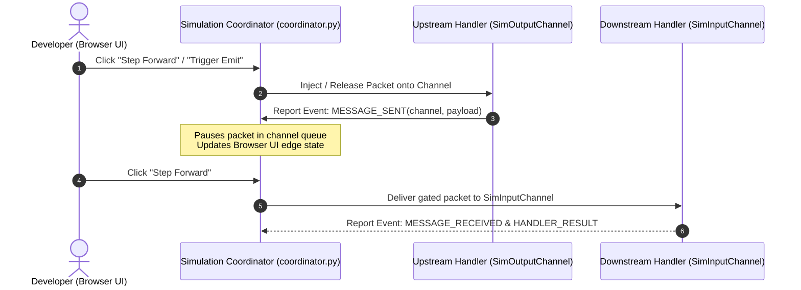

# 001: Native PCAP Engine, `SimBackend`, & Interactive Step-By-Step Debugger

## 1. Overview & Problem Statement

### Why It's Needed
In `d09cf3c` – `543ec99`, debugging multi-process handler topologies and replaying captured network traffic required a deterministic simulation environment:
1. **Zero-Dependency PCAP Replay**: Engineers needed to replay standard Wireshark/tcpdump `.pcap` packet captures (and synthesize mixed valid/invalid test captures via `tools/generate_sample_pcap.cpp`) without requiring external `libpcap` system libraries.
2. **Deterministic Clock & In-Memory Mock Channels**: Unit tests needed a virtualized `SimulationClock` and `MockInputChannel` / `MockOutputChannel` to advance time deterministically without wall-clock `sleep` delays.
3. **Interactive Visual Stepper (`backend/sim`)**: Understanding how a packet traverses a multi-stage chain (`DummySend` / `UdpIngress` -> `SplitHandler` -> `XmlVerificationHandler` -> `RouteHandler` -> `MergeHandler` -> `PrintHandler`) required an interactive transport backend (`backend/sim`) coordinated by a control plane (`scripts/proxy_runner/coordinator.py`) that pauses messages at each channel hop and lets the user step forward packet-by-packet in a browser UI.

### The Solution
1. **Native PCAP Parser & Generator (`Core::Simulation::PcapParser`, `d09cf3c`)**: Implemented a zero-dependency binary `.pcap` reader supporting microsecond/nanosecond magic headers and Ethernet/IPv4/UDP payload extraction, paired with `tools/generate_sample_pcap.cpp`.
2. **`SimulationClock` & Mock Channels (`d09cf3c`)**: Added `Core::Simulation::SimulationClock`, `MockInputChannel`, and `MockOutputChannel` in `core/include/core/simulation/`.
3. **Interactive Simulation Transport (`backend/sim`, `611fb52`, `543ec99`)**: Implemented `SimBackend`, `SimInputChannel`, and `SimOutputChannel`, which intercept every channel `send()` and `receive()`, report events to the Python simulation coordinator over a control socket, and gate message delivery on interactive user step commands (`Step Forward`, `Auto-Play`, `⚡ Trigger Emit`).

---

## 2. Architecture & How It Works

### 2.1 Interactive Simulation Stepping Architecture



---

## 3. Design Decisions

### 3.1 Transport-Level Interception via `backend/sim`
- **Decision**: Implement simulation stepping as a standard `Backend::IBackend` (`backend/sim`) linked into `<handler>_sim` binaries.
- **Rationale**: Handlers execute their exact production C++ validation and routing code without any simulation `#ifdef`s; only channel transit is gated by the coordinator.

### 3.2 Persistent Batching & Generator Triggering (`543ec99`)
- **Decision**: In simulation mode, autonomous generator timers (`DummySendHandler`) are paused (`delay_ms = 999999999`) and triggered explicitly via control commands or batched PCAP injection.
- **Rationale**: Prevents autonomous generators from flooding the visual canvas before the developer steps through the pipeline.

---

## 4. Concrete Examples

### 4.1 Launching Interactive Simulation Mode
```bash
# Launch interactive browser debugger for a handler chain with a PCAP capture:
./scripts/chain_runner.py chains/example_socket_chain.toml --sim --pcap sample_orders.pcap
```

---

## 5. Tasks / Checklist

- [x] Implement zero-dependency `PcapParser`, `SimulationClock`, `MockInputChannel`, and `MockOutputChannel` in `core/simulation` (`d09cf3c`).
- [x] Implement `tools/generate_sample_pcap.cpp` to generate synthetic PCAP files (`d09cf3c`).
- [x] Implement `SimBackend`, `SimInputChannel`, and `SimOutputChannel` in `backend/sim` (`611fb52`).
- [x] Implement interactive simulation coordinator (`scripts/proxy_runner/coordinator.py`) and browser stepper UI (`611fb52`, `543ec99`).

