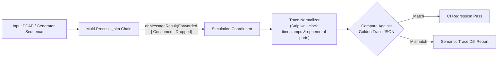

# 002: Deterministic Execution Tracing, Semantic Assertions, & Interactive Queue Visualization

## 1. Overview & Problem Statement

### Why It's Needed
In `cfef9c8` – `0dab6de`, as simulation topologies grew to include fan-out (`SplitHandler`), content-based routing (`RouteHandler`), and multi-generator chains, two capabilities were needed:
1. **Automated Deterministic Trace Regression Testing (`cfef9c8`, `ec283dd`)**: Developers needed a headless CLI trace mode (`--trace`) that runs a full PCAP or generator sequence through a multi-process chain, records every node-centric event (` Consumed`, `Forwarded`, `Dropped` with reason/error code and source file/line attribution), normalizes non-deterministic timestamps/PIDs, and diffs the execution trace against golden snapshot files in CI.
2. **Concurrent Queue & Multi-Branch Visualization (`2c06c26` – `32d2e66`)**: In the interactive simulation dashboard, triggering a generator or fan-out while another message was still in flight previously overwrote active animation state. Additionally, Real-Time and Step-Trace modes needed unified stepping controls and smooth frame-rate-independent particle animations.

### The Solution
1. **Node-Centric Trace Events & `MessageResult` Reporting (`cfef9c8`, `ec283dd`, `2c06c26`)**:
   - Connected `IHandler::processBatch()` to `SimBackend::onMessageResult()` so every handler outcome (`Forwarded { channel }`, `Consumed {}`, `Dropped { reason, errorCode }`) is emitted as a structured trace event.
   - Split simulation UI into **Real-Time Simulation Mode** and **Trace Inspector Mode**, with unified `Step Forward` auto-loading the next PCAP packet when no in-flight hops remain (`35fa340`).
2. **In-Flight Branch Queueing & Batch Inspector (`7584e41`, `6ae6c39`, `32d2e66`)**:
   - Queued concurrent generator triggers and fan-out branches in `coordinator.py` so multiple messages traverse the DAG without clobbering active packets.
   - Added grouped batch packet badges, auto-scrolling trace logs, and elapsed-time (`dt`) particle interpolation for terminal consumptions and channel forwards.

---

## 2. Architecture & How It Works

### 2.1 Node-Centric Trace Event & Regression Pipeline



---

## 3. Design Decisions

### 3.1 Node-Centric Over Edge-Centric Trace Events (`2c06c26`)
- **Decision**: Record trace steps anchored at each handler node (`INGRESS`, `FORWARDED`, `CONSUMED`, `DROPPED`) rather than raw socket read/write edges.
- **Rationale**: Aligns visual step animations directly with handler business decisions and makes golden trace assertions invariant to low-level socket poll timing.

### 3.2 Frame-Rate-Independent Particle Motion (`32d2e66`)
- **Decision**: Advance canvas message particles using `requestAnimationFrame` elapsed delta time (`dt`) rather than fixed per-frame increments, and animate terminal `Consumed` messages from the input edge into the consuming node center.
- **Rationale**: Ensures consistent animation speed across 60 Hz and 120 Hz ProMotion displays.

---

## 4. Concrete Examples

### 4.1 Running Headless Deterministic Trace Verification
```bash
# Capture or verify a deterministic execution trace in headless mode:
./scripts/chain_runner.py chains/example_socket_chain.toml --sim --trace --pcap sample_orders.pcap
```

---

## 5. Tasks / Checklist

- [x] Add `MessageResult` trace reporting (`SimBackend::onMessageResult`) and trace regression testing (`cfef9c8`, `ec283dd`).
- [x] Split Real-Time and Trace simulation modes and unify `Step Forward` auto-packet loading (`ec283dd`, `35fa340`).
- [x] Queue concurrent generator triggers and multi-branch fan-out packets in `coordinator.py` (`7584e41`, `6ae6c39`).
- [x] Smooth terminal particle animations with elapsed-time stepping (`2c06c26`, `32d2e66`).

