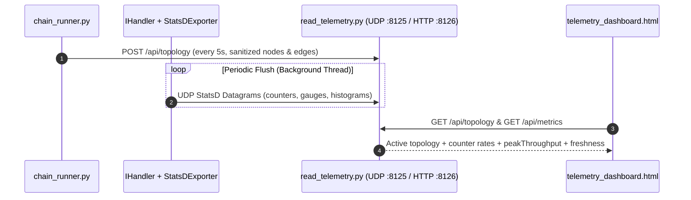

# 003: Lock-Free StatsD Telemetry & Consolidated Live Operator Dashboard

## 1. Overview & Problem Statement

### Why It's Needed
In `1e97172` and `bdfe1e4` – `c891bdd`, production deployments (`shm`, `socket`, `uds`, `inproc`) needed real-time operational visibility without the per-message pause/trace overhead of `backend/sim`:
1. **Lock-Free In-Process Telemetry (`Core::Telemetry`)**: Handlers needed to record ingress message counts (`messages_ingress_total`), byte counts (`bytes_ingress_total`), malformed drop counts (`messages_dropped_total`), and message transit age histograms (`message_processing_duration_us`) on the hot path with minimal atomic overhead and periodically flush UDP StatsD datagrams on a background thread (`StatsDExporter`).
2. **Consolidated Topology-First Operator Dashboard (`scripts/read_telemetry.py` & `scripts/telemetry_dashboard.html`)**: Previously, a standalone metrics page (`read_telemetry.py`) only showed flat StatsD counter tables, while a separate visual prototype (`live-topology-mockup.html`) displayed hardcoded synthetic data. Operators needed a single, live, read-only dashboard combining:
   - **Overview View**: Live chain topology published by `chain_runner.py`, source-node ingress KPIs, peak throughput tracking, edge rates, and node health states.
   - **Metrics & Diagnostics View**: Per-namespace tabs, latency age bucket distributions, and raw metric inspection.

### The Solution
1. **`Core::Telemetry::MetricsRegistry` & `StatsDExporter` (`1e97172`)**: Implemented lock-free atomic `Counter`, `Gauge`, and bucketed `Histogram` primitives in `core/include/core/telemetry/` with background periodic UDP export initialized automatically by `IHandler::configureTelemetry()`.
2. **Sanitized Topology Publishing (`bdfe1e4`)**: Updated `scripts/chain_runner.py` (`--telemetry-url`) to publish a sanitized topology projection (`scripts/proxy_runner/topology.py`) to `POST /api/topology` on `scripts/read_telemetry.py` every 5 seconds.
3. **Accurate Source-Node Aggregation & Freshness Tracking (`bdfe1e4`)**: Updated `read_telemetry.py` and `telemetry_dashboard.html` to compute message/byte rates from counter deltas, aggregate chain-level ingress strictly from source nodes (avoiding downstream double-counting), track interval-based `peakThroughput`, and explicitly display stale, missing, or disconnected states.

---

## 2. Architecture & How It Works

### 2.1 End-to-End Live Telemetry & Topology Pipeline



---

## 3. Design Decisions

### 3.1 Source-Node Ingress Aggregation (No Downstream Double Counting)
- **Decision**: Compute chain-level ingress message and byte rates using only topology source nodes rather than summing counters across every intermediate processing stage.
- **Rationale**: In a 4-stage pipeline (`Ingress -> Validator -> Router -> Egress`), summing all stages would over-report chain throughput by $4\times$.

### 3.2 Sanitized Topology Projection & Localhost Binding
- **Decision**: Exclude arbitrary handler configuration values, secrets, and message payloads from `POST /api/topology`, and bind `read_telemetry.py`'s HTTP server to `127.0.0.1` by default (`--web-host`).
- **Rationale**: Prevents leaking sensitive handler configuration over the diagnostics API and keeps the collector local unless explicitly fronted by a reverse proxy.

### 3.3 Explicit Message Age Labeling
- **Decision**: Label `message_processing_duration_us` as **message age measured from the envelope ingress timestamp to handler dispatch**, rather than callback execution duration.
- **Rationale**: Accurately reflects what `IHandler::processBatch()` measures (total transit + queueing delay since envelope creation).

---

## 4. Concrete Examples

### 4.1 Running the Collector & Live Chain Topology
```bash
# 1. Start the StatsD collector and web dashboard server:
python3 scripts/read_telemetry.py --host 0.0.0.0 --port 8125 --web-host 127.0.0.1 --web-port 8126

# 2. Launch a handler chain publishing live topology and StatsD metrics:
python3 scripts/chain_runner.py chains/example_socket_chain.toml \
    --backend socket \
    --telemetry-url http://127.0.0.1:8126
```

---

## 5. Tasks / Checklist

- [x] Implement lock-free `Counter`, `Gauge`, `Histogram`, and `StatsDExporter` in `core/telemetry` (`1e97172`).
- [x] Publish sanitized chain topology from `chain_runner.py` to `read_telemetry.py` (`POST /api/topology`) (`bdfe1e4`).
- [x] Consolidate Overview topology view and Metrics & Diagnostics view in `scripts/telemetry_dashboard.html` (`bdfe1e4`).
- [x] Correct source-node ingress aggregation, byte-rate delta math, stale/missing state indicators, and `peakThroughput` tracking (`bdfe1e4`).
- [x] Add regression tests in `test/test_live_telemetry.py` (`bdfe1e4`).

