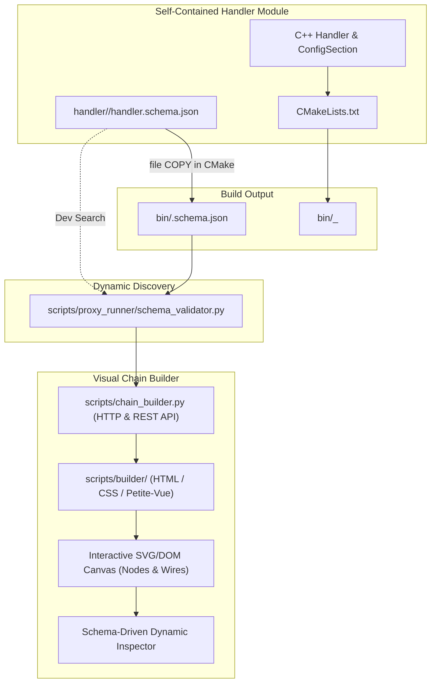

# 004: Visual Chain Builder Studio & Decoupled Per-Handler Schema System

## 1. Overview & Problem Statement

### Why It's Needed
Constructing and configuring declarative multi-stage messaging pipelines previously required manual authoring of `.toml` or `.json` files. This workflow had several pain points:
1. **Error-Prone Syntax & Silent Parameter Bugs**: Misspelling configuration keys or using invalid integer bounds was only caught at runtime or resulted in silent fallbacks to defaults.
2. **Topology Blindness**: Operators could not visually inspect fan-out/fan-in branching (e.g. `split_handler`, `scatter_handler`, `gather_handler`) or verify channel linkages before executing the pipeline.
3. **Monorepo Coupling Risks**: If handlers were coupled to a centralized configuration schema, extracting handlers into isolated repositories or independent Conan packages (polyrepo transition) would break the schema registry.

### The Solution
We implemented a self-contained, browser-based **Visual Chain Builder Studio** paired with **Decoupled Per-Handler Configuration Schemas**:
1. **Per-Handler Single Source of Truth (`handler.schema.json`)**:
   - Each handler directory (e.g. `handler/dummy_send/`, `handler/udp_egress_handler/`) owns its authoritative `handler.schema.json`.
   - Defines operational roles (`generator`, `processor`, `external_ingress`, `external_egress`), protocols (`none`, `udp`), input/output port cardinalities, and typed parameters (types, descriptions, defaults, min/max limits, enums).
   - CMake automatically packages and copies the schema alongside the compiled binaries (`bin/<handler_name>.schema.json`).
   - Discovery tools scan directories dynamically without relying on any centralized or monorepo registry.
2. **Interactive Visual Drag & Drop Canvas**:
   - Palette organized by functional category (`Generators`, `Gateways`, `Processors`, `Routing`, `Sinks`).
   - Interactive zoom/pan canvas with smooth cubic Bezier link drawing from output sockets to downstream input sockets.
   - Sockets snap and enforce single vs multiple port cardinality.
3. **Dynamic Schema-Driven Property Inspector & Real-Time Validation**:
   - Real-time diagnostics banner detects missing required parameters, unconnected input ports, unlinked output channels, or duplicate node names as user edits.
4. **Bidirectional Serialization & Integration**:
   - Import and export cleanly to/from standard `.toml` and `.json` files.
   - Standalone CLI launcher (`./scripts/chain_builder.py`) and direct link from the interactive simulation dashboard.

---

## 2. Architecture & Data Flow



---

## 3. Schema Structure Specification

Each handler maintains a `handler.schema.json`:

```json
{
  "$schema": "https://json-schema.org/draft/2020-12/schema",
  "name": "gather_handler",
  "displayName": "Gather Merger",
  "role": "processor",
  "protocol": "none",
  "category": "Routing",
  "description": "Gather stage of scatter-gather pipeline. Synchronizes and requires verdicts across all parallel branches before forwarding.",
  "ports": {
    "inputs": [
      {
        "name": "input_channels",
        "label": "Gather Branches",
        "cardinality": "multiple",
        "default": "branch_res_a,branch_res_b",
        "description": "Comma-separated branch output channels to correlate."
      }
    ],
    "outputs": [
      {
        "name": "output_channel",
        "label": "Merged Egress",
        "cardinality": "single",
        "default": "gather_out",
        "description": "Output channel where fully validated consolidated messages are forwarded."
      }
    ]
  },
  "parameters": {
    "gather.timeout_ms": {
      "type": "integer",
      "label": "Branch Timeout (ms)",
      "default": 5000,
      "min": 1,
      "description": "Maximum duration in milliseconds to wait for all parallel branch results before expiring."
    }
  }
}
```

---

## 4. Usage Examples

### 4.1 Launching the Visual Builder
```bash
# Launch with an existing chain
./scripts/chain_builder.py chains/example_scatter_gather_chain.toml --port 8095

# Launch with an empty canvas
./scripts/chain_builder.py --port 8095
```
Open `http://localhost:8095` to drag-and-drop nodes, draw wires, configure properties, and export to TOML.

### 4.2 Running Automated Schema & Topology Tests
```bash
PYTHONPATH=scripts:. python3 test/test_handler_schemas.py
```

---

## 5. Verification Checklist
- [x] Defined individual `handler.schema.json` files for all 12 handlers in `handler/`.
- [x] Updated `cmake/ProxyBackends.cmake` to copy `handler.schema.json` to `bin/<name>.schema.json`.
- [x] Implemented `scripts/proxy_runner/schema_validator.py` with decoupled dynamic discovery and topology checks.
- [x] Created `scripts/chain_builder.py` standalone server and REST endpoints (`/api/schemas`, `/api/chain`, `/api/chain/validate`, `/api/chain/save`, `/api/chain/run`).
- [x] Implemented responsive HTML5/SVG drag-and-drop canvas and wire-routing engine (`scripts/builder/`).
- [x] Integrated "Chain Builder" shortcut in simulation dashboard (`scripts/dashboard/index.html`).
- [x] Created unit tests `test/test_handler_schemas.py` verifying all 12 schemas and existing chains.

