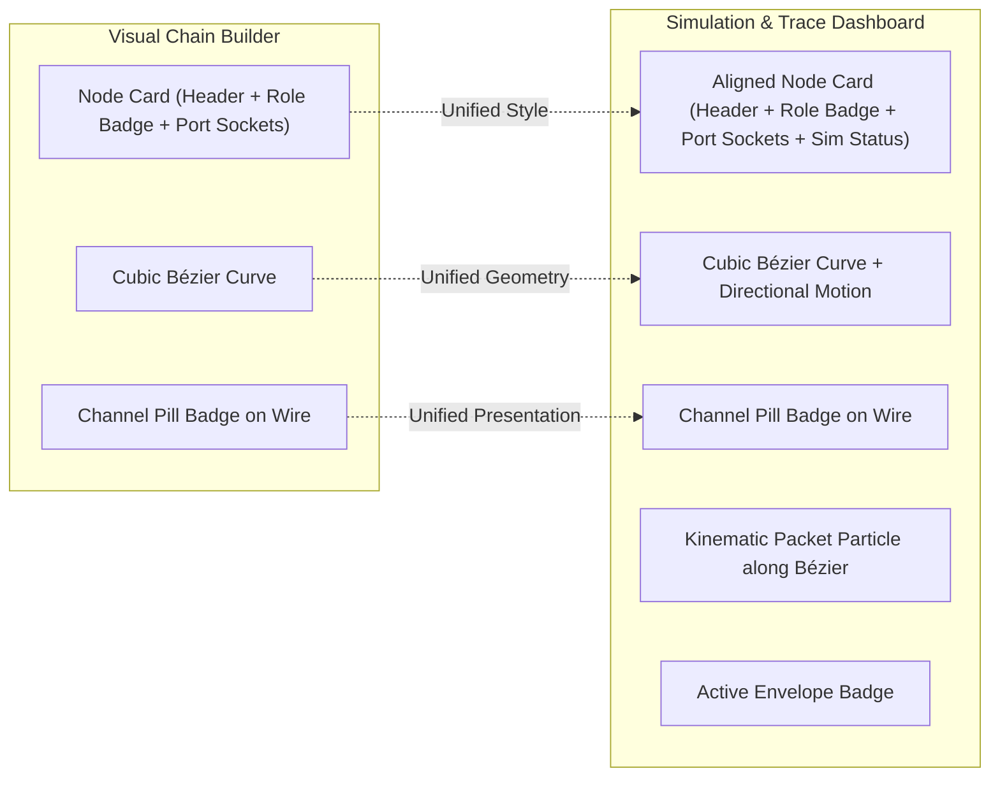

# 005: Align Simulation & Trace Dashboard Node and Link View with Visual Chain Builder

## 1. Overview & Problem Statement

### Why It's Needed
In feature `004`, we introduced the modern **Visual Chain Builder Studio** with:
- Structured handler cards featuring distinct header bars, semantic role badges (`role-generator`, `role-external_ingress`, `role-external_egress`, `role-processor`), handler type labels, and discrete input/output port rows with circular terminal sockets.
- Smooth cubic Bézier wire interconnects with directional curvature and styled channel name pill badges centered on links (`wire-label-rect` and `wire-label-text`).
- Consistent color palettes and typography.

However, the **Interactive Simulation & Trace Dashboard** (`scripts/dashboard/`) still used an earlier rendering layout:
1. Primitive rectangular nodes (simple single rounded boxes with plain text, lacking the header/body separation, distinct role badges, and explicit port sockets).
2. Straight dashed lines with plain text channel labels above the line instead of smooth cubic Bézier curves with styled channel pill badges.
3. Lack of visual parity between building a pipeline and stepping through/replaying it in simulation.

### The Solution
Upgrade the Canvas visualizer in `scripts/dashboard/js/canvas.js` (and associated styling in `scripts/dashboard/css/dashboard.css`) to align the visual rendering of handler nodes, ports, sockets, and channel links directly with the Visual Chain Builder design language:
1. **Node Cards**:
   - Card dimensions and layout matching Builder styling (width ~200-220px, header + body partition, subtle border and drop shadows).
   - Card header with bold node instance name on the left and semantic role badge on the right (`GENERATOR`, `INGRESS`, `EGRESS`, `PROCESSOR`) using identical background/text colors.
   - Node body showing handler type label and discrete left/right port items with circular port sockets.
   - Connected / active port socket styling.
   - Generator nodes feature the interactive "⚡ Trigger Emit" button integrated into the card body.
2. **Smooth Bézier Wire Links**:
   - Smooth cubic Bézier curves connecting the exact source output socket to destination input socket (`M x1 y1 C cx1 cy1, cx2 cy2, x2 y2`).
   - Active event edge highlighting following the exact Bézier trajectory.
3. **Channel Pill Badges**:
   - Rounded pill badge centered on the wire curve displaying the channel name with dark fill, colored border, and drop shadow.
4. **Cinematic Particle & Envelope Integration**:
   - Kinematic packet particles and persistent envelope status badges travel seamlessly along the Bézier paths between sockets and sit prominently above active nodes.

---

## 2. Architecture & Visual Comparison

---

## 3. Tasks / Checklist
- [x] Create feature specification `docs/features/simulation/005-align-simulation-node-view-with-visual-builder.md`.
- [x] Update `scripts/dashboard/css/dashboard.css`:
  - Add semantic role badge styles matching builder palette.
  - Convert 3-column layout to flexible panels with draggable splitter resizers (`.resizer`, `.panel-left`, `.panel-right`).
  - Add canvas zoom/pan floating controls overlay.
- [x] Refactor `scripts/dashboard/js/canvas.js`:
  - Calculate discrete socket positions for input and output ports on each handler node layout.
  - Implement cubic Bézier wire routing for channel links between specific output and input sockets.
  - Render channel pill badges centered on Bézier curves with background pill box and border.
  - Render handler node cards with header, title, role badge, type label, port items, and circular sockets.
  - Align particle animation trajectories with Bézier paths.
  - Implement smooth cursor-centered mouse wheel zooming, mouse-drag panning, and floating control buttons (`+`, `-`, `⌂`).
  - Stabilize world-space layout coordinates so nodes maintain position without squashing when viewport changes.
- [x] Implement panel resizing in `scripts/dashboard/js/app.js` with mouse drag and persistent `localStorage` memory.
- [x] Run full automated test suite to ensure zero regressions.

