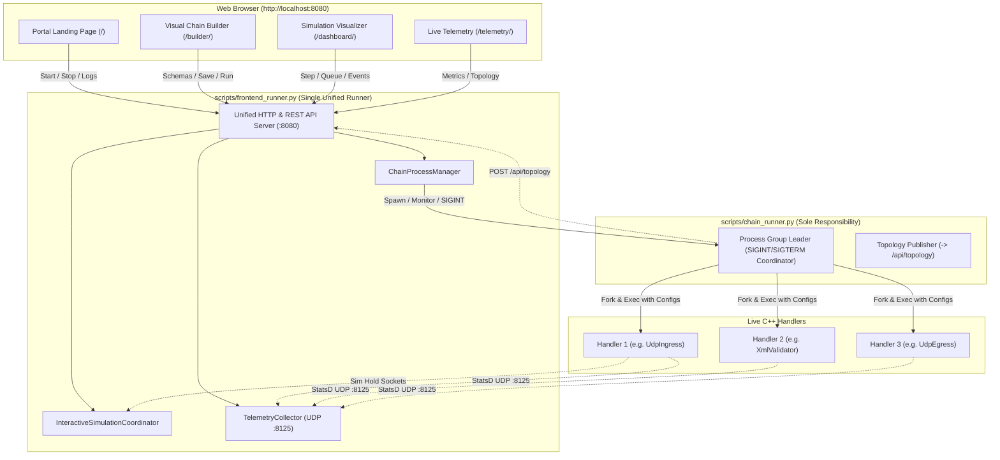

# 006: Unified Frontend Runner and Decoupled Chain Supervisor

## Overview & Problem Statement

Prior to this architectural enhancement, orchestration and user-interface responsibilities were fragmented across multiple scripts:
1. `scripts/chain_runner.py`: Supervised C++ handler processes, but also attempted to host an HTTP web server (`start_dashboard_server` on port 8090) when running the `sim` backend. Terminating or restarting a chain killed the web dashboard, forcing the developer to re-launch the script and refresh browser tabs.
2. `scripts/read_telemetry.py`: Listened for StatsD UDP datagrams on port 8125, but also spawned an independent HTTP dashboard on port 8126.
3. `scripts/chain_builder.py`: Managed DAG schema validation and served the Visual Chain Builder on port 8095, while spawning background `chain_runner.py` instances on separate ports.

This fragmentation caused several developer pain points:
- **Port Sprawl & Mixed Concerns**: Running all tools required juggling multiple terminal sessions across ports 8090, 8095, and 8126.
- **Fragile Frontend Lifecycle**: Stopping a running chain killed the simulation dashboard, disconnecting the frontend and dropping trace inspection state.
- **Lack of UI-Driven Lifecycle Control**: Developers could not start, stop, switch configurations, or inspect process logs dynamically from a single browser landing portal.

This feature introduces `scripts/frontend_runner.py`, a single authoritative Python runner for all front-end tools, backed by a unified landing portal and REST control plane, while strictly refocusing `scripts/chain_runner.py` on its sole responsibility: headless or interactive pipeline process orchestration.

---

## Architecture & How It Works

The architecture establishes a clean separation between the **User Interface & Control Plane** (`frontend_runner.py`) and the **Handler Process Supervisor** (`chain_runner.py`).



### 1. Unified Control Plane (`scripts/frontend_runner.py`)
- Runs a multi-threaded HTTP server defaulting to port `8080`.
- Serves:
  - `/` or `/index.html`: Portal Landing Page with quick action cards, configuration selection, and a live streaming terminal console.
  - `/builder/`: Visual DAG pipeline builder with real-time schema validation.
  - `/dashboard/`: Interactive simulation visualizer with packet queue inspection, step-by-step forward/backward tracing, and trace artifact export.
  - `/telemetry/`: Real-time pipeline health, throughput, latency histograms, and DAG topology.
- Embeds a background UDP listener on port `8125` collecting StatsD metrics into an in-memory `TelemetryCollector`.
- Implements `ChainProcessManager`:
  - Spawns `scripts/chain_runner.py` as an isolated subprocess group.
  - Streams `stdout` and `stderr` asynchronously into a rolling 2,000-line buffer accessible via `/api/runner/status`.
  - Sends clean `SIGINT` signals to the process group when "Stop Chain" is clicked in the UI, allowing all C++ handlers to exit safely and remove temporary configuration files without interrupting the web server.

### 2. Refocused Chain Runner (`scripts/chain_runner.py`)
- Stripped of all web server and dashboard hosting responsibilities (`start_dashboard_server` removed).
- Manages:
  - Discovery and resolution of handler binaries for the active backend (`file`, `socket`, `uds`, `shm`, `sim`).
  - Temporary per-handler `.conf` file generation in a secure working directory.
  - Process execution, monitoring, and signal forwarding (SIGINT, SIGTERM, SIGHUP).
  - Headless simulation execution for CI / regression testing (`--headless`, `--assert-trace`, `--export-trace`), executing without any GUI overhead.

---

## Design Decisions

1. **Persistent Frontend Lifecycle**:
   - *Rationale*: Stopping or restarting a pipeline runner should never drop the developer's web connection, reset DAG canvas layouts, or force page reloads. The frontend runner remains active indefinitely, providing immediate restart capabilities.
2. **Standard Process Group Signals**:
   - *Rationale*: The `ChainProcessManager` spawns `chain_runner.py` with `start_new_session=True` and delivers `os.killpg(pid, signal.SIGINT)`. This guarantees that `chain_runner.py`'s built-in graceful shutdown logic executes cleanly across all child C++ handlers.
3. **Decoupled Simulation Coordinator**:
   - *Rationale*: When running with the `sim` backend, `frontend_runner.py` instantiates `InteractiveSimulationCoordinator`, binding the Unix domain sockets (`/tmp/proxy_sim_events.sock` and `/tmp/proxy_sim_hold_<ch>.sock`). C++ binaries launched by `chain_runner.py` connect to these existing hold sockets, allowing step-by-step simulation directly from the web interface.
4. **Unified Top Bar & Integrated Workspace Dropdown**:
   - *Rationale*: Instead of cluttering the top bar with redundant individual navigation buttons across every screen, the top-left workspace badge functions as an interactive dropdown selector. Users can jump directly between Control Plane, Visual Builder, Simulation Visualizer, and Telemetry, while the top-right header area remains reserved for workspace-specific controls.

---

## Concrete Examples

### 1. Starting the Unified Web Studio
```bash
./scripts/frontend_runner.py
# Or bind to custom HTTP and Telemetry ports:
./scripts/frontend_runner.py --port 8080 --telemetry-port 8125
```
Output:
```text
==================================================================
 🚀 PROXY UNIFIED WEB STUDIO & CONTROL PLANE
==================================================================
 🏠 Landing Page Portal:       http://localhost:8080/
 🎨 Visual Chain Builder:     http://localhost:8080/builder/
 🔍 Simulation Visualizer:     http://localhost:8080/dashboard/
 📊 Telemetry & Topology:      http://localhost:8080/telemetry/
 📡 StatsD UDP Listener:       0.0.0.0:8125
==================================================================
```

### 2. Running a Chain Standalone (Solely Supervising Handlers)
```bash
./scripts/chain_runner.py chains/example_socket_chain.toml
```
`chain_runner.py` launches the handler processes, configures them, handles signals, and terminates without attempting to bind web ports.

### 3. Headless Trace Assertions in CI / CTest
```bash
./scripts/chain_runner.py chains/example_shm_full_proxy_chain.toml \
    --pcap sample_orders.pcap \
    --assert-trace test/traces/example_shm_full_proxy_chain.trace.json \
    --bin-dir ./build/gcc16-debug/bin
```

---

## Tasks / Checklist

- [x] Create `scripts/frontend_runner.py` hosting the unified HTTP server and StatsD UDP listener.
- [x] Create `scripts/portal/` landing page (`index.html`, `css/portal.css`, `js/portal.js`).
- [x] Implement `ChainProcessManager` with start, stop, restart, and asynchronous log streaming APIs.
- [x] Refactor `scripts/chain_runner.py` to remove web dashboard server startup logic while preserving headless execution.
- [x] Update `scripts/read_telemetry.py` to make standalone web server optional (`--web`) and point to `frontend_runner.py`.
- [x] Update headers in `scripts/dashboard/index.html`, `scripts/builder/index.html`, and `scripts/telemetry_dashboard.html` with unified workspace dropdown badge.
- [x] Implement unit tests in `test/test_frontend_runner.py` and register in `test/CMakeLists.txt`.
- [x] Verify full regression suite and CTest `simulation_trace_regression_test`.

