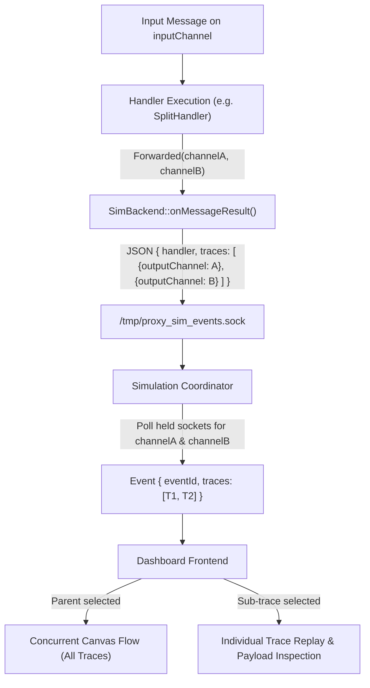

# 007: Multi-Trace Event Architecture & Tree View Replay in Simulation

## 1. Overview & Problem Statement

### Why It's Needed
In complex pipeline topologies—specifically fan-out architectures (`SplitHandler`, content routers, and scatter dispatchers)—a single handler execution on an input packet produces multiple outgoing forwarded messages across distinct output channels. 

Previously:
1. An execution step/event assumed a 1-to-1 relationship between an event and an outgoing channel (`outputChannel: string`), flattening multi-channel outputs into a glued, comma-separated string (e.g. `"file_receiver_branch,file_printer_branch"`).
2. The simulation coordinator (`coordinator.py`) struggled to correlate multiple held output sockets with discrete trace records.
3. The dashboard execution trace list showed a single flat record per step, and the canvas animation could only animate a single outgoing particle trajectory at a time.
4. Developers could not inspect or replay individual outgoing branches produced by a fan-out event.

### The Solution
1. **Multi-Trace Event Model**: Every simulation event encapsulates its outcomes inside a `traces: [...]` array. Single-trace events (`ingress`, `egress`, `drop`, or 1-to-1 forwards) cleanly contain a 1-element array, while fan-out handlers (`SplitHandler`) contain $N$ discrete trace records.
2. **Structured `SimBackend` Reporting**: Using `nlohmann::json`, `SimBackend::onMessageResult()` constructs a structured JSON event containing the array of traces and sends it atomically over `/tmp/proxy_sim_events.sock`.
3. **Multi-Branch Interception & Aggregation**: `coordinator.py` collects held payloads across all output channels and maps each to a discrete trace record within the parent event.
4. **Hierarchical Tree View & Interactive Replay**:
   - The simulation dashboard's Execution Trace panel presents events with an uncollapsible tree structure (`▾` / `▸`).
   - Clicking the parent event visualizes all traces flowing simultaneously along their respective channel edges in one concurrent particle flow.
   - Expanding the event reveals each individual sub-trace (target channel, payload summary, status).
   - Clicking an individual sub-trace replays that specific branch on the canvas and populates the payload inspector with that branch's exact data.
5. **Deterministic Trace Assertions**: The trace normalization engine (`TraceManager`) normalizes and diffs the `traces` array deterministically across test runs.

---

## 2. Architecture & How It Works

### 2.1 Multi-Trace Event Lifecycle



### 2.2 Event & Trace Data Schema

```json
{
  "eventId": 2,
  "msgId": 1,
  "batchIds": [1],
  "batchCount": 1,
  "type": "hop",
  "handler": "splitter_1",
  "handlerType": "split_handler",
  "inputChannel": "file_ingress_pipe",
  "detail": "'splitter_1' forwarded Packet #1 to 2 channels",
  "traces": [
    {
      "traceId": 1,
      "msgId": 1,
      "channel": "file_receiver_branch",
      "outputChannel": "file_receiver_branch",
      "result": "Forwarded",
      "status": "forwarded",
      "payloadSummary": "Hello through file split pipe!",
      "payloadFull": "Hello through file split pipe!",
      "detail": "Forwarded to 'file_receiver_branch'"
    },
    {
      "traceId": 2,
      "msgId": 1,
      "channel": "file_printer_branch",
      "outputChannel": "file_printer_branch",
      "result": "Forwarded",
      "status": "forwarded",
      "payloadSummary": "Hello through file split pipe!",
      "payloadFull": "Hello through file split pipe!",
      "detail": "Forwarded to 'file_printer_branch'"
    }
  ]
}
```

---

## 3. Design Decisions

### 3.1 Uniform `traces: [...]` Array Across All Events
- **Decision**: All events (including single-output hops, ingress, egress, and drops) represent their trace outcome inside a `traces` array of length $\ge 1$.
- **Rationale**: Eliminates branching logic across the coordinator, trace normalizer, and frontend renderer. A single-item trace array simplifies consumption without requiring special casing for "multi vs single" events.

### 3.2 Dual Replay Mode (All-in-One vs. Sub-Trace Selection)
- **Decision**: Selecting a parent event in the Execution Trace list triggers concurrent particle flows to all output channels simultaneously. Selecting an uncollapsed sub-trace isolates that channel edge and inspects its specific payload.
- **Rationale**: Allows users to step normally through high-level pipeline execution while retaining the granular debugging capability to isolate individual fan-out branches.

---

## 4. Concrete Examples

### 4.1 Replaying Multi-Trace Events in Dashboard
1. Launch any fan-out chain:
   ```bash
   ./scripts/frontend_runner.py
   ```
2. In the Simulation Visualizer, step forward into a `SplitHandler` node.
3. Observe concurrent particles emerging from the split node along all outgoing wires.
4. In the right-hand panel, click the `▸` arrow beside the step to expand individual branch traces, or click a branch trace to isolate its path and view its payload.

---

## 5. Tasks / Checklist

- [x] Integrate `nlohmann_json` into `backend-sim` CMake and Conan configurations.
- [ ] Update `SimBackend::onMessageResult()` to construct and send structured JSON events with `traces: [...]`.
- [ ] Update `InteractiveSimulationCoordinator` (`scripts/proxy_runner/coordinator.py`) to generate `traces: [...]` on all events and handle multi-branch held payloads.
- [ ] Update `TraceManager` (`scripts/proxy_runner/trace.py`) to normalize and assert `traces` arrays.
- [ ] Regenerate/update reference execution trace snapshots (`test/traces/*.trace.json`).
- [ ] Update `scripts/dashboard/index.html` and `dashboard.css` with tree view collapsible list items and trace count indicators.
- [ ] Update `scripts/dashboard/js/canvas.js` to animate concurrent particle flows for all traces in an event.
- [ ] Update `scripts/dashboard/js/app.js` to handle tree expansion, event/sub-trace selection, and inspection.
- [ ] Verify test suite passing via CTest.
