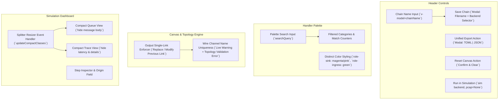

# 008: Visual Chain Builder UX Enhancements & Simulation Dashboard Compact Views

## 1. Overview & Problem Statement

### Motivation
As pipelines created in the Visual Chain Builder grow in complexity, UI ergonomics and safety constraints become critical:
1. **Handler Discovery Friction**: Locating specific handlers across many functional categories required manual scrolling and expanding/collapsing sections.
2. **Backend Configuration Location**: The transport backend was placed as a persistent global dropdown inside the handler palette sidebar, creating confusion between handler component selection and pipeline runtime export/save settings.
3. **Implicit Simulation Traffic Coupling**: Running a chain in simulation mode previously defaulted to auto-injecting `sample_orders.pcap` regardless of whether the pipeline was designed for synthetic generators or if the user intended to load custom PCAPs inside the simulation dashboard.
4. **Visual Role Ambiguity**: Handlers with `sink` and `external_ingress` roles used nearly identical dark-green color styling, reducing visual hierarchy on the canvas.
5. **Chain Identification**: Pipelines had no user-editable top-level identity/name field in the visual designer.
6. **Export Clutter**: Export buttons were split into individual TOML and JSON actions on the main toolbar.
7. **Canvas State Reset**: No straightforward mechanism existed to wipe the canvas and reset the chain to a blank state.
8. **Link Multiplicity & Wire Name Collisions**: Connecting an output socket to an input could create multiple duplicate links rather than replacing or modifying the previous connection, and duplicate wire channel identifiers across different links were not enforced.
9. **Responsive Overflow in Simulation Dashboard**: In the interactive simulation dashboard, resizing the PCAP Queue or Execution Trace panels smaller caused long text payloads, step latencies, and item descriptions to wrap vertically and blow out the card heights.
10. **Inspector Terminology Alignment**: The trace inspector box header and field labels used verbose or non-uniform terminology (`Step & MessageResult Inspector` and `Handler / Location`).

---

## 2. Architecture & How It Works

### Visual Builder UX Workflow



### Key Architectural Enhancements

1. **Palette Search & Live Filtering (`builder_app.js`, `index.html`, `builder.css`)**:
   - Added instant search box filtering schemas across `displayName`, `name`, `role`, and `description`.
   - Real-time matched handler count badge and clear button.
2. **Save Modal with Embedded Backend Selector**:
   - Removed backend selector from the handler palette sidebar.
   - Introduced a focused Save Pipeline modal that prompts for `chainName`, output filename (`.toml`), and the target runtime `backend` (`file`, `socket`, `shm`, `uds`, `sim`).
3. **Decoupled Simulation Launch (`frontend_runner.py`)**:
   - `Run in Simulation` now executes purely with `backend = "sim"` and `pcap_str = None`.
   - Ingress PCAP files are loaded deliberately by operators on the simulation page.
4. **Distinct Ingress vs. Sink Role Badges (`builder.css`, `dashboard.css`)**:
   - Ingress handlers retain deep forest green (`#14532d` / `#86efac`).
   - Sink handlers are now styled with distinct magenta/purple hues (`#701a75` / `#f472b6` with a soft border).
5. **Chain Name Editing**:
   - Header now includes an inline editable chain name widget (`v-model="chainName"`).
   - Propagates into exported TOML comments and JSON metadata.
6. **Unified Export Prompt**:
   - Combined separate export buttons into a single `Export` button opening a clean selection dialog for TOML or JSON downloads.
7. **Reset Chain Action**:
   - Added `Reset` button with user confirmation to clear all nodes, wires, and selections.
8. **Single-Link Output Invariant & Wire Name Uniqueness**:
   - In `builder_app.js`: An output socket may only have 1 active wire. Creating a new link replaces the previous outgoing wire and unbinds the old destination channel.
   - Wire channels are validated for global uniqueness across the chain. `validate_chain_topology` in `schema_validator.py` flags any duplicate producer wires.
9. **Responsive Compact Views in Simulation Dashboard (`dashboard.css`, `app.js`)**:
   - When the PCAP queue panel is resized below 290px, `.compact-queue` hides packet payload summaries.
   - When the Execution Trace panel is resized below 320px, `.compact-trace` hides latency badges and detail lines.
10. **Terminology Normalization (`dashboard/index.html`)**:
    - Renamed header box to `STEP INSPECTOR`.
    - Renamed `Handler / Location` field to `Origin`.
    - Shortened `Input Channel` to `Channel` and `MessageResult` to `Result`.
11. **Interactive Link Re-assignment with Direct Drag**:
    - Dragging from an output socket that already has a connection wire dynamically re-routes the existing link with the mouse cursor while hiding the old wire.
    - Dropping on a new socket re-assigns the link, while releasing in empty canvas space safely cancels the operation and preserves the existing connection.
12. **Chain Name Title Styling**:
    - Removed all nested icons and secondary borders from the chain name container.
    - Styled with a semi-transparent slate shaded background, vivid cyan accent text, bottom underline highlight (`border-bottom: 2px solid #38bdf8`), and `cursor: text` on hover.
13. **Automatic Unique Wire Naming on Link Creation**:
    - When creating a new connection wire, `generateUniqueChannelName` is always called directly to produce an explicit, collision-free unique channel name across the entire DAG (e.g. `<src>_to_<dst>` or `<src>_b1_to_<dst>_2`), updating both the producing output socket and consuming input socket.
14. **Inline In-Node Parameter Configuration**:
    - Embedded schema parameters directly into node cards (`.node-params-section`) with compact inputs, inline collapse/expand toggle, and socket count modifiers.
    - Removed the right sidebar inspector, allowing the canvas to span the full available viewport width.
15. **Floating Corner Diagnostics Pill**:
    - Positioned an interactive pill button (`.floating-diagnostics`) in the bottom-right corner of the canvas showing real-time clean, warning, or error states.
    - Accurately differentiates between fully clean (valid with 0 warnings: green `Pipeline Clean`), warning state (valid with warnings: amber `N Warnings`), and invalid error state (rose `N Issues`).
    - Clicking the pill opens a floating diagnostic drawer detailing errors and warnings.
16. **In-Node Warning Diagnostics & Active Link Socket State**:
    - Socket styling strictly distinguishes between active links and unlinked ports: sockets are muted/dark when unlinked (`opacity: 0.45`), glowing green only when linked by an active connection wire.
    - Node cards display dedicated warning badges (`.node-warn-badge`) with amber borders and tooltips when a handler has warnings (e.g. unconsumed output or unproduced input channels).

---

## 3. Concrete Examples

### Example: Validation Rule for Wire Name Uniqueness
```python
# scripts/proxy_runner/schema_validator.py
for ch, producers in output_channels.items():
    if len(producers) > 1:
        errors.append(
            f"Channel wire '{ch}' is produced by multiple handlers ({producers}). "
            "Connection wires must be uniquely named."
        )
```

### Example: CSS Rules for Compact Simulation Panels
```css
/* scripts/dashboard/css/dashboard.css */
.panel-left.compact-queue .packet-payload-summary {
  display: none !important;
}

.panel-right.compact-trace .trace-latency {
  display: none !important;
}

.panel-right.compact-trace .trace-item-detail {
  display: none !important;
}
```

---

## 4. Implementation Checklist

- [x] Add search filter box to handler palette (`scripts/builder/index.html`, `builder_app.js`, `builder.css`).
- [x] Move transport backend selection from palette into Save Chain modal prompt.
- [x] Ensure Run in Simulation always uses `backend = "sim"` without auto-loading PCAPs (`scripts/frontend_runner.py`).
- [x] Differentiate visual colors between `role-sink` and `role-external_ingress` (`builder.css`, `dashboard.css`).
- [x] Add chain name editing textbox to Visual Builder header (`index.html`, `builder_app.js`).
- [x] Unify export buttons into single Export prompt dialog supporting TOML and JSON.
- [x] Add chain Reset button with confirmation to clear canvas.
- [x] Restrict output sockets to at most 1 link, replacing/modifying previous links (`builder_app.js`).
- [x] Enforce unique channel wire naming across the full chain in editor and backend schema validator.
- [x] Hide message body in simulation PCAP queue when resized smaller (`dashboard.css`, `app.js`).
- [x] Hide latency and details in simulation execution trace when resized smaller (`dashboard.css`, `app.js`).
- [x] Rename simulation inspector title to `STEP INSPECTOR` and `Handler / Location` to `Origin`.
- [x] Add unit test coverage in `test/test_handler_schemas.py` for duplicate wire channel validation.
- [x] Embedded in-node configuration parameters eliminating the inspector sidebar.
- [x] Display detailed error tooltips when hovering over node error badges.
- [x] Visually grey out unconnected input and output sockets.
- [x] Accurately reflect warning count in diagnostics pill instead of showing green Pipeline Clean.
- [x] Display in-node warning badges and warning tooltips alongside error badges (clean text without superfluous icons).
- [x] Initialize newly added nodes with empty port sockets to avoid spurious unconsumed channel diagnostics.
- [x] Format diagnostics messages with handler titles, node-facing port names, level colors, and separator borders.
- [x] Add interactive delete button badge (`✕`) to selected wire connection labels for intuitive disconnection.

