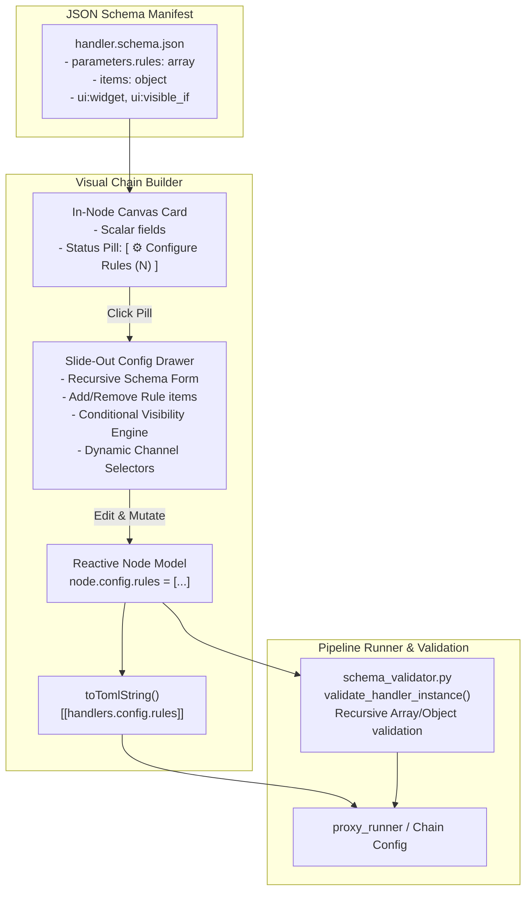

# 009: Schema-Driven UI Manifest & Complex Parameter Form Generator

## 1. Overview & Problem Statement

### Motivation
As the Proxy handler architecture expands to support advanced routing, Lua scripting, complex multi-predicate expressions, and nested rule evaluation, pipeline configurations require rich, nested, and extensible data structures.

Previously:
1. **Schema Parameter Limitation**: The JSON schema contract and visual builder only accommodated flat key-value pairs (primitives like `string`, `integer`, and `enum`), forcing complex handlers to use awkward flattened keys (e.g. `route.rule.0.pattern`, `route.rule.0.target`).
2. **Canvas Clutter & Monolithic Cards**: Rendering every configuration parameter directly within a canvas node card caused nodes to balloon in height, breaking canvas ergonomics and readability.
3. **Lack of Dynamic Forms & Conditional Fields**: Handlers like `route_handler` have conditional properties depending on choice of rule type (e.g., `expression` vs `pattern` vs `lua` script) or action (`forward` with a target channel vs `reject` with reason and error code). Without conditional rendering directives, users are presented with irrelevant or confusing fields.
4. **Serialization Asymmetry**: TOML and JSON serializers/deserializers lacked recursive translation for arrays of tables (`[[handlers.config.rules]]`) and nested objects.
5. **Validation Rigidity**: `schema_validator.py` did not recursively traverse or validate nested `array` and `object` properties or conditional constraints.

---

## 2. Architecture & How It Works

### 2.1 Manifest Contract Extensions (`handler.schema.json`)
The authoritative source of truth for handler parameters resides in `handler/<name>/handler.schema.json`. We augment standard JSON Schema attributes with lightweight `ui:` rendering directives:

- **Complex Schema Types**:
  - `type: "array"`: Dynamic repeating lists of items (e.g. routing rules).
  - `type: "object"`: Nested groups of properties.
- **UI Widget Directives (`ui:widget`)**:
  - `ui:widget: "rule-list"` or `"array"`: Repeatable card container with `+ Add Item` and `✕ Delete` controls.
  - `ui:widget: "code-editor"` or `"code"`: Monospace editor supporting language syntax highlighting hints (`ui:language: "lua"` or `"proxy-expr"`).
  - `ui:widget: "channel-select"`: Dropdown selector automatically populated with output channels defined on the node or chain.
- **Conditional Visibility (`ui:visible_if`)**:
  - Declarative conditions (e.g. `{"type": "expression"}`) that toggle field visibility based on sibling field values within the item scope.

### 2.2 Two-Tier Parameter Editing UX
1. **Tier 1 — In-Node Card Canvas View**:
   - Scalar fields (strings, enums, numbers, booleans) render directly in the compact node card.
   - Complex types (`array`, `object`) render as a concise status pill:
     `[ ⚙ Configure Rules (N items defined) ]`
   - Keeps node footprints minimal and prevents canvas bloat.
2. **Tier 2 — Slide-Out Configuration Drawer / Modal**:
   - Clicking `Configure <Field>` opens an expanded configuration drawer.
   - The generic form generator recursively parses the JSON Schema definition:
     - Renders array item cards, item indexing, and item deletion.
     - Evaluates `ui:visible_if` to dynamically hide/show fields based on selected options (e.g. condition type or action type).
     - Renders syntax-friendly monospace code areas for expressions and Lua blocks.
     - Synchronizes updates directly with the reactive node model (`node.config`).

### 2.3 Serialization & Validation Compatibility
- **TOML Export / Import**:
  - `builder_app.js`'s `toTomlString()` handles nested arrays of tables (`[[handlers.config.rules]]`), nested maps, and multi-line strings.
  - `importChainDefinition()` preserves nested structures in `node.config`.
- **Python Runner & Schema Validator**:
  - `scripts/proxy_runner/schema_validator.py` validates nested rules and array types against the JSON Schema definition, enforcing required item fields and allowed enum choices.



### 2.4 Condition Engines Reference (`route_handler`)

The `route_handler` supports three condition evaluation engines:

#### 1. `expression` (Boolean Expression Engine)
Parses structured boolean expressions combining text predicates, port/protocol checks, and metadata comparisons:
- **Text predicates**:
  - `contains("pattern" [, min_count])`: Matches if payload contains the substring (optionally at least `min_count` times).
  - `prefix("pattern")`: Matches if payload starts with the given string.
  - `exact("pattern")`: Matches if payload exactly equals the string.
- **Metadata field comparisons**:
  - `metadata.<fieldName> [==, !=, <, <=, >, >=] <value>`
  - Evaluates dynamically against the protocol's metadata catalog (e.g. `metadata.price > 100`, `metadata.symbol == "AAPL"`).
- **Network / Transport fields**:
  - `port == <num>` or `port(<num>)`: Matches client/source port.
  - `protocol == <num>` or `protocol(<num>)`: Matches protocol identifier.
- **Logical operators & nesting**:
  - `and` / `&&`, `or` / `||`, `not` / `!`
  - Grouping via parentheses `( ... )`
- *Example*: `prefix("ORDER:") and metadata.price > 500 and (port == 8080 or port == 9000)`

#### 2. `pattern` (Direct Substring Match)
- Simple, high-throughput substring scanner.
- Searches for the exact text pattern anywhere inside the raw message payload.
- *Example*: `CANCEL_REQUEST` or `VIP_TIER`

#### 3. `lua` (Embedded Script Engine)
- Executes arbitrary Lua scripting with full access to message content and metadata.
- **Function Contract**: Provide a script that returns a `function(msg) -> bool` or defines a global `function route(msg) -> bool`.
- **Available `msg` Properties**:
  - `msg.payload`: Raw ASCII string of the payload bytes.
  - `msg.protocol`: Numeric protocol ID (`int`).
  - `msg.meta.<fieldName>`: Dynamically resolved metadata fields according to the schema catalog.
- *Example*:
  ```lua
  return function(msg)
    if msg.protocol == 1 and msg.meta.priority == 1 then
      return true
    end
    return msg.payload:find("CRITICAL") ~= nil
  end
  ```

---

## 3. Concrete Example: `route_handler` Manifest

```json
{
  "$schema": "https://json-schema.org/draft/2020-12/schema",
  "name": "route_handler",
  "displayName": "Route Dispatcher",
  "role": "processor",
  "protocol": "none",
  "category": "Routing",
  "description": "Content-aware rule routing dispatcher that matches message payloads against configurable criteria.",
  "ports": {
    "inputs": [
      {
        "name": "input_channel",
        "label": "Incoming Traffic",
        "cardinality": "single",
        "default": "route_in",
        "description": "Incoming channel carrying unrouted messages."
      }
    ],
    "outputs": [
      {
        "name": "output_channels",
        "label": "Route Target Channels",
        "cardinality": "multiple",
        "default": "route_target_1,route_target_2",
        "description": "Available destination channels targeted by routing rules."
      }
    ]
  },
  "parameters": {
    "default_action": {
      "type": "string",
      "label": "Default Action",
      "enum": ["drop", "forward", "reject"],
      "default": "drop",
      "description": "Action taken when no rules match."
    },
    "rules": {
      "type": "array",
      "label": "Routing Rules",
      "description": "Sequential rules evaluated against message payload and metadata.",
      "ui:widget": "rule-list",
      "items": {
        "type": "object",
        "properties": {
          "name": {
            "type": "string",
            "label": "Rule Name"
          },
          "type": {
            "type": "string",
            "label": "Condition Engine",
            "enum": ["expression", "pattern", "lua"],
            "default": "expression"
          },
          "pattern": {
            "type": "string",
            "label": "Match Pattern",
            "ui:visible_if": { "type": "pattern" }
          },
          "expression": {
            "type": "string",
            "label": "Boolean Expression",
            "ui:widget": "code",
            "ui:placeholder": "metadata.price > 100 && payload contains 'VIP'",
            "ui:visible_if": { "type": "expression" }
          },
          "script": {
            "type": "string",
            "label": "Lua Script",
            "ui:widget": "code-editor",
            "ui:language": "lua",
            "ui:visible_if": { "type": "lua" }
          },
          "action": {
            "type": "string",
            "label": "Action",
            "enum": ["forward", "reject", "drop"],
            "default": "forward"
          },
          "target": {
            "type": "string",
            "label": "Target Channel",
            "ui:widget": "channel-select",
            "ui:visible_if": { "action": "forward" }
          }
        }
      }
    }
  }
}
```

---

## 4. Implementation Tasks & Verification

- [x] Create feature documentation `docs/features/simulation/009-schema-driven-ui-manifest-and-nested-forms.md`.
- [ ] Update `handler/route_handler/handler.schema.json` with the structured `rules` array, expressions, Lua, and actions schema.
- [ ] Add slide-out parameter drawer / modal component in `scripts/builder/index.html`.
- [ ] Implement recursive schema interpreter in `scripts/builder/js/builder_app.js`:
  - [ ] Support `type: "array"` with add/remove/reorder items.
  - [ ] Support `type: "object"` nested rendering.
  - [ ] Implement `ui:visible_if` conditional logic.
  - [ ] Implement `ui:widget: "channel-select"` bound to node output ports.
  - [ ] Implement code/monospace input for expressions and Lua scripts.
  - [ ] Add compact `[ ⚙ Configure <Field> (N) ]` trigger buttons on node cards for complex parameters.
- [ ] Extend `toTomlString()` in `builder_app.js` to serialize nested object lists (`[[handlers.config.rules]]`).
- [ ] Update `importChainDefinition()` to parse and bind nested TOML tables into node state.
- [ ] Extend `scripts/proxy_runner/schema_validator.py` to recursively validate array/object schema types.
- [ ] Add unit test cases in `test/test_handler_schemas.py` for structured rule validation.
- [ ] Verify `route_handler` end-to-end in Visual Builder and automated tests.

