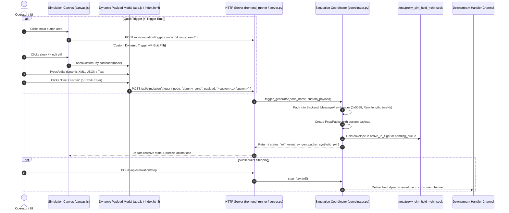

# 010: Dynamic Simulation Generator Payloads & Sleek Trigger Modal

## 1. Overview & Problem Statement

### Motivation
In simulation mode (`backend/sim`), generator nodes such as `dummy_send` were previously constrained to static payloads configured upfront in handler definitions (`dummy.message` in configuration files).
When testing complex dynamic pipelines (such as XML validation, routing logic, and branch selection), engineers and operators often need to craft and inject custom dynamic messages on demand (for example, triggering a specific XML order with edge-case attributes or intentionally corrupted values) without modifying configuration files, re-running the chain, or producing custom PCAP captures.

Prior to this feature:
1. **Static Generator Triggers**: Triggering an autonomous generator in the interactive simulation visualizer (`POST /api/simulation/trigger`) unconditionally packed the static `dummy.message` string into `MessageView` framing.
2. **Lack of Dynamic Payload Input**: There was no mechanism in either the HTTP simulation control plane or the interactive canvas UI to supply an arbitrary custom payload during trigger invocation.
3. **Modal Friction**: While a modal is useful for drafting custom payloads, popping up a modal for every trigger emit creates significant friction when an operator simply wants to emit standard messages repeatedly.

---

## 2. Architecture & How It Works



### 2.1 Control Plane & Coordinator Extensions (`coordinator.py`, `frontend_runner.py`, `server.py`)
- **`trigger_generator(node_name: str, custom_payload: Optional[str] = None)`**:
  - If `custom_payload` is provided, the coordinator encodes `custom_payload.encode("utf-8")` into raw bytes.
  - Generates the standard binary `Backend::MessageView` framing header (`0x5058` magic `PX`, version `1`, protocol `0` (Raw), length, timestamp).
  - Creates the synthetic `PcapPacket` with `payload_text=custom_payload` and holds the datagram in `active_in_flight["held_data"]` (or queues it in `pending_queue`).
  - If `custom_payload` is `None` or omitted, it falls back to the configured `dummy.message` (or default fallback).
- **HTTP Endpoints (`/api/simulation/trigger`)**:
  - Both `scripts/frontend_runner.py` and `scripts/proxy_runner/server.py` parse `params.get("payload")` and forward it directly to `trigger_generator`.

### 2.2 Sleek Split-Button on Canvas (`canvas.js`)
Instead of a single trigger rectangle, generator nodes render a split button:
- **Left segment (Main Action - "⚡ Trigger Emit", ~94px)**: Single-click instant emission of the default or cached payload. No modals, zero friction.
- **Right segment (Edit Pill - "✏️", ~26px)**: Opens the custom payload modal.
- Both zones are hit-tested cleanly in `canvas.js` click listeners and hover states.

### 2.3 Lightweight Dynamic Payload Modal (`app.js`, `index.html`, `dashboard.css`)
- A minimal, non-intrusive modal dialog matching the dashboard's dark glassmorphism theme.
- Displays target generator node and output channel.
- A monospace multi-line text area pre-populated with either the configured default message or the last emitted custom message.
- Keyboard shortcut support: `Cmd+Enter` / `Ctrl+Enter` to submit immediately, `Escape` to close.
- Action buttons:
  - **⚡ Emit Custom**: Emits the custom message and closes modal.
  - **↺ Reset Default**: Resets the text area to the node's static configured message.
  - **Cancel / Close (✕)**: Closes without emitting.

---

## 3. Concrete Examples

### CLI / API Dynamic Trigger Invocations
```bash
# 1. Trigger with custom XML payload
curl -X POST http://localhost:8080/api/simulation/trigger \
  -H "Content-Type: application/json" \
  -d '{
    "node": "dummy_send",
    "payload": "<order id=\"999\"><symbol>TSLA</symbol><quantity>500</quantity></order>"
  }'

# 2. Trigger with default configured payload (omitting payload field)
curl -X POST http://localhost:8080/api/simulation/trigger \
  -H "Content-Type: application/json" \
  -d '{"node": "dummy_send"}'
```

---

## 4. Tasks / Checklist

- [x] Create feature documentation (`docs/features/simulation/010-dynamic-simulation-generator-payloads.md`).
- [x] Extend `InteractiveSimulationCoordinator.trigger_generator` in `scripts/proxy_runner/coordinator.py` to accept `custom_payload: Optional[str]`.
- [x] Update `/api/simulation/trigger` handlers in `scripts/frontend_runner.py` and `scripts/proxy_runner/server.py` to extract `payload` parameter.
- [x] Update `canvas.js` to render the split button on generator nodes and handle hit-testing for the edit pill vs main button.
- [x] Add the Dynamic Payload modal markup in `scripts/dashboard/index.html` and styles in `scripts/dashboard/css/dashboard.css`.
- [x] Implement modal state management and `triggerGenerator(nodeName, customPayload)` in `scripts/dashboard/js/app.js`.
- [x] Add unit tests verifying API and coordinator custom payload handling.
