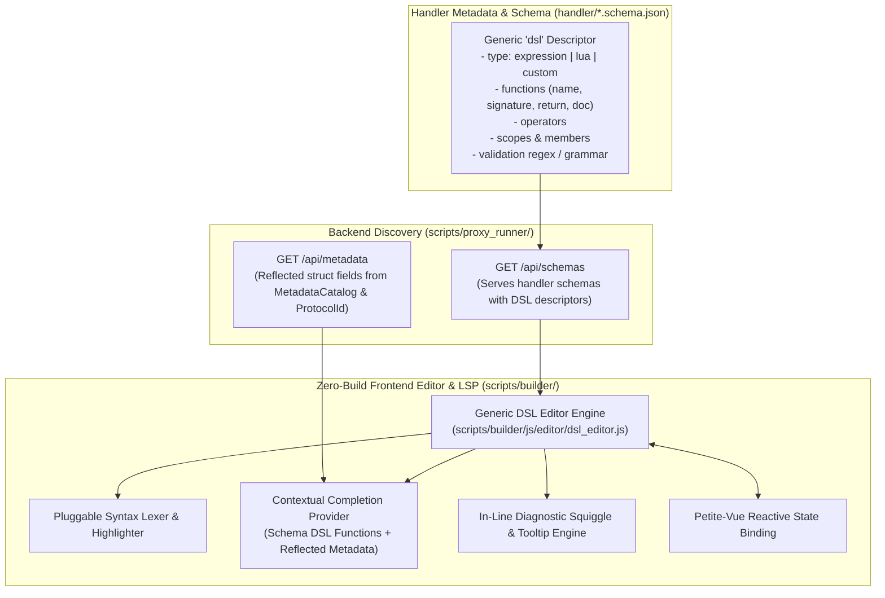

# 011: Minimal LSP Capabilities for Handler DSLs & Script Expressions

## Overview & Problem Statement
The Visual Chain Builder (`scripts/builder/`) introduces schema-driven rule configuration for routing handlers (`route_handler`) and other script/expression-driven components, enabling users to define dynamic dispatch criteria using composite boolean expressions (e.g. `metadata.src_port == 8080 and contains("VIP")`) or embedded Lua scripts (`function(msg) return msg.payload:find("REQ") ~= nil end`).

Previously, authors configured these expressions inside standard monochromatic HTML `<textarea>` inputs without:
- **Syntax Highlighting**: Plain text rendering without differentiation of tokens, keywords, functions, literals, or syntax errors.
- **Auto-completion (IntelliSense / LSP)**: No in-editor suggestion of handler-specific functions (`contains`, `prefix`, `exact`, `port`), operators, metadata fields (`src_ip`, `dst_port`), or envelope members (`msg.payload`, `msg.meta.<field>`).
- **Inline Validation**: Syntax and reference errors were only caught at simulation runtime rather than inline while authoring.

Furthermore, tying autocomplete and syntax tokens directly to a specific handler (like `route_handler`) creates tight coupling. To maintain a modular architecture, **handlers must declaratively expose their accepted tokens, functions, keywords, and DSL properties through their schema**, allowing the frontend editor to act as a **generic, schema-driven LSP engine**.

---

## Architecture & How It Works



### 1. Declarative Handler DSL Schema Extension (`handler.schema.json`)
Any parameter with `"ui:widget": "code"` or `"code-editor"` can declare a `dsl` property describing its language specification:
- **`type`**: Language type identifier (`"expression"`, `"lua"`, `"json"`, or custom).
- **`functions`**: List of callable predicates or helper functions:
  - `name`: Function identifier (e.g. `contains`).
  - `signature`: Display signature (e.g. `contains("text" [, count])`).
  - `return`: Return type name (e.g. `bool`).
  - `doc`: Detailed documentation tooltip.
- **`operators`**: Supported logical, relational, or arithmetic operators (`and`, `or`, `not`, `==`, `!=`, `<`, `>`, `+`, etc.).
- **`scopes`**: Identifier namespaces or root objects:
  - `name`: Root prefix identifier (e.g. `metadata`, `meta`).
  - `source`: Dynamic data source, such as `"upstream_contributions"` to inherit metadata emitted by ancestor handlers in the pipeline DAG.
  - `doc`: Description tooltip.
- **`globals`**: (For scripting languages like Lua) Global objects (e.g. `msg`) and their sub-properties.

### 2. Decentralized Handler Contributions (`dslContributions`)
Any handler (ingress, validator, transformer) can declare what it contributes to downstream messages and the DSL via `dslContributions` in its schema:
```json
{
  "name": "udp_ingress_handler",
  "dslContributions": {
    "protocol": {
      "name": "udp",
      "id": 17,
      "struct": "UdpMetadata",
      "doc": "Network transport metadata captured by UDP Ingress",
      "fields": [
        { "name": "src_ip", "type": "uint32", "doc": "Originating client IPv4 address" },
        { "name": "src_port", "type": "uint16", "doc": "Originating client UDP port" },
        { "name": "dst_port", "type": "uint16", "doc": "Target ingress UDP port" },
        { "name": "dst_ip", "type": "uint32", "doc": "Target ingress IPv4 address" },
        { "name": "address_family", "type": "uint8", "doc": "IP address family" }
      ]
    }
  }
}
```
When a user composes a pipeline in the Visual Builder, the LSP traverses upstream DAG connections to dynamically harvest all `dslContributions` from ancestor nodes. Downstream editors automatically receive:
- The exact fields contributed by upstream nodes (e.g. `meta.src_port` attributed to `"udp_ingress_handler"`).
- Explicit protocol namespaces (e.g. `meta.udp.*`).
- Custom functions or predicates contributed by upstream processors.

### 2. Zero-Build Frontend Editor & LSP Engine (`scripts/builder/js/editor/`)
To preserve the zero-build-step requirement for web assets, the editor layer is built using a lightweight self-contained code editor distribution and generic LSP controller:
- **Syntax Lexer & Highlighting**:
  - Automatically generates syntax rules from the parameter's `dsl.functions`, `dsl.operators`, string quotes, numbers, and comments.
- **IntelliSense & Autocompletion**:
  - Triggers on typing or trigger characters (`.`, `(`, or alphanumeric).
  - Scope awareness: If typing at root, suggests root functions, operators, and declared scopes (`metadata.`, `msg.`).
  - If typing after a scoped dot (e.g., `metadata.`), queries the metadata cache populated via `GET /api/metadata` and displays field types and descriptions.
  - If typing inside Lua after `msg.` or `msg.meta.`, queries the envelope and metadata definitions.
- **Inline Diagnostic Linting**:
  - Validates parenthesis/bracket/quote balance.
  - Identifies trailing or dangling logical operators.
  - Flags unknown function calls not defined in the parameter's DSL specification.

### 3. Server Metadata Reflection (`GET /api/metadata`)
- `scripts/proxy_runner/server.py` exposes `GET /api/metadata`, returning known protocol structures and their reflected fields (e.g. `UdpMetadata` with fields `src_ip`, `src_port`, `dst_port`, `dst_ip`, `address_family`).
- The frontend caches this data and dynamically merges it into DSL scopes marked with `"source": "metadata_catalog"`.

### 3. Payload Contract Resolution (`payloadContract`)
When a handler verifies or structures message payloads (e.g. `xml_verification_handler` reading an XSD schema file), it declares a generic contract:
```json
"payloadContract": {
  "format": "xsd",
  "sourceParam": "xml.xsd_path",
  "scope": "xml",
  "doc": "Validated XML document payload schema"
}
```
- The backend runner remains 100% agnostic to handler logic: it exposes a generic format inspector (`GET /api/payload_contract?format=xsd&file=...`) via [`scripts/proxy_runner/payload_contracts.py`](scripts/proxy_runner/payload_contracts.py).
- Arrays (`maxOccurs="unbounded"` or `> 1`) and nested `<xs:complexType>` trees are parsed into structured property hierarchies.
- Downstream nodes in the DAG inherit contextual autocompletion:
  - Typing `payload.` or `xml.` suggests root elements (e.g. `order` or `Orders`).
  - Typing `payload.order.` suggests nested elements: `customer (string)`, `item (string)`, `quantity (positiveInteger)`.
  - Nested array navigation (`payload.Orders.Order.` or `payload.Orders.Order[0].`) completes child fields directly.

---

## Design Decisions

| Decision | Rationale | Alternatives Considered |
|---|---|---|
| **Declarative `dsl` block in JSON Schema** | Decouples language features from any specific handler. Handlers expose their own DSL capabilities, functions, and documentation. | Hardcoding handler rules in JavaScript (breaks extensibility when new handlers are added). |
| **Dynamic `metadata_catalog` Scope Resolution** | Bridges C++ `MetadataCatalog` reflection with web UI autocomplete without duplicating field lists. | Manually maintaining duplicate field names in JSON schemas. |
| **Lightweight Zero-Dependency Editor (`dsl_editor.js`)** | Zero heavy third-party vendor bloat (~15KB total). Provides native syntax highlighting, VS Code-style popup completions, and diagnostics cleanly integrated with Petite-Vue. | Heavy IDE bundles (Monaco, large multi-module distributions). |
| **Petite-Vue Reactive Two-Way Sync** | Integrates seamlessly with existing drawer architecture, automatically syncing edits into `item[prop.key]` and running live chain validation. | Separate iframe or modal window (disrupts editing flow in the sidebar drawer). |

---

## Concrete Schema Example

### Expression DSL Definition in `route_handler/handler.schema.json`
```json
{
  "expression": {
    "type": "string",
    "label": "Boolean Expression",
    "ui:widget": "code",
    "dsl": {
      "type": "expression",
      "functions": [
        { "name": "contains", "signature": "contains(\"txt\" [, count])", "return": "bool", "doc": "Matches if message payload contains substring." },
        { "name": "prefix", "signature": "prefix(\"hdr\")", "return": "bool", "doc": "Matches if message payload begins with prefix." },
        { "name": "exact", "signature": "exact(\"full\")", "return": "bool", "doc": "Matches exact full payload string." },
        { "name": "port", "signature": "port(num)", "return": "bool", "doc": "Matches source UDP port." },
        { "name": "protocol", "signature": "protocol(id)", "return": "bool", "doc": "Matches numeric protocol identifier." }
      ],
      "operators": ["and", "or", "not", "&&", "||", "!", "==", "!=", "<", "<=", ">", ">="],
      "scopes": [
        {
          "name": "metadata",
          "source": "metadata_catalog",
          "doc": "Protocol metadata attributes reflected from C++"
        }
      ]
    }
  }
}
```

---

## Tasks / Checklist

- [x] Create feature branch `feat/generic-lsp-capabilities`.
- [x] Add generic `dsl` specification to `handler/route_handler/handler.schema.json` for expressions and Lua scripts.
- [x] Implement `GET /api/metadata` in `scripts/proxy_runner/server.py` and `scripts/frontend_runner.py` exposing reflected protocol fields.
- [x] Add unit tests for `GET /api/metadata` in `test/test_frontend_runner.py`.
- [x] Bundle lightweight code editor styles and component under `scripts/builder/css/dsl_editor.css`.
- [x] Implement schema-driven DSL editor controller (`scripts/builder/js/editor/dsl_editor.js`) with generic syntax highlighting, autocompletion, and linter.
- [x] Mount DSL editor dynamically inside rule card properties in `scripts/builder/index.html` and `scripts/builder/js/builder_app.js`.
- [x] Verify expression and Lua editing with completion popups and syntax validation.
