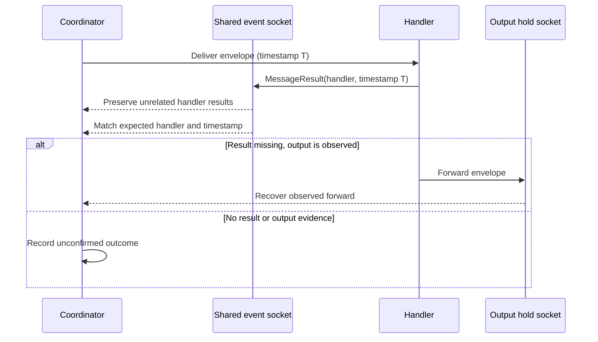

# Reliable Simulation Message Results

## Overview & Problem Statement

The real-time Simulator could report a packet as dropped when the coordinator did not receive a matching `MessageResult`. A result from a different configured handler was consumed and discarded while the coordinator waited on a particular handler, and later waits also drained the shared event socket. Separately, a missing result was treated as equivalent to an explicit handler rejection.

These behaviors made telemetry timing look like packet loss. In particular, a splitter could successfully place envelopes on its output hold sockets while the visualizer showed a rejection.

## Architecture & How It Works

The coordinator now retains results for other configured handlers and matches internal message results by both handler and envelope timestamp. Generator-triggered envelopes use the same timestamp as their packet metadata, so subsequent steps can identify the result belonging to that packet.

If a result is absent but a configured output hold socket contains the packet, the coordinator uses that observed output as evidence of forwarding. If neither a result nor output evidence is available, the outcome is marked unconfirmed rather than falsely reported as a drop.



## Design Decisions

- **Correlate results using handler and envelope timestamp.** Handler-only matching can associate an asynchronous result with the wrong step; timestamp is already carried in simulation envelopes and in the `SimBackend` result event.
- **Preserve unrelated results.** A shared event socket may receive results from multiple handlers. Results for configured handlers should remain available to the matching wait rather than being discarded.
- **Use output observation as forwarding evidence.** A held envelope confirms that the handler emitted that output even when its telemetry result was missed.
- **Do not infer rejection from missing telemetry.** Only an explicit `Dropped` result is a confirmed rejection; missing evidence is shown as unconfirmed.

## Concrete Examples

For a splitter result event carrying `msgTimestampNs = T`, the coordinator matches the event to the expected handler and the packet whose envelope timestamp is `T`. If that event is missing but the configured `output_channels` have held envelopes, the packet continues through those branches and is recorded as forwarded.

When no matching result or held output is available, the trace records `result: "Unknown"` and `type: "unconfirmed"`. This is counted separately from explicit drops in the Simulator dashboard.

Run the focused Python tests with:

```bash
python3 test/test_simulation_coordinator.py
```

## Tasks / Checklist

- [x] Preserve out-of-order results from configured handlers.
- [x] Correlate results with handler name and envelope timestamp.
- [x] Recover forwarding when output is observed without a result event.
- [x] Show missing-result outcomes as unconfirmed, not dropped.
- [x] Add regression coverage for result routing and missing-result behavior.
