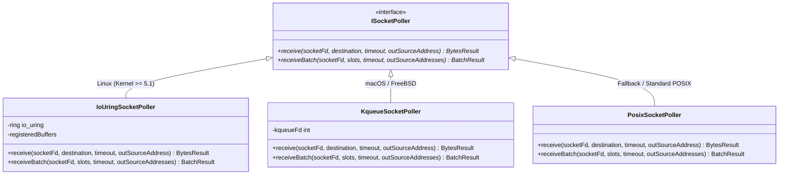

# Socket Poller & Platform Multiplexing Architecture

## 1. Overview & Problem Statement

### Why It's Needed
High-speed networking handlers (such as UDP ingress gateways and route dispatchers) face substantial performance bottlenecks when using standard POSIX synchronous blocking I/O:
- Calling `recvfrom()` or `poll()` for individual packets incurs a kernel mode transition per datagram. Under heavy traffic (e.g. 500,000 packets/sec), system call overhead dominates CPU consumption.
- Different operating systems provide wildly divergent asynchronous I/O and multiplexing primitives: Linux offers the modern submission/completion ring subsystem **`io_uring`**, macOS/BSD provides **`kqueue`**, while POSIX environments fallback to `epoll` or `poll()`.
- Exposing platform-specific network code inside message handlers breaks portability and modularity.

### The Solution
The `ISocketPoller` subsystem provides a unified, cross-platform abstraction that abstracts asynchronous I/O multiplexing behind a clean C++ interface. It automatically selects the optimal platform backend (`io_uring`, `kqueue`, or POSIX `recvmmsg`) while providing zero-allocation batch draining semantics to consuming channels.

---

## 2. How It Works

### Architectural Hierarchy



### Platform Dispatch & Execution Mechanisms
1. **Linux `IoUringSocketPoller`**:
   - Initializes a shared memory submission ring (SQ) and completion ring (CQ) using `io_uring_queue_init`.
   - Batches receive requests directly to the kernel without invoking repeated `sys_enter_recvfrom`.
   - Drains completions in a single pass, filling user-space `BufferSlot` buffers with zero user-to-kernel context switches.
2. **macOS / BSD `KqueueSocketPoller`**:
   - Registers socket descriptors with a `kqueue` kernel event queue using `EVFILT_READ`.
   - When the descriptor is readable, it executes a speculative non-blocking drain loop into caller buffer slots, amortizing the cost of `kevent()` across multiple packets.
3. **Generic POSIX `PosixSocketPoller`**:
   - On Linux systems without `io_uring`, it leverages `recvmmsg` to receive multiple datagrams with a single system call.
   - On other POSIX systems, it uses `poll()` followed by `recvfrom()`.

---

## 3. High-Level Design Decisions

1. **Batched Reception via `BufferSlot` Spans**:
   - Instead of receiving one packet at a time, `receiveBatch()` takes a `span<BufferSlot>`. Handlers pre-allocate contiguous slot spans, allowing the driver to drain up to 32 or 64 packets per poll cycle.
2. **Provenance Tracking (`SocketAddress`)**:
   - When receiving UDP packets, the poller records origin client IPv4/IPv6 address and port into optional `SocketAddress` outputs. This metadata feeds directly into `MessageEnvelope`'s `UdpMetadata` header for origin-preserving return routing.
3. **Strongly-Typed Outcome Variants**:
   - Avoids error-prone `-1` and `errno` sentinel returns. Methods return `BytesResult` or `BatchResult` variants:
     - `ReceivedBytes`: Payload byte count.
     - `TimedOut`: Poll duration expired without messages.
     - `ChannelClosed`: Connection was closed or interface brought down.
     - `ChannelError`: Fatal socket error with OS error code.

---

## 4. Concrete Examples

### Example: Using `ISocketPoller` in a Network Channel
```cpp
// Create poller instance (abstracted via factory)
std::unique_ptr<Backend::ISocketPoller> poller = Backend::createSocketPoller();

// Prepare a batch of buffer slots
std::array<std::byte, 2048> storage[8];
std::array<Backend::BufferSlot, 8> slots;
for (size_t i = 0; i < 8; ++i) {
    slots[i].buffer = storage[i];
    slots[i].receivedBytes = 0;
}

// Receive a batch of datagrams from a non-blocking UDP socket
int socketFd = getBoundUdpSocketFd();
auto timeout = std::chrono::milliseconds(5);

std::array<Backend::SocketAddress, 8> sourceAddrs;
auto result = poller->receiveBatch(socketFd, slots, timeout, sourceAddrs);

if (std::holds_alternative<Backend::ReceivedBatch>(result)) {
    size_t packetCount = std::get<Backend::ReceivedBatch>(result).count;
    for (size_t i = 0; i < packetCount; ++i) {
        auto payload = slots[i].buffer.subspan(0, slots[i].receivedBytes);
        std::string originIp = sourceAddrs[i].ipToString();
        uint16_t originPort = sourceAddrs[i].port();
        // Dispatch payload to pipeline...
    }
}
```

---

## 5. Tasks / Checklist
- [x] Define abstract `ISocketPoller` interface
- [x] Implement macOS `KqueueSocketPoller`
- [x] Implement Linux `IoUringSocketPoller`
- [x] Implement fallback `PosixSocketPoller`
- [x] Add batched packet receipt (`receiveBatch`) supporting `recvmmsg`
